# Post Merger Identity Consolidation: One Forest, One Tenant, One Governance Stack

**Two companies. Two forests. One week to make them one identity program.**

This is the bonus week of my 12 week IAM Engineer portfolio. I simulated an acquisition: DKN Holdings (my `iamlab.local` lab) buys a smaller company called Peachtree Logistics (`peachtree.local`). Then I did the work a company does after the deal closes. I connected the two forests, moved Peachtree's people into one directory, synced them to Entra ID, replaced their spreadsheet access reviews with SailPoint, locked their admin and service accounts in CyberArk, and gave an automation agent an identity with no password at all.

Every claim in this write up is backed by a screenshot, a script, or a raw evidence file in this repo.

Related repos: [CyberArk Tier 0 PAM](https://github.com/GokuCooper/cyberark_pam_tier0_privileged_access) · [SailPoint access governance](https://github.com/GokuCooper/sailpoint_iiq_access_governance) · [SailPoint JML workflows](https://github.com/GokuCooper/sailpoint_iiq_jml_workflows) · [Microsoft Graph inactive user report](https://github.com/GokuCooper/msgraph_inactive_user_report)

---

## The 30 second version

| Question | Answer |
|---|---|
| **What problem does this solve?** | After an acquisition, the new company's people live in a directory you cannot see, with shared admin passwords, ownerless service accounts, and access reviews done by email. |
| **What did I build?** | A forest trust, a GPO baseline and custom schema attribute, an ADMT migration with SID history, Entra Connect sync, a SailPoint rebuild of Peachtree's access, CyberArk vaulting with safe service account rotation, and a federated identity for an automation agent. |
| **How did I prove it works?** | 12 PowerShell scripts that write their results to `evidence/`, a migration count table matched by SID history, Microsoft Graph queries against the synced tenant, CyberArk and Event Viewer logs, and GitHub Actions run logs. |
| **Tools** | Windows Server, Active Directory, Group Policy, ADMT 3.2, SQL Server Express, Microsoft Entra Connect Sync, SailPoint IdentityIQ 8.3, CyberArk PAM 12.6, Microsoft Graph, GitHub Actions, PowerShell, Python |
| **Built on** | November 2026 |

## The short version

| Measure | Before | After |
|---|---|---|
| Forests that can see each other | 0 | 2 (two way trust), then 1 after migration |
| Peachtree identities in the DKN directory | 0 | 15 user accounts (12 people, 3 service accounts) and 6 groups |
| Migrated accounts that kept their old access (SID history) | 0 | 15 of 15 users and 6 of 6 groups |
| Peachtree users synced to Entra ID with a source company tag | 0 | 12 of 12 |
| Legacy access lines with an owner and a decision | 0 of 15 | 15 of 15 |
| Shared admin passwords outside a vault | 2 (admin, itadmin) | 0 (two built in Administrators are a documented gap) |
| Service accounts with a named owner | 0 of 6 | 6 of 7 |
| Service accounts fully compliant | 0 of 6 | 5 of 7 |
| Stored secrets used by the automation agent | 1 | 0 |

This is a lab with one person playing every role. The numbers show the controls work end to end. They are not a production benchmark.

---

## Explain it like I am in 5th grade

Picture two families moving into one house.

First you build a hallway between the two houses so people can walk back and forth (the **forest trust**). Then you write one set of house rules everyone follows (**Group Policy**). Then you move everyone's stuff over and put a label on each box saying which house it came from (the **ADMT migration** and the **custom schema attribute**). Then you give everyone the same key card that works at the house and at the cloud office down the street (**Entra Connect**). Then you check who is allowed in which room (**SailPoint**), lock the master keys in a safe (**CyberArk**), and finally deal with the robots in the house. Robots need keys too, but a robot should never keep a key forever (**service accounts** and the **AI agent**).

### Words you will see

| Word | Simple meaning |
|---|---|
| Forest | A company's whole Active Directory world. Two forests cannot see each other until you connect them. |
| Trust | The hallway between two forests, with a guard at each end. |
| Conditional forwarder | A note in DNS that says "for addresses ending in peachtree.local, ask that server." |
| GPO | A rule sheet AD pushes to every computer and user in a folder (OU). |
| Schema | The list of fields every AD object is allowed to have. Adding one is permanent. |
| SID | The hidden ID number behind every account. Permissions are tied to the SID, not the name. |
| SID history | The old ID number a moved account carries so it can still open old doors. |
| Entra Connect | The sync engine that copies AD users up to Microsoft Entra ID. |
| Correlation | How SailPoint decides an account belongs to a person. |
| Certification | A review where a manager says "keep" or "remove" for each piece of access. |
| NHI (non human identity) | An account used by a program, not a person. Service accounts and agents are NHIs. |
| Usage | Every place a service account's password is typed in, like a Windows service. |
| gMSA | A service account whose password Windows changes by itself and no human ever knows. |
| Federated credential | A trust rule that lets a program prove who it is with a short lived token instead of a password. |

---

## The big picture

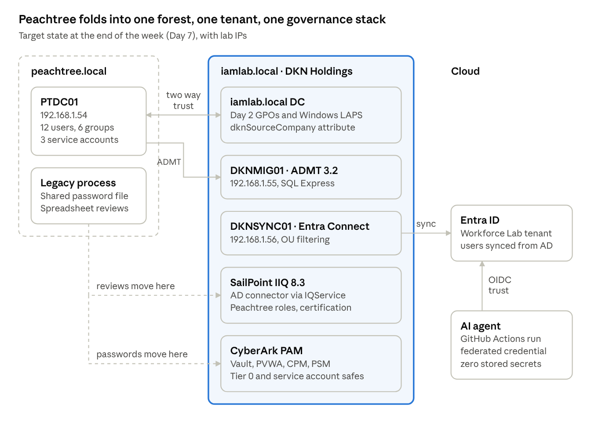
*Screenshot 00, the target state at the end of the week. The dashed box is the company being absorbed. The dashed arrows show Peachtree's old spreadsheet reviews and shared password file being replaced.*

| Component | Detail |
|---|---|
| iamlab.local DC | 192.168.1.54 (WIN-4LRG6K4IKL1) |
| PTDC01 | 192.168.1.60, first DC of `peachtree.local` |
| DKNMIG01 | 192.168.1.61, ADMT 3.2, SQL Server Express, gMSA host for the reports task |
| DKNSYNC01 | 192.168.1.62, Microsoft Entra Connect Sync |
| CyberArk | Vault .50, PVWA .51, CPM .52, PSM .53 |
| Existing | SailPoint IdentityIQ 8.3, Entra tenant DKN IAM Workforce Lab |
| Hosting | VMware Workstation, bridged networking, one VM per role |

---

## Day 1: Connect the two forests

### Situation
Peachtree arrived as a separate forest. Nobody at DKN could see a single Peachtree account, and no Peachtree user could open a DKN file share. Before anything can move, the two directories have to trust each other.

In plain words: two buildings with no hallway between them. Day 1 builds the hallway and puts a guard at each end.

### Build
1. Promoted `PTDC01` as the first DC of a new forest, `peachtree.local` (screenshot 01).
2. Seeded it with [`scripts/01_Seed-Peachtree.ps1`](scripts/01_Seed-Peachtree.ps1): 12 employees, 6 groups, 2 shared admin accounts, and 3 service accounts with no owner. Output: [`evidence/day1_peachtree_seed.csv`](evidence/day1_peachtree_seed.csv).
3. Created DNS conditional forwarders both ways: `peachtree.local` to 192.168.1.60 on the DKN DC, and `iamlab.local` to 192.168.1.54 on PTDC01.
4. Built a two way forest trust with forest wide authentication, then proved it with a shared folder that only a DKN Domain Local group can read.

### Snag: the trust wizard didn't know Peachtree existed
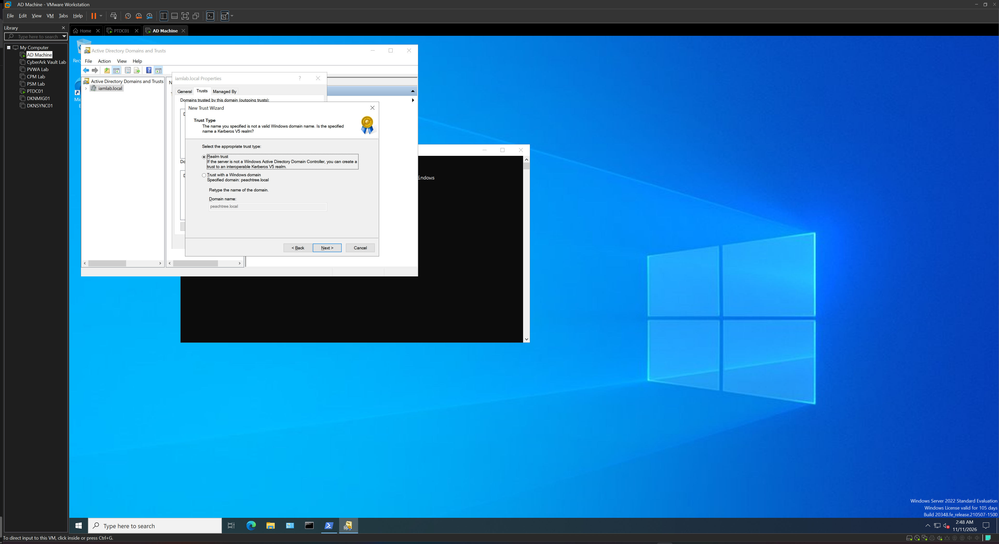
*Screenshot 02, Beginning: the wizard asked "The name you specified is not a valid Windows domain name. Is the specified name a Kerberos V5 realm?"*

**Root cause layer:** DNS. The wizard's question sounds like a Kerberos problem, but `Resolve-DnsName peachtree.local` returned DNS_ERROR_RCODE_NAME_ERROR and `nltest /dsgetdc:peachtree.local` returned 1355 ERROR_NO_SUCH_DOMAIN. The DKN DC simply had no way to find a Peachtree DC.

**Fix:** conditional forwarders on both DCs. Right after adding them, DNS resolved the SRV record but nltest still said 1355. That was the Netlogon locator's negative cache remembering the earlier failure, and `nltest /dsgetdc:peachtree.local /force` cleared it.

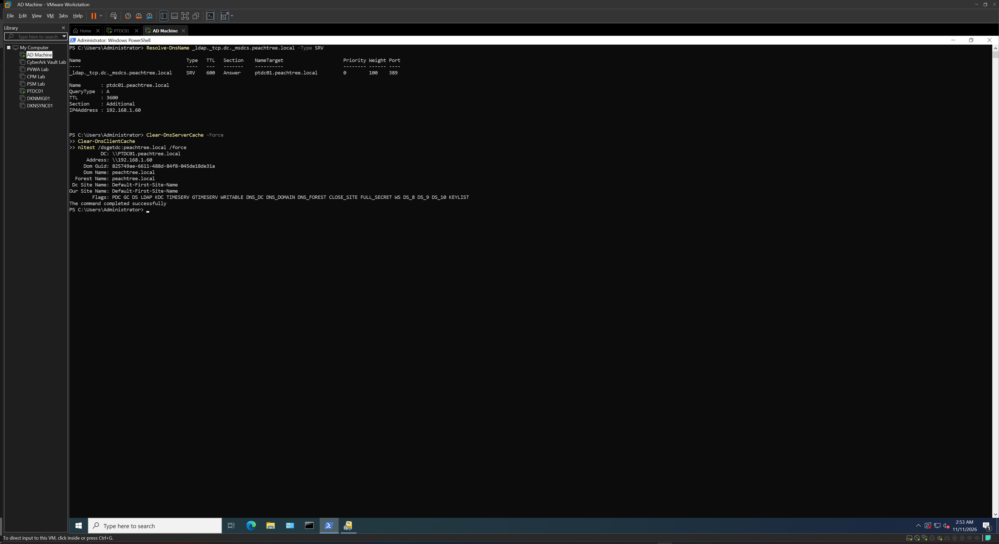
*Screenshot 03a, Middle: the forwarder on the DKN side. Screenshot 03b shows the matching one on PTDC01.*

Two more snags came after the trust existed. `netdom trust /verify` said "Access is denied", but that was netdom's own permission precheck, not the trust. Two independent tools (`nltest /sc_verify` and the Validate button) both said the trust was healthy. And a negative test looked like it failed: `net use` "succeeded" for mlopez, who isn't in the DKN group. Connecting isn't access, though. Reading a file returned "Access is denied" (screenshots 05a and 05b).

### Result

*Screenshot 04, End: the trust is validated, in place and active in both directions.*

| Check | Result |
|---|---|
| `nltest /sc_verify:peachtree.local` | NERR_Success |
| Name suffix routing | `*.peachtree.local` Enabled |
| Peachtree user in `DKN_Projects_Readers` reads the DKN share | Allowed (screenshot 05) |
| Peachtree user not in the group reads the DKN share | Access is denied, also on a fresh session by IP (screenshots 05a, 05b) |

[`scripts/02_Test-ForestTrust.ps1`](scripts/02_Test-ForestTrust.ps1) recorded the final state: [`evidence/day1_trust_validation_after.txt`](evidence/day1_trust_validation_after.txt).

### Engineer notes
* **Forest wide vs selective authentication.** Forest wide lets any Peachtree user authenticate to any DKN server, and permissions decide the rest. The lab used it so every later test had a clear path. A real merger starts with selective authentication and grants "Allowed to authenticate" server by server, so the trust is narrow until each system is ready.
* **Only Domain Local groups can hold members from another forest.** That's why the cross forest test group is `DKN_Projects_Readers` and not a Global group.
* **SID filtering stayed on today.** It gets turned off on Day 3 on purpose, and that is a risk to write down.

### Real world mapping
The first technical task after an acquisition closes is usually connectivity: DNS, then a trust, then a few proven access paths. Doing it with forwarders and a validated trust, and proving both a yes and a no, is the same pattern a consolidation team uses before they schedule a single migration wave.

---

## Day 2: One set of house rules (GPO and schema)

### Situation
Before moving anyone in, DKN needed a place to put Peachtree's objects, rules that apply only to them, and a way to remember where each identity came from after it moves. Without a source tag, six months after the migration nobody can say who used to be a Peachtree employee.

### Build
1. Created `OU=Peachtree,OU=Acquired` with Users, Groups, Servers, and ServiceAccounts under it, so merger rules target acquired assets without touching DKN (screenshots 06c and 06d).
2. Built `GPO_Merger_Security_Baseline` (a legal notice at logon and a 15 minute inactivity lock), a deny logon GPO that blocks `PEACHTREE\Domain Admins` from local and RDP logon on `OU=Acquired`, and `PSO_Peachtree_Migrated_Users` (14 characters, 24 history, lockout after 5 tries in 15 minutes) for the people moving in.
3. Generated a unique OID with [`scripts/03_New-SchemaOID.ps1`](scripts/03_New-SchemaOID.ps1) and created the `dknSourceCompany` attribute. Record: [`evidence/day2_schema_oid.txt`](evidence/day2_schema_oid.txt).
4. Stamped every DKN human user with [`scripts/04_Set-SourceCompany.ps1`](scripts/04_Set-SourceCompany.ps1). Output: [`evidence/day2_source_company_stamp_dkn.csv`](evidence/day2_source_company_stamp_dkn.csv).

### Snag: the baseline GPO never reached the server
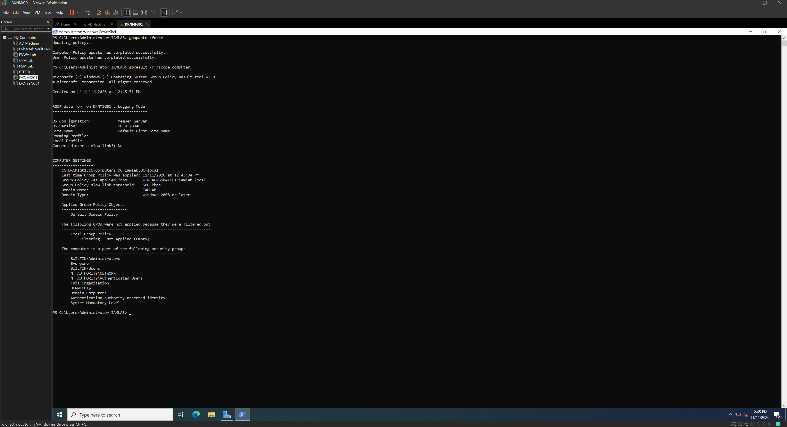
*Screenshot 07, Beginning: `gpresult /r /scope computer` listed only the Default Domain Policy.*

**Root cause layer:** AD (OU design). DKNMIG01 was joined without `-OUPath`, so it landed in `CN=Computers`. That's a container, not an OU, and GPOs can't link to containers. It was also outside `OU=Acquired`, where the baseline lives.

**Fix:** moved it with `Move-ADObject` to `OU=Servers,OU=Peachtree,OU=Acquired`, ran `gpupdate /force`, then proved it at three levels: gpresult, the registry values, and the legal notice on screen at the next logon (screenshots 08 to 09b).

The schema step had its own scare. The AD Schema snap-in crashed with "MMC has detected an error in a snap-in" while adding the attribute to the user class. A schema change is permanent, so retrying blindly could have created a duplicate. Checking the directory with PowerShell showed the change had already committed: right OID, Unicode string, single value, and `mayContain` listed `dknSourceCompany` (screenshots 11b to 11d).

### Result
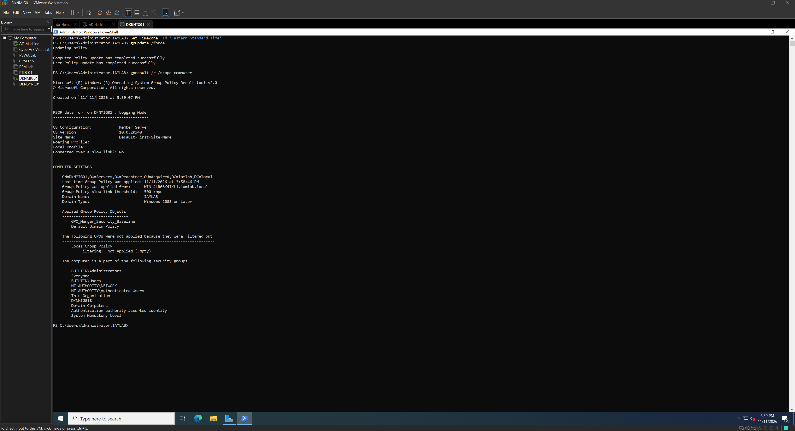
*Screenshot 09, End: GPO_Merger_Security_Baseline applied to DKNMIG01.*

| Control | Proof |
|---|---|
| Baseline GPO | gpresult, registry values, legal notice at logon (09 to 09b) |
| Old Peachtree Domain Admins blocked on acquired servers | Logon denied for `PEACHTREE\Administrator` (10c, 10d) |
| Password rules for migrated users | PSO_Peachtree_Migrated_Users (10e) |
| Source company attribute | Created and on the user class (11c, 11d). DKN users stamped after a dry run (11f, `day2_source_company_stamp_dkn.csv`) |

### Engineer notes
* **Schema changes cannot be deleted, only made defunct.** I snapshotted the DC before touching the schema.
* **Password policy in an OU GPO only changes local accounts.** Domain user password rules come from the domain policy or a PSO, which is why Peachtree's rules live in a PSO on a group.
* **Why one custom attribute matters.** `dknSourceCompany` follows each identity through AD and up to Entra ID: Entra Connect syncs it on Day 4, and the agent filters on it on Day 7. On Day 5, SailPoint picked roles from the company attribute in the HR feed instead, because HR is the authoritative source for who works where.

### Real world mapping
Acquired environments arrive with their own admins and their own habits. A separate OU tree with its own baseline, plus a deny logon rule for the old admin group, is how a merger team contains that risk on day one. The source company tag is a small design choice that pays off in every later audit question about acquired users.

---

## Day 3: Move everyone into one forest (ADMT)

### Situation
Peachtree's people had to become DKN accounts without losing access to the Peachtree files they still needed on Monday morning. One name was also taken: DKN already had a `jsmith` (Jamie Smith), and Peachtree's Jordan Smith was `jsmith` too.

In plain words: everyone moves to the new house, but each person carries their old key along (SID history), so the old doors still open until the locks are changed.

### Build
1. Took a before snapshot with [`scripts/05_Export-PeachtreeDirectory.ps1`](scripts/05_Export-PeachtreeDirectory.ps1).
2. Prepared SID history: auditing on in both domains, the `PEACHTREE$$$` group, `TcpipClientSupport`, and SID history enabled on the trust (screenshots 12b to 12h).
3. Migrated groups, then users, then the service accounts with ADMT 3.2. The two shared Domain Admins (`admin`, `itadmin`) were left behind on purpose, because carrying a foreign forest's Domain Admin SIDs into iamlab would bring their privilege along.
4. Renamed Peachtree's `jsmith` to `jsmith_pt` with an ADMT include file (screenshots 14c to 14e).
5. Stamped the new arrivals with `04_Set-SourceCompany.ps1 -Company Peachtree`.
6. Checked every object with [`scripts/06_Compare-MigrationResults.ps1`](scripts/06_Compare-MigrationResults.ps1), which matches by SID history first.

### Snag: "0 errors" while ADMT gave Jamie Jordan's access
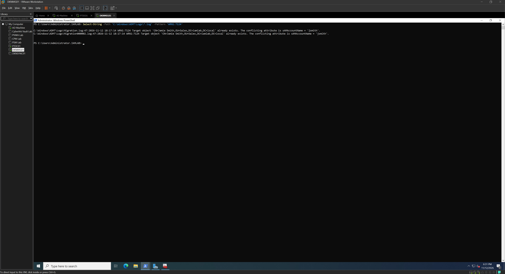
*Screenshot 14, Middle: ADMT skipped Peachtree's jsmith because `jsmith` already existed in iamlab.*

The run summary said 12 examined, 11 copied, 0 errors. The log said more. Because of the name clash, "Fix users' group memberships" matched on sAMAccountName and added DKN's **Jamie Smith** to Jordan's Peachtree groups, including `PT_Ops_Dispatch`, which carries the old Peachtree SID. Jamie had quietly gained real access to Peachtree dispatch files.


*Screenshot 14a, Middle: DKN's Jamie Smith in PT_All_Staff and PT_Ops_Dispatch.*

**Root cause layer:** App (ADMT behavior). The group fix step matches by name, not by the source SID, so a collision becomes a grant.

**Fix:** removed Jamie from both groups and verified with `Get-ADPrincipalGroupMembership` (14b). Then migrated Jordan on his own as `jsmith_pt` through an include file, so the rename is written down and repeatable instead of a hand edit (14c to 14e).

The access test had one more snag: `jsmith_pt` got "System error 1909, the referenced account is currently locked out". A mistyped password in a `runas /netonly` window kept retrying in the background and hit the new PSO lockout threshold of 5. Event 4740 named the source machine, and the unlock plus a clean retry worked (19a to 19d).

### Result

| Type | In source | Found in target | With SID history | Renamed | Missing |
|---|---|---|---|---|---|
| Users | 17 | 15 | 15 | 1 | 2 |
| Groups | 6 | 6 | 6 | 0 | 0 |

The 17 source users are 12 people, 2 shared Domain Admins, and 3 service accounts. The 2 missing are the Domain Admins, left behind by design. The 1 rename is `jsmith_pt`. Source: [`evidence/day3_migration_counts.csv`](evidence/day3_migration_counts.csv). Per object detail: [`evidence/day3_migration_results.csv`](evidence/day3_migration_results.csv).

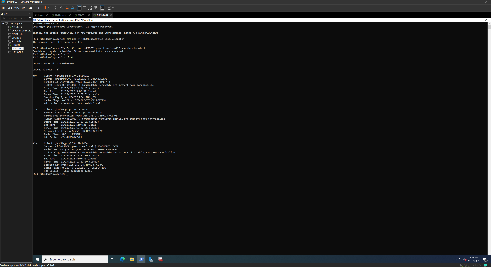
*Screenshot 19e, End: IAMLAB\jsmith_pt reads a Peachtree only share through SID history. The control user, Jamie, authenticated but got "Access is denied" (19g, 19j), which proves the access came from SID history and nothing else.*

The temporary cross forest admin rights used for the migration were removed the same day (20 and 20a), and the generated password file stayed out of the repo (21a).

### Engineer notes
* **ADMT 3.2 is no longer updated by Microsoft** and is not listed as supported on Windows Server 2012 R2 through 2022. Real migrations use commercial tools that automate the same steps. I used ADMT to learn what those tools do underneath.
* **Read the migration log, not the summary.** The Jamie Smith grant only showed up line by line.
* **SID filtering is off on the trust until cleanup.** That lets SID history work, and it also widens what the trust allows. It goes back on after shares are re permissioned.

### Real world mapping
Name collisions happen in every merger, and SID history is the standard way to keep users working during cutover. This day shows both sides of it: the access it preserves (jsmith_pt reads dispatch files) and the access it can leak (Jamie). A collision rule written down before the migration, and a denied control user in the test, are what separate a migration from a guess.

---

## Day 4: One key card for on prem and cloud (Entra Connect)

### Situation
DKN runs Microsoft 365, so Peachtree's people needed cloud identities that match their new AD accounts. The source company tag also had to make it to the cloud, so cloud side tools could tell Peachtree users apart.

### Build
1. Built DKNSYNC01 in a new `OU=Tier0_Servers`, because a sync server with password hash sync holds DCSync level rights (23b to 23e).
2. Installed Microsoft Entra Connect Sync from the Entra admin center (version recorded in screenshot 25a): custom install, password hash sync, default virtual service account.
3. OU filtering so service accounts never leave AD. Peachtree is selected child by child (Users only), so a new OU under Peachtree doesn't start syncing by accident (25c0, 25c).
4. Directory extension sync for `dknSourceCompany` (25e).
5. Predicted the errors first with [`scripts/07_Find-SyncBlockers.ps1`](scripts/07_Find-SyncBlockers.ps1), including a duplicate proxyAddress I planted on purpose to see how sync handles it (24c).
6. Switched the inter forest referral ticket from RC4 to AES 256 on both sides of the trust, a finding logged on Day 3 (22 to 22c).

### Snag: a duplicate address vanished with zero errors
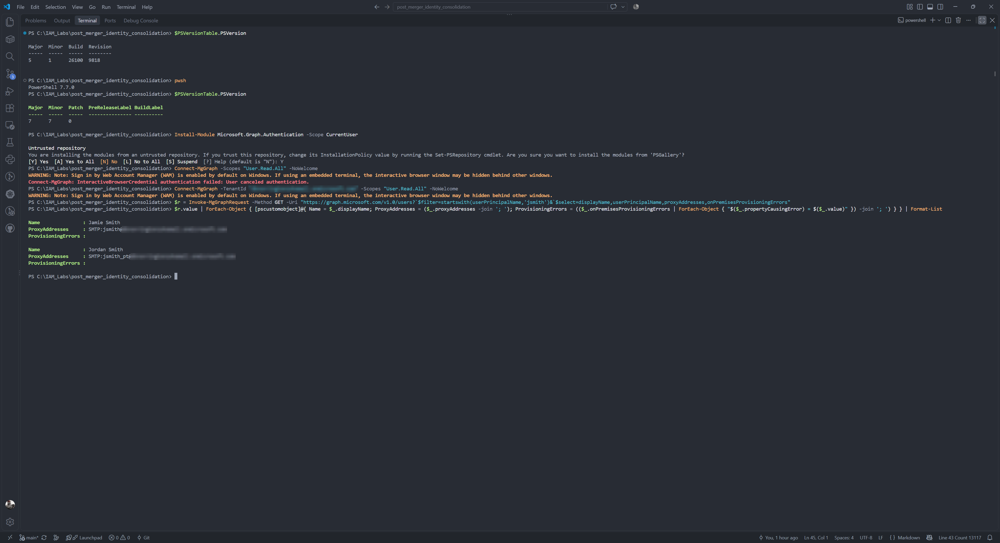
*Screenshot 28a, Middle: Graph shows jsmith_pt with only its primary address. The planted duplicate is simply gone.*

I expected the planted duplicate `smtp:jsmith@` alias to fail the export. Instead, every dashboard was green: the export succeeded, Connect Health showed 0 duplicate attribute errors (28), and Graph v1.0 and beta both returned empty provisioning errors (28a1).

**Root cause layer:** Sync (duplicate attribute resiliency). Entra quietly dropped the conflicting alias instead of failing the object. Only comparing AD to Graph showed it.

**Fix:** removed the alias at the source in AD, ran a delta sync, and reran script 07: 0 duplicates (28j to 28l). AD is the source of authority, so a cloud side edit would have been overwritten.

Checking that took its own troubleshooting. Microsoft Graph PowerShell crashed on the sync server's Windows PowerShell 5.1 with a TypeLoad error. Rather than fight it there, I removed it from the Tier 0 box and ran Graph from the admin workstation in PowerShell 7, with `-TenantId` so the sign in went to the work tenant (28b0 to 28i).

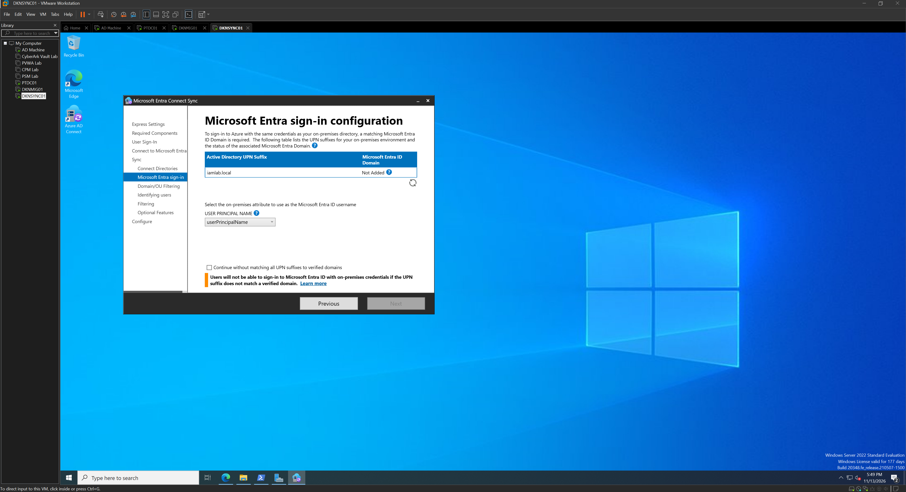
*Screenshot 26, Middle: the wizard warned that `iamlab.local` can't be verified, so users landed as `@<tenant>.onmicrosoft.com`. `.local` is not a domain anyone can own.*

### Result
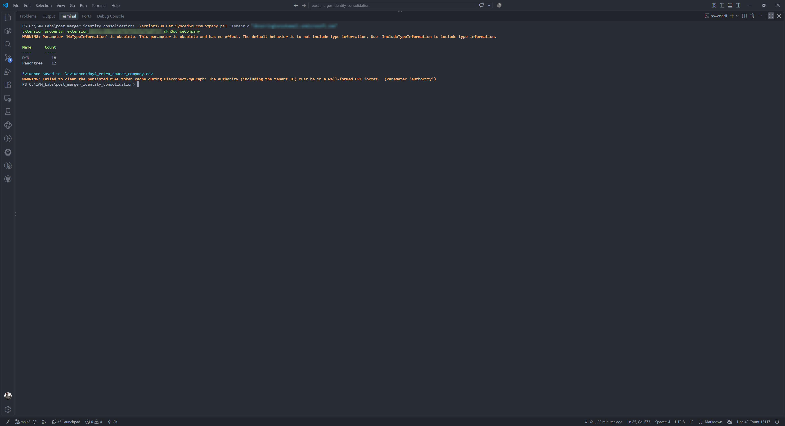
*Screenshot 28o, End: read back from Microsoft Graph, 18 DKN and 12 Peachtree synced users carry their source company.*

| Check | Result |
|---|---|
| Synced users with `dknSourceCompany` | DKN 18, Peachtree 12 |
| Service accounts in Entra | 0 (filtered out) |
| Duplicate addresses before and after | 1, then 0 ([before](evidence/day4_duplicate_addresses_before.csv), [after](evidence/day4_duplicate_addresses_after.csv)) |
| Inter forest referral ticket | RC4 before, AES 256 after |

[`scripts/08_Get-SyncedSourceCompany.ps1`](scripts/08_Get-SyncedSourceCompany.ps1) read the extension attribute back out of Microsoft Graph: [`evidence/day4_entra_source_company.csv`](evidence/day4_entra_source_company.csv). The Entra portal doesn't show directory extensions, so Graph is the only real proof.

### Engineer notes
* **Microsoft now enforces a minimum Entra Connect Sync version.** Older builds stop syncing. I installed the current build from the Entra admin center and recorded it (25a).
* **A green dashboard means "no errors reported," not "no problems."** Sync, Connect Health and Graph all said fine while an alias was missing. Compare the source to the target.
* **Keep admin tools off Tier 0 servers.** The sync server can effectively read every password hash in the domain. Graph PowerShell runs from the admin workstation instead.

### Real world mapping
Hybrid identity is where on prem mistakes become cloud mistakes. Treating the sync server as Tier 0, filtering out service accounts, fixing conflicts at the source, and proving the result with Graph instead of the portal are the same habits a production identity team uses before any acquired users get Microsoft 365 licenses.

---

## Day 5: Bring Peachtree under governance (SailPoint IdentityIQ)

### Situation
Peachtree tracked "who has what" in a spreadsheet ([`evidence/day5_peachtree_legacy_access.csv`](evidence/day5_peachtree_legacy_access.csv)) and reviewed it by email once a year. Two of the people on it had already left, and one line had no approver at all.

In plain words: the old school kept the hall passes in a notebook. Day 5 moves them into a system that knows every student, every pass, and who signs off on each one.

### Build
1. Mapped every legacy line to an AD group, a SailPoint entitlement, a role, and a decision: [`evidence/day5_target_state_mapping.csv`](evidence/day5_target_state_mapping.csv).
2. Connected IdentityIQ to Active Directory with the AD connector and IQService, running as `svc_iiq_dkn` with write rights scoped to Peachtree users and groups only.
3. Added the 12 Peachtree people to the HR feed and correlated AD accounts on `employeeID`, because ADMT renamed `jsmith` to `jsmith_pt` and account names can't be trusted after a migration.
4. Mined roles from the migrated groups and published 7 business roles on top of 6 IT roles ([`config/iiq/roles/peachtree_department_roles.xml`](config/iiq/roles/peachtree_department_roles.xml)).
5. Built a separation of duties policy for AP plus GL, scoped the joiner and leaver lifecycle events by company, and tested every rule on one person who should match and one who shouldn't.
6. Ran three staged manager certifications and one targeted review of the Peachtree managers by the DKN IAM Team.

### Snag: two Marcus Reeds became one identity
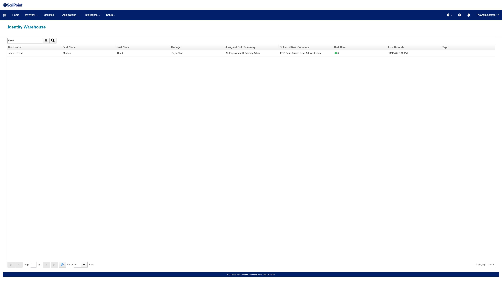
*Screenshot 35c, Middle: after the first HR aggregation, 11 identities were created instead of 12. One "Marcus Reed" held two HR accounts: DKN's E1002, a Systems Administrator with IT Security Admin, and Peachtree's PT1003, the IT Manager.*

**Root cause layer:** IGA (identity matching). I ruled out the correlation config (already employeeId), a corrupted employeeId (still E1002), and the creation rule on its own. When employeeId found no match, the account was attached by display name, and both men are named Marcus Reed. That would have given a Peachtree manager a DKN security admin's access in every report and review.

**Fix:** changed the HR feed's Display Attribute to `employeeId`, named new identities by employee ID, removed the PT1003 link and re-aggregated: 1 created, 23 updated, two separate Marcus Reeds (36g to 36j).

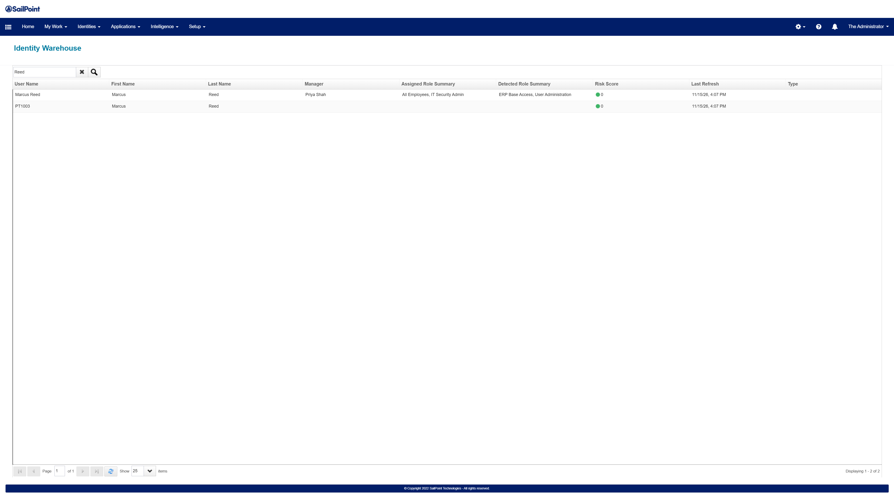
*Screenshot 36j: two identities, two employee IDs.*

Other Day 5 catches, each in the troubleshooting log: a pre-merger "every active employee" role that silently gave a Peachtree user DKN ERP access (row 28, lesson 34), a DKN joiner event that created a real DKN Portal account for a Peachtree identity and couldn't delete it until I added a Delete branch to the provisioning rule (row 29), four role rules that said OR instead of AND and were caught at the impact review before going live (row 30), and a leaver that never fired because the migrated identities had no baseline snapshot yet (row 31).

### Result
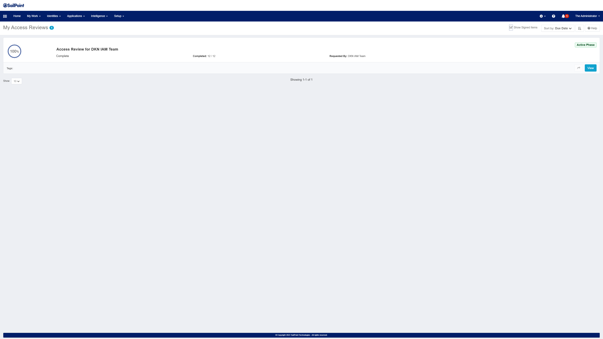
*Screenshot 66d, End: the targeted review signed by the DKN IAM Team. Across all four certifications, 39 items reviewed, 2 revoked, 1 SoD exception allowed with an expiry.*

| Measure | Result |
|---|---|
| Legacy spreadsheet lines with an owner and a decision | 15 of 15 |
| Lines retired because nothing was behind them | 3 (kwhite and rgarcia had left, crm_poweruser had no approver or AD group) |
| Certifications | 3 manager reviews (Dana, Kiran, PT1003) and 1 targeted review |
| Items reviewed | 39 |
| Revoked and verified gone in AD | 2 (Dana's warehouse access, PT1003's helpdesk access), still gone after a provisioning refresh (67a to 67g) |
| SoD exception | Kiran's AP plus GL, allowed to 12/15/2026 with a compensating control |

Exports: [`evidence/certifications/`](evidence/certifications/).

### Engineer notes
* **Honest framing:** this migrates a spreadsheet based process into SailPoint. It is not a migration between two licensed IGA platforms. The design work (mapping, target state, rebuild) is the same.
* **The AP plus GL approver line is a segregation of duties conflict.** Kiran Patel is the Finance Manager and the only person in both groups, and she has no manager on record. The violation routes to the DKN IAM Team so she never reviews herself, and it's allowed only until 12/15/2026 with a second approver on her payments and a monthly GL review.
* **After a merger, every "everyone" rule is a question.** Two pre-merger rules said "every active employee" and quietly included the acquired company.
* **A revoke isn't done until the target system says so.** Both revokes were checked in AD, and a provisioning refresh proved no role put the access back.

### Real world mapping
Most acquired companies have no IGA platform, so the real project is exactly this: turn a spreadsheet into a target state, correlate on a key that survives the migration, and run the first certification with the new managers. Catching identity merges, unscoped birthright rules, and SoD conflicts before the first review goes out is what makes that review defensible to an auditor.

---

## Day 6: Lock up the master keys and the robot accounts (CyberArk and NHI)

### Situation
Peachtree came with two kinds of risky keys. The first kind was the **master keys**: `admin` and `itadmin`, two shared Domain Admin accounts that several people logged in with using the same password. The second kind was the **robot keys**: service accounts that programs use to run. They had no owner, their passwords never changed, and after the ADMT migration on Day 3 nobody even knew what those passwords were.

In plain words, Day 6 does three things. It puts the master keys in a safe that takes two people to open and films every use (Part B). It puts the robot keys in the safe too, and teaches the safe to change them without breaking the programs that use them (Part B). And for one robot, it uses a key Windows makes and changes by itself, so nobody ever holds it (Part C). Part A comes first and finds every robot key in the building.

**Result:** 6 service accounts found with 0 compliant before the cleanup. 7 found with 5 compliant after. The two remaining are the Entra Connect sync account (documented exception) and the built in Administrator (known gap, planned change).

### Part A: Find every robot account (NHI inventory)

1. Built the non human identity inventory with [`scripts/09_Find-ServiceAccounts.ps1`](scripts/09_Find-ServiceAccounts.ps1). It flags any account that looks like a program (password never expires, has an SPN, a service style name, or sits in a ServiceAccounts OU) and scores it against two rules: the `svc_<app>_<env>` naming standard and a named owner. Output: [`evidence/day6_nhi_inventory_before.csv`](evidence/day6_nhi_inventory_before.csv).
2. Renamed the three Peachtree service accounts to the standard with [`scripts/10_Rename-ServiceAccounts.ps1`](scripts/10_Rename-ServiceAccounts.ps1), dry run first. Output: [`evidence/day6_service_account_rename_results.csv`](evidence/day6_service_account_rename_results.csv) and the plan in [`evidence/day6_service_account_naming.csv`](evidence/day6_service_account_naming.csv).

| Old name | New name | Owner | What it does |
|---|---|---|---|
| sqlsvc | svc_sql_pt | nfoster | Runs SQL Server Express on DKNMIG01 |
| backup | svc_backup_pt | nfoster | Nightly file backup job |
| reportsvc | svc_reports_pt | mreed | Reports job (replaced by a gMSA in Part C) |

3. Gave every account an owner through the `manager` attribute or a Description that starts with `Owner:`. The DKN side got owners too: dgrayson for `svc_iiq_dkn` (the SailPoint connector) and bwayne for `MSOL_a1af344839a3` (Entra Connect). The MSOL account got its owner through `manager` only, because its Description holds the tenant name and Entra Connect signs in by that exact account name.
4. Looked for every place each account is used with [`scripts/11_Get-ServiceAccountUsage.ps1`](scripts/11_Get-ServiceAccountUsage.ps1). The first scan came back empty, so before trusting it I proved the scan could actually reach DKNMIG01 from the machine it ran on. It was a real zero: SQL still ran as its built in virtual account. After the SQL cutover to `svc_sql_pt` in Part B, a rerun found `MSSQL$SQLEXPRESS` running as `IAMLAB\svc_sql_pt`, which is the usage CyberArk has to keep in sync. Output: [`evidence/day6_service_account_usages.csv`](evidence/day6_service_account_usages.csv).

The before inventory ([`evidence/day6_nhi_inventory_before.csv`](evidence/day6_nhi_inventory_before.csv)) found **6 service accounts and 0 fully compliant**: Peachtree's three with bad names and no owners, plus three on the DKN side nobody had looked at (`svc_iiq_dkn`, the Entra Connect `MSOL_` account, and the built in Administrator, flagged because its password never expires).

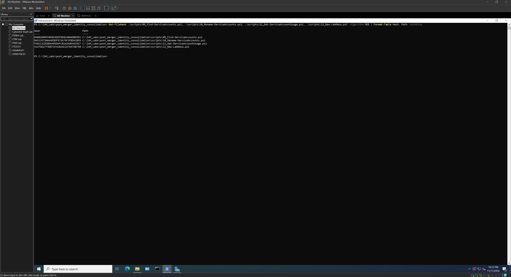
*Screenshot 73, Beginning: 6 service accounts found, 0 fully compliant.*

### Part B: Vault the service accounts without breaking SQL

**Build**
1. Created the `PT_Service_Accounts` safe, managed by the CPM `PasswordManager2`.
2. Removed `PSMAppUsers` from the safe, since nobody should ever open an interactive session as a service account. Onboarded `svc_sql_pt` and `svc_backup_pt`, each linked to the reconcile account `pam_reconcile`. ADMT left these accounts with `pwdLastSet 0` and a password nobody knew, so the first step was a **reconcile** (an admin reset) instead of a change.
3. Created `PSO_PAM_Vaulted_ServiceAccounts` (MinPasswordAge 0, length 12, history 24, max age 60 days, lockout 10) and applied it through `GG_PAM_Vaulted_ServiceAccounts`, so only vaulted accounts get the relaxed minimum age.
4. Added a Windows Service usage for `MSSQL$SQLEXPRESS` on `DKNMIG01.iamlab.local`, with `pam_logon_t1` as its logon account. That account is local admin on DKNMIG01 only and never a Domain Admin.

**Snag: the vault went dark after a router change**

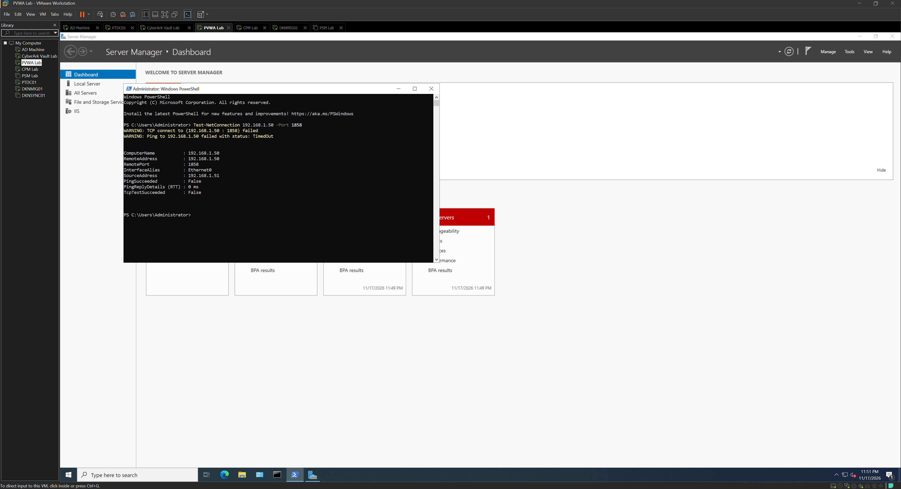
*Screenshot 77, Beginning: PVWA and the CPM both timed out on port 1858, while the Vault's own log said "Firewall is open for client communication."*

**Root cause layer:** Windows Firewall network profile. A new home router made Windows treat the Vault's network as new and label it **Public**. The Vault's hardening policy ignores local firewall rules on Public networks, and its only rules for 1858 were local. I ruled out the Vault service and an IP conflict first.

**Fix:** Set the network category back to Private instead of loosening the hardening policy.


*Screenshot 77j, End: PVWA reaches the Vault on 1858 again.*

**Snag: rotation broke SQL Server, and fixing it took four layers**

This one is the best example of how a single symptom hides several causes. Each fix uncovered the next problem.

| Order | What I saw | Root cause layer | Fix |
|---|---|---|---|
| 1 | CPM change failed with `winRc=2245` | AD password policy. The 1 day minimum password age blocks a self change, but not an admin reset | `PSO_PAM_Vaulted_ServiceAccounts` with MinPasswordAge 0 |
| 2 | The change succeeded, SQL kept running, then would not restart (Events 7038 and 7000) | Application configuration. The service still had the old password typed into "Log on as" | Added the Windows Service usage in CyberArk |
| 3 | The usage failed: RPC server unavailable, then access denied, then SCM error 1722 | Network and permissions on DKNMIG01 | WMI and Remote Service Management firewall rules scoped to the CPM (192.168.1.52) only, the FQDN as the usage address, and `pam_logon_t1` as the logon account |
| 4 | I opened the WMI rules on the CPM instead of DKNMIG01 | Operator error, wrong VM | Reverted the CPM, applied the rules on DKNMIG01 |

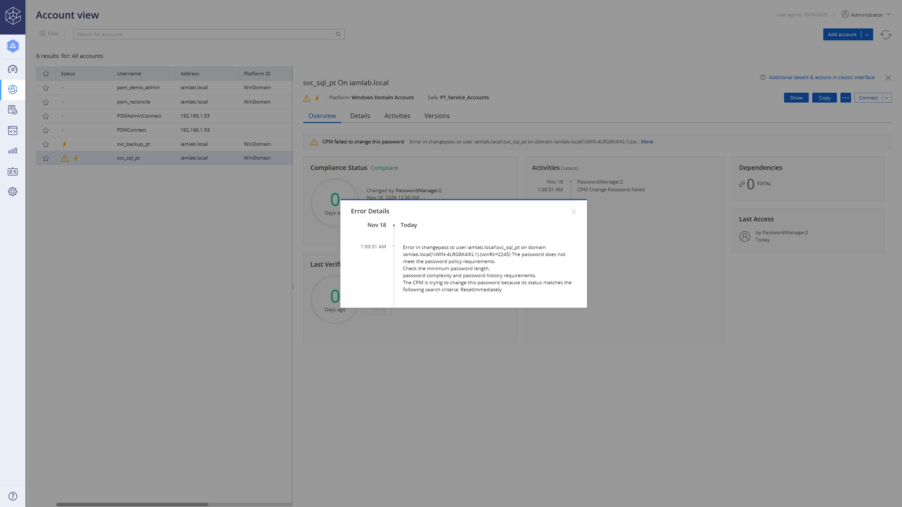
*Screenshot 84a, Beginning: the first CPM change on `svc_sql_pt` failed on password policy 30 minutes after the reconcile.*


*Screenshot 86, Middle: after the change, SQL still showed Running. It only failed on the next restart, because Windows never rechecks a running service's password.*

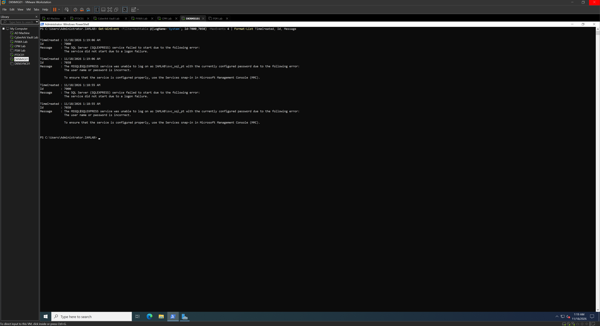
*Screenshot 86b, Middle: on restart, Event 7038: the service "was unable to log on as IAMLAB\svc_sql_pt with the currently configured password."*

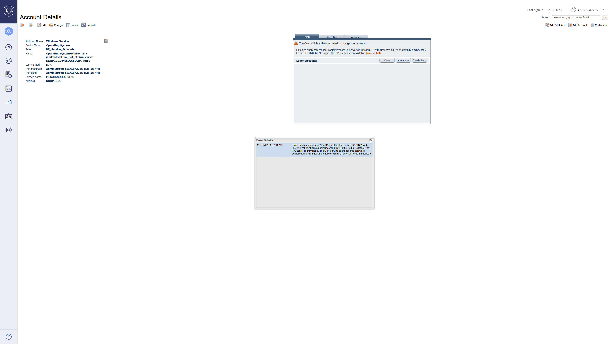
*Screenshot 87b, Middle: the first of three usage failures, each one a step further along than the last.*

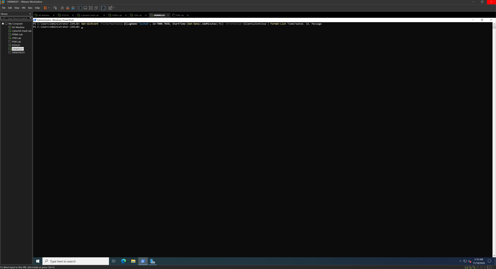
*Screenshot 88i, End: SQL restarts on a password only the vault knows, with no 7000 or 7038 events after the fix.*

**A detail worth knowing:** a failed usage does not stop the password change. The CPM changed `svc_sql_pt` three times while the usage was still failing, and each change left the service one password further behind. A green "change succeeded" is not proof the application survived. The restart is.

### Part B: Put the Peachtree Domain Admins behind two people and a camera

**Build**
1. Duplicated the Windows Domain Account platform as **PT Tier0 Domain Admin** and added a Master Policy exception for **dual control** (1 confirmer). The copy also brought along the **PSM required** exception from the original platform, which I confirmed was Active.

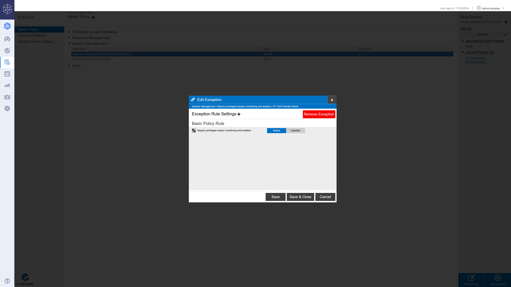
*Screenshot 90e: "Require privileged session monitoring and isolation" is Active for PT Tier0 Domain Admin. A copied platform is not a clean slate.*

2. Created `pt_itops` and `pt_approver` as vault users in the PrivateArk Client, because PVWA's user provisioning in 12.6 only offers LDAP integration and that isn't configured in this lab. Then created the **PT_Tier0_Admins** safe with three people in three roles.

| Member | Permissions | Can do | Can never do |
|---|---|---|---|
| pt_itops | List, Use | Request and connect through PSM | See or copy the password, skip approval |
| pt_approver | List, Authorize (Level 1) | Read and approve or reject requests | Log in with the account |
| audit_reviewer | List, View audit log | Watch recordings and read the log | Request or approve |

3. Checked that the CPM could reach the Peachtree DC before onboarding anything (DNS and port 445 from 192.168.1.52).
4. Onboarded `PEACHTREE\admin` and `itadmin`, verified them, then let the CPM rotate them one at a time.
5. Created `PSO_PAM_Vaulted_Tier0` in `peachtree.local` through `GG_PAM_Vaulted_T0`, so the CPM could rotate without the minimum age blocking it.
6. Turned on RDP on PTDC01 and scoped it to the PSM server (192.168.1.53) only.

**Snag: the safe gave out the wrong permissions**

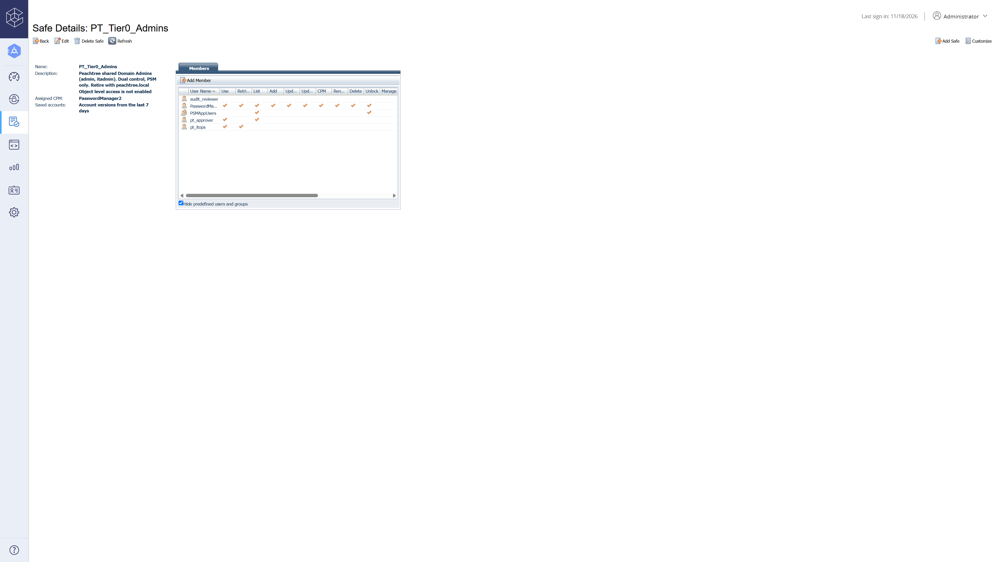
*Screenshot 91a, Beginning: pt_itops had **Retrieve** (it could see the Domain Admin password) and no List. pt_approver had no Authorize, so nobody could approve anything.*

The classic safe page adds members without presets, and the defaults did not match the design. I fixed each member by hand. Authorize account requests turned out to be hidden under the collapsed **Workflow** heading.

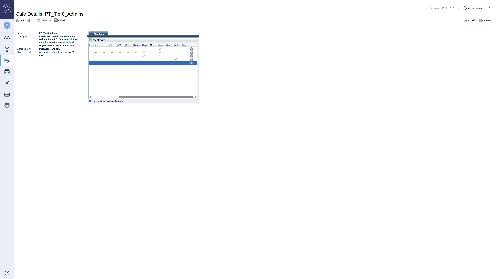
*Screenshot 91e, End: Retrieve is empty for every human, and pt_approver has Authorize.*

**Snag: the first Verify failed, and that was a good thing**

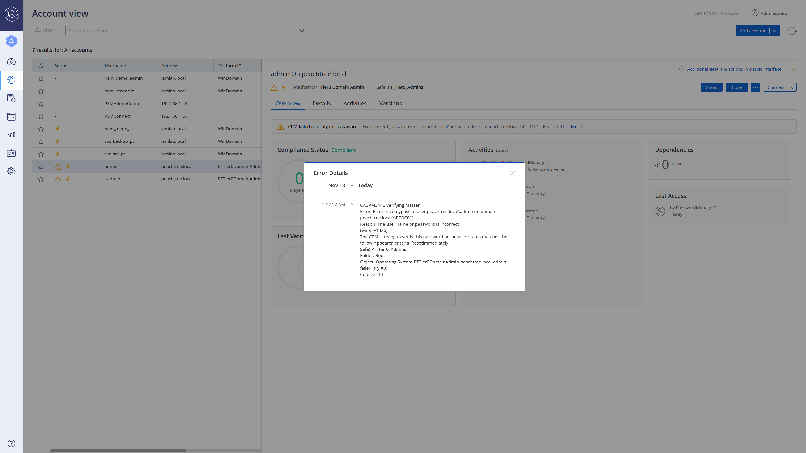
*Screenshot 93b, Beginning: `The user name or password is incorrect (winRc=1326)`. I had typed the wrong password into the vault.*

Verify caught the typo before the CPM changed anything in AD. Checking the accounts on PTDC01 then turned up a bigger problem: `peachtree.local` had **LockoutThreshold 0**, so anyone could guess the Domain Admin passwords forever. The seeded password also failed the platform rule of two uppercase letters, so both accounts were reset in AD to compliant values, the vault copy was updated, and the PSO added a lockout of 10.

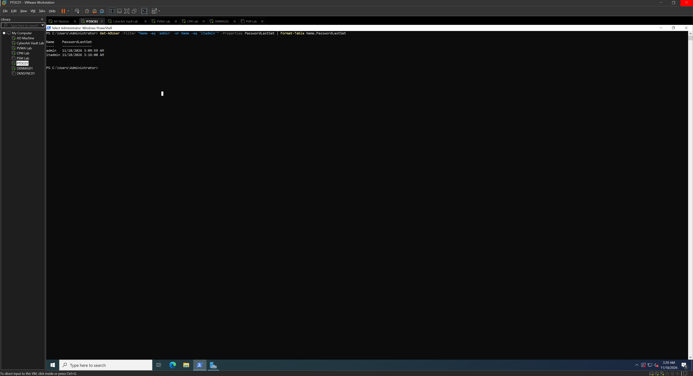
*Screenshot 94e, End: PasswordLastSet on PTDC01 shows the CPM rotated admin at 3:09 AM and itadmin at 3:16 AM. Nobody knows either password now.*

**Snag: a suspended approver account**

pt_itops kept getting "Authentication failure" even after a password reset. The vault had suspended the user after repeated failed logins, which PrivateArk shows as **Disable User**, and a reset does not lift a suspension.

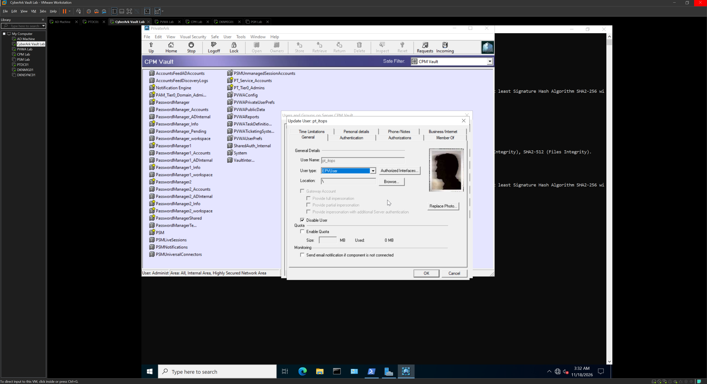
*Screenshot 95b, Middle: the real cause was one checkbox on the General tab.*

**The dual control test: a no, a mistake, and a yes**

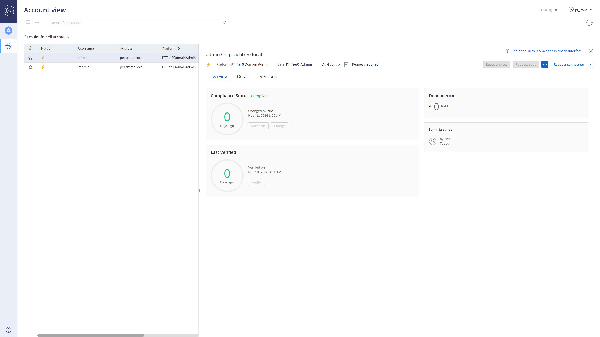
*Screenshot 95f: pt_itops sees only the two Tier 0 accounts. Show and Copy are grayed out, and the only path is "Request connection."*

| Request | What happened | Why it matters |
|---|---|---|
| 1 | Asked for 49 hours because the form defaults to a two day window. **Rejected** with a written reason | Proves the approver is a real check |
| 2 | Asked for 03:30 AM to 04:30 **PM**, 13 hours. **Confirmed by mistake** | The Incoming Requests list cuts the end time off, and the approver clicked Confirm without opening it |
| 2 | Deleted by the requester | A 13 hour Tier 0 approval should not stay open |
| 3 | 1 hour, opened and read on the detail page, then **confirmed** | The process working the way it should |

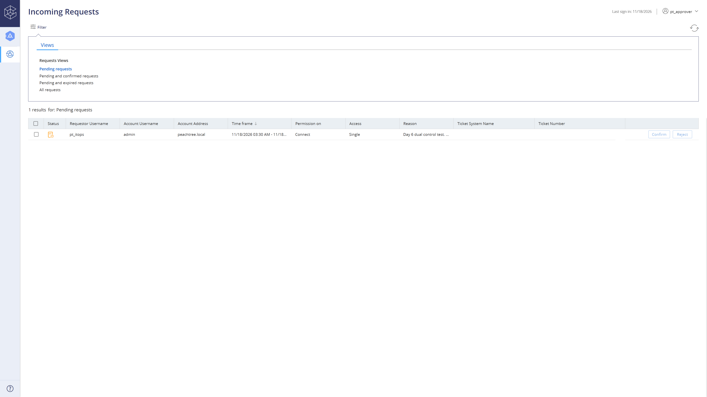
*Screenshot 95l, Middle: the end time is hidden behind "11/18...". The control worked as designed. The review did not.*

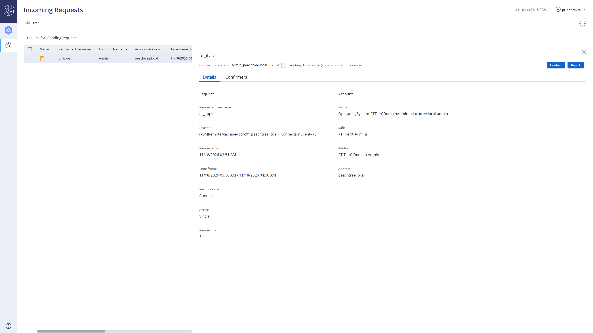
*Screenshot 95q, End: the approver reads the full window, target machine and requester before confirming.*

**Snag: RDP closed on the DC, then fixed on the wrong VM**

A preflight from PSM showed port 3389 closed on PTDC01, with 35 minutes left in the approval window. RDP was off and its firewall rules were disabled, because the DC had only ever been managed from the VMware console. I applied the fix in the DKNMIG01 tab by mistake, which is the same slip as the CPM firewall in Part B. I reverted DKNMIG01, ran `hostname` first, and applied it on PTDC01 scoped to PSM only.

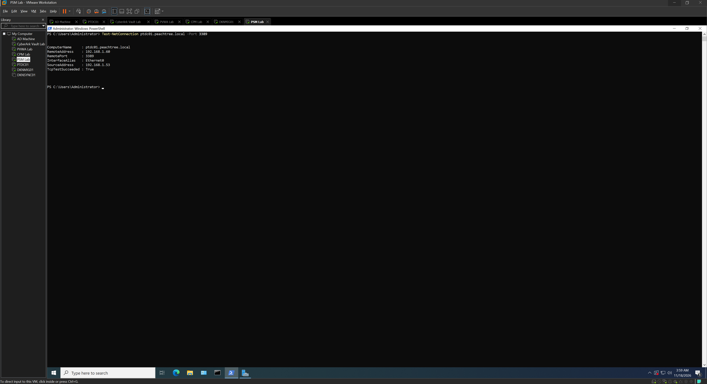
*Screenshot 96g: TcpTestSucceeded True from 192.168.1.53. PSM is now the only door to the DC at the network layer too.*

**The session and the recording**

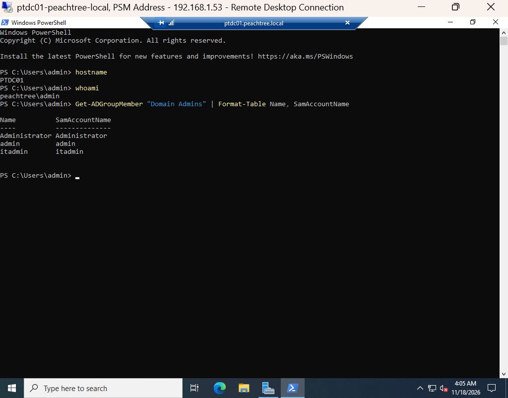
*Screenshot 97c: hostname PTDC01, whoami `peachtree\admin`, and pt_itops never typed or saw a password. The Domain Admins list also showed a **third** Domain Admin, the built in Administrator, which is not in the vault.*

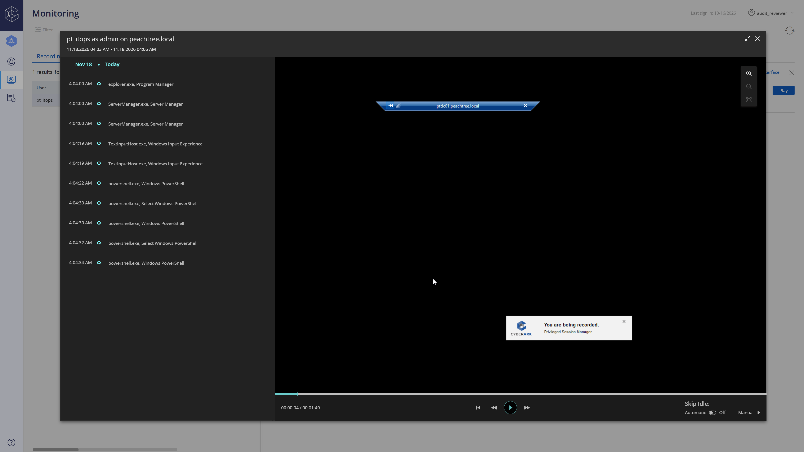
*Screenshot 98a, End: audit_reviewer replays the session. The left panel is a searchable timeline of every program opened, and the user saw "You are being recorded."*

Requester, approver and reviewer are three different people. That separation is the point of the whole exercise.

### Part C: Give one robot a key nobody holds (gMSA)

**Build**
1. Confirmed `svc_reports_pt` had **never logged on**. It was an enabled account with a password that did nothing, which is exactly the kind of account attackers look for.
2. Created the KDS root key and `gmsa_reports_pt` with [`scripts/12_New-LabGmsa.ps1`](scripts/12_New-LabGmsa.ps1), allowed on DKNMIG01 only. Output: [`evidence/day6_gmsa_settings.csv`](evidence/day6_gmsa_settings.csv).
3. Installed and tested it on DKNMIG01 (`Test-ADServiceAccount` returned True).
4. Gave it a real job: a scheduled task, `PT_Daily_Report`, that writes who ran it.
5. Disabled `svc_reports_pt` (delete after 30 days with no complaints) and ran the after inventory.

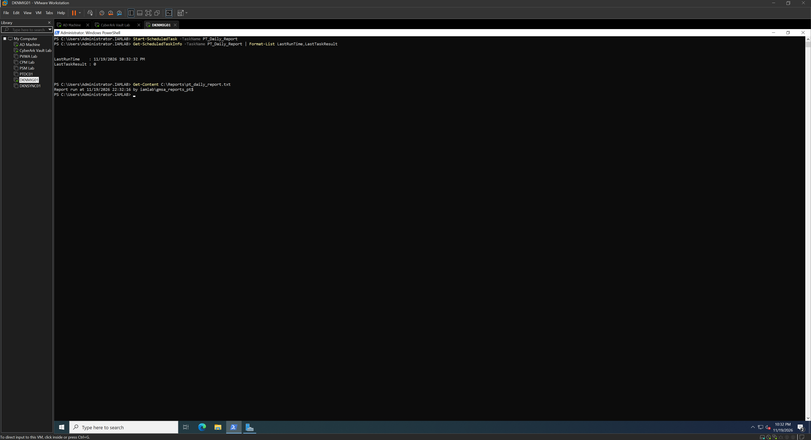
*Screenshot 100b: LastTaskResult 0 and the report says `by iamlab\gmsa_reports_pt$`. Windows fetched the password from the DC by itself. No human typed one.*

**Snags in Part C**

* **The evidence file was wrong.** Script 12 created the gMSA correctly, but the CSV showed a blank DNS name and `Microsoft.ActiveDirectory.Management.ADPropertyValueCollection` where 30 should be. DNSHostName is not a default property, and the rotation interval is a collection. Patched and reran (screenshot 99c).
* **PowerShell ate the `$`.** `"IAMLAB\gmsa_reports_pt$:(OI)(CI)M"` in double quotes made PowerShell look for a variable. Single quotes fixed it.
* **The inventory could not see the new account.** Script 09 used `Get-ADUser`, and a gMSA is not a user object. The after report would have shown the old account gone and nothing in its place. Patched to include `Get-ADServiceAccount` and to accept `gmsa_` names.

### Result

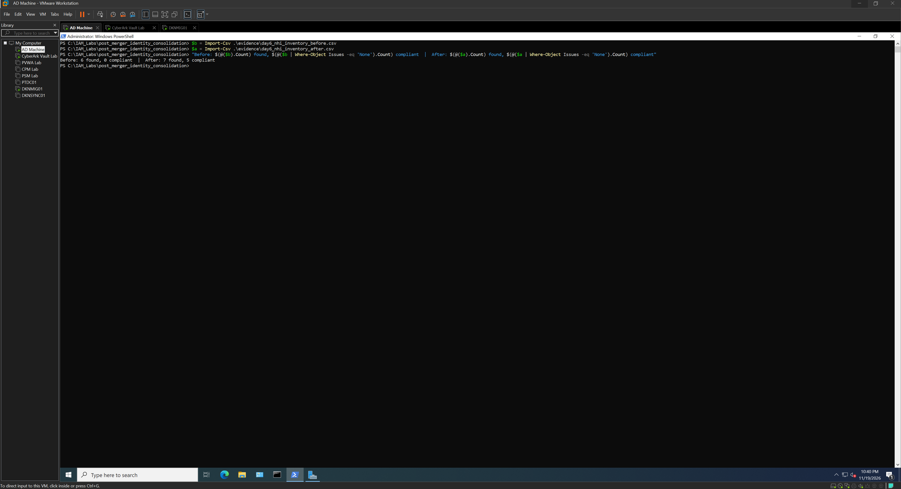
*Screenshot 101b, End: Before 6 found, 0 compliant. After 7 found, 5 compliant.*

| Measure | Before | After |
|---|---|---|
| Service accounts fully compliant (named, owned, rotating) | 0 of 6 | 5 of 7 |
| Service accounts with a named owner | 0 of 6 | 6 of 7 |
| Following the `svc_` or `gmsa_` naming standard | 1 of 6 | 5 of 7 |
| Shared Domain Admin passwords known by people (admin, itadmin) | 2 | 0 |
| Service account passwords nobody knows | 0 | 3 (svc_sql_pt and svc_backup_pt in CyberArk, gmsa_reports_pt by Windows) |
| Ways into a Peachtree Domain Admin session | Anyone with the password | Request, approval, PSM, recording |
| Enabled service accounts that were never used | 1 (svc_reports_pt) | 0 |

Source: [`evidence/day6_nhi_inventory_before.csv`](evidence/day6_nhi_inventory_before.csv) and [`evidence/day6_nhi_inventory_after.csv`](evidence/day6_nhi_inventory_after.csv). The after run used the patched script 09, which can also see gMSAs. The patch did not change how user accounts are scored, so the counts are fair to compare. The extra account is the gMSA. The two that still fail are the Entra Connect account and the built in Administrator.

**What is still open, on purpose:**
* `MSOL_a1af344839a3` stays as a documented exception. Entra Connect manages it, and renaming or rotating it outside the wizard breaks sync.
* `IAMLAB\Administrator` and `PEACHTREE\Administrator` are built in Domain Admins that are not vaulted yet. They are the console logins used to build and repair both DCs, so they get vaulted together in one planned change once a break glass path is written and tested.

### Engineer notes
* **gMSA or CyberArk?** Use a gMSA when the workload runs on Windows, supports gMSA, and no human ever needs the password. Use CyberArk when the account has usages to keep in sync, needs a human recovery path, or the application cannot run as a gMSA.
* **Policy and permissions are two separate locks.** The PSM rule blocks Show and Copy today, but a Master Policy exception can be turned off with one click. Removing Retrieve at the safe level keeps the password hidden even if the policy changes.
* **Defaults are decisions someone else made for you.** The request form opens with a two day window, and the approval list hides the end time. Both nearly gave a Tier 0 account away for hours.
* **Run `hostname` before any change.** I applied a fix to the wrong VM twice in this lab. The prompt showed the machine name both times.
* **About "privileged elevation."** Job descriptions often mean endpoint tools like CyberArk EPM or BeyondTrust Privilege Management. Dual control plus PSM is the closest control in this lab.

### Real world mapping
After an acquisition, the acquired company's admin and service accounts are usually the first thing an auditor asks about, because they are shared, undocumented and never rotated. This day maps to the controls most frameworks ask for in some form: account management with named owners (NIST 800-53 AC-2), least privilege (AC-6), and an audit trail of privileged activity (the AU family). Dual control on Domain Admins is the same idea as two person approval for a large payment: no single person can act alone on the most powerful access. The gMSA replacement is the cheapest win in the whole project, because it removes a password from the world instead of protecting it.

---

## Day 7: An AI agent with an identity and no password

### Situation
Automation and AI agents call APIs on their own, with nobody watching each request. The easy way to give one access is a **client secret**, which is just a password for a program. It sits in a file or a CI setting, it works from anywhere in the world, and if it leaks, nobody notices until the damage is done.

Peachtree's 12 migrated identities needed a recurring access review, so I built a small read only agent ([`agent/access_hygiene_agent.py`](agent/access_hygiene_agent.py)) that reads them from Microsoft Graph and flags anything stale. Then I made it the cleanest identity in the whole project: a human owner, two read only permissions, and **no password anywhere**. It proves who it is with a short lived token that GitHub creates for each run and Entra checks against a trust rule.

In plain words: a password is a house key you have to hide somewhere. A federated credential is the doorman recognizing you. There is nothing to steal, because nothing is stored.

**Result:** the agent went from a client secret (screenshot 103) to zero stored secrets (screenshot 109). It can read but not write (HTTP 403, screenshot 110a), and Entra rejects the same repo when the job skips the protected environment (AADSTS700213, screenshot 111a).

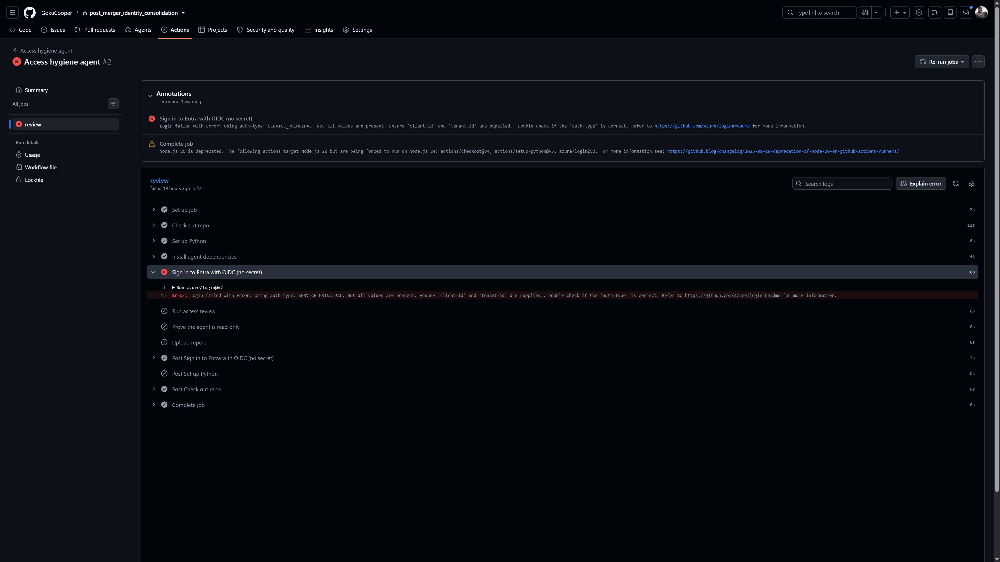
*Screenshot 102a, Beginning: the scheduled workflow had already run twice before the agent had an identity. With no client ID and no tenant ID, azure/login stopped before asking for a token. It failed closed: no identity, no data.*

### Part A: Register the agent and take the before picture

1. Registered `access_hygiene_agent` in Entra as a single tenant app with no redirect URI, because it never signs in a person (screenshots 102c and 102d).
2. Removed the default delegated `User.Read` and granted two **application** permissions with admin consent: `User.Read.All` (read users and the synced `dknSourceCompany` attribute) and `AuditLog.Read.All` (read last sign in). Nothing that writes (screenshot 102e).
3. Created a client secret that expired the next day and kept it only in the terminal's memory with `Read-Host -MaskInput`, never in a file (screenshots 102f and 102g).
4. Ran the agent locally. It signed in with the secret, found the synced attribute, and reviewed **12 Peachtree identities: all 12 enabled and never signed in** (screenshots 103 and 103a). The agent worked with just the two permissions, so `Directory.Read.All` was tested as unnecessary and left off.

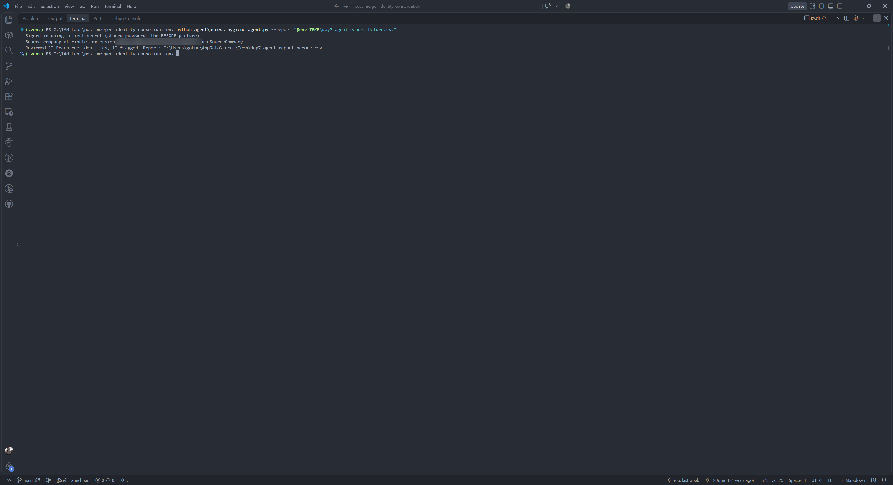
*Screenshot 103, the before picture. Line 1: `client_secret (stored password, the BEFORE picture)`.*

### Part B: Replace the secret with a trust rule

1. Added a federated credential that trusts exactly one workload: this repo's `access-agent` GitHub environment (screenshots 104e and 104f).
2. Configured the `access-agent` environment: deployments limited to `main`, and the client and tenant IDs stored as environment secrets so GitHub masks them as `***` in every log (screenshots 105 and 105a).
3. Patched the workflow and agent: IDs read from secrets, Node 24 action versions, and the tenant domain scrubbed from every UPN in the report (`achen@<tenant>`) (screenshots 106 to 106b).
4. Ran the workflow. It passed on the first try (screenshots 107 to 107e).
5. Deleted the client secret, cleared the terminal, and proved the old way is dead: the same agent run locally with no secret now fails with `CredentialUnavailableError` (screenshots 109 and 109a).

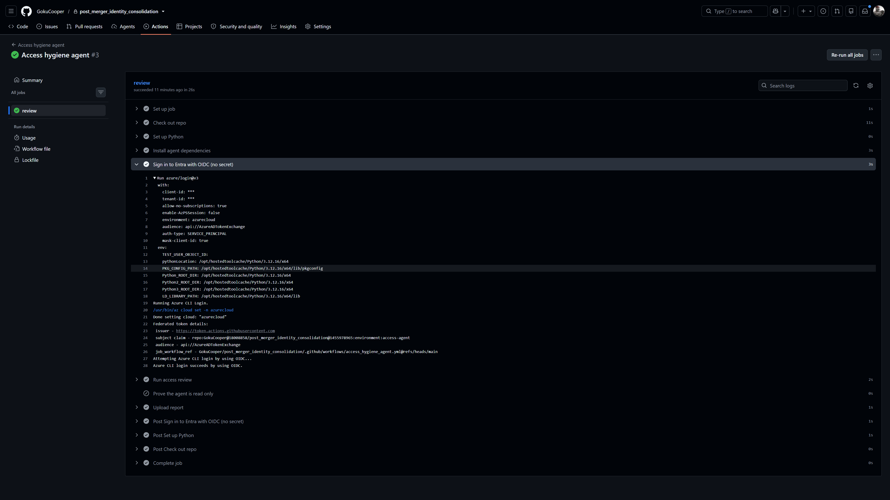
*Screenshot 107c, Middle: the subject GitHub put in the token, `repo:GokuCooper@18008858/post_merger_identity_consolidation@1455978965:environment:access-agent`, matches the federated credential character for character. The client and tenant IDs show as `***`.*

**Snags in Part B**

* **The Entra form wasn't the one in my notes.** The GitHub scenario now asks for the **Organization ID** and **Repository ID** and builds an *immutable* subject: `repo:{owner}@{owner_id}/{repo}@{repo_id}:...`. My workflow comments described the old name only format. Names can be reused: delete or rename a repo, and someone else can create one with the same name and inherit the trust. IDs are never reused. GitHub applies the ID format by default to repos created after July 15, 2026, and older repos keep the name format until someone opts in. Entra and GitHub have to agree exactly, so before building anything I confirmed this repo's first commit was 2026-11-12. That meant its tokens already carried IDs, and no opt in was needed (screenshots 104 to 104e).
* **`gh` was not installed.** Rather than install a tool for two numbers, I took the owner ID from the public GitHub API, the repo ID from the page source, and the creation date from the first commit (screenshots 104a to 104d).
* **The environment already existed, wide open.** GitHub creates an environment the first time a job names it, and the failed scheduled runs had done exactly that. It had no secrets and no branch rule. Existing is not the same as configured, so I locked it to `main` (screenshot 105a).
* **The negative test would have failed for the wrong reason.** It runs without the environment on purpose, so it cannot read environment secrets. Without a fix it would have stopped at "client-id missing", which proves nothing about Entra. The IDs went in as repository secrets too, so the test reaches Entra and gets rejected there (screenshot 106a).
* **A run log printed an ID from my blur list.** Run #3's log showed the full `extension_<app ID>_dknSourceCompany` name. Logs become public if the repo does. The agent now prints `extension_<app_id>_dknSourceCompany`, run #4 confirmed it, and run #3 was deleted (screenshots 107d to 108c).

### Part C: Prove the guardrails, not just the green check

A green run only proves the agent **can** do its job. I also needed proof it **can't** do anything else.

1. **Read only, tested.** The workflow made the agent try to change a lab user's job title. Graph answered **HTTP 403**, and the step passed *because* the write failed (screenshot 110a).
2. **Only the approved job, tested.** [`federation_negative_test.yml`](.github/workflows/federation_negative_test.yml) uses the same repo, the same branch, and the same app, but skips the environment. The subject changed to `...@1455978965:ref:refs/heads/main`, and Entra refused it: `AADSTS700213: No matching federated identity record found` (screenshots 111 and 111a).
3. **Closed an old loop.** Troubleshooting row 21 (Day 4) guessed that a Graph SDK warning came from using the tenant domain instead of the tenant GUID. I retested with the GUID and got the same warning, so the theory was wrong. The row now says so (screenshot 112).

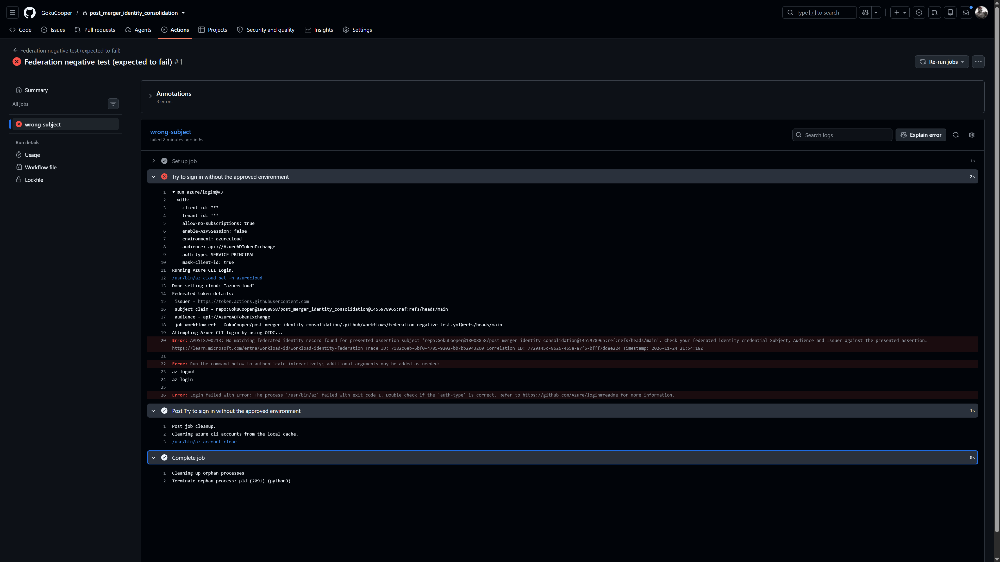
*Screenshot 111a: the same repo without the `access-agent` environment. Entra answered AADSTS700213.*

### Result

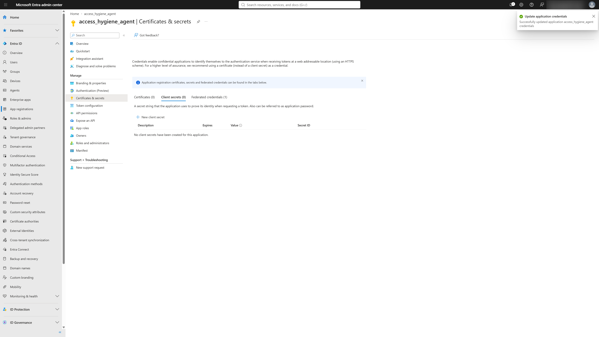
*Screenshot 109, End: Client secrets (0), Federated credentials (1). The only way in is a job on `main`, in the `access-agent` environment, in repo 1455978965.*

| Guardrail | Test | Result |
|---|---|---|
| No stored secret | Client secrets on the app after cutover, and a local run with the old method | 0 secrets (screenshot 109). Local run fails with `CredentialUnavailableError` (screenshot 109a) |
| Read only | Agent tries to change a user's job title | HTTP 403, PASS (screenshot 110a) |
| Only the approved job | Same repo and branch, no environment | AADSTS700213, rejected by Entra (screenshot 111a) |
| Nothing sensitive in logs or reports | Read every run log and the downloaded report | IDs masked as `***`, extension ID masked, UPNs scrubbed to `@<tenant>` (screenshots 107c, 108a, 108c) |
| A human owns it | NHI register | Owner DeJurnett, review due 2027-02-15 ([`evidence/day7_nhi_register.csv`](evidence/day7_nhi_register.csv)) |

| Measure | Before | After |
|---|---|---|
| Stored secrets the agent can use | 1 client secret | 0 |
| Where the agent can sign in from | Anywhere the secret is | One GitHub environment, `main` only |
| Graph permissions | Default delegated User.Read | 2 application permissions, read only, write proven blocked |
| Peachtree identities reviewed every Monday | 0 | 12 (12 flagged: enabled, never signed in) |

The finding itself matters too: **12 of 12 migrated Peachtree identities are enabled and have never signed in.** In a real merger those are live accounts nobody is watching, which is why they go into a certification rather than staying enabled by default. Report: [`evidence/day7_agent_report.csv`](evidence/day7_agent_report.csv).

### Engineer notes
* **A federated credential has three parts that must match exactly:** issuer (`https://token.actions.githubusercontent.com`), subject, and audience (`api://AzureADTokenExchange`). When it fails, the azure/login log prints the subject GitHub sent. Compare that line to the credential before changing anything else.
* **Two locks, owned by two systems.** Entra decides which subject it trusts, and GitHub decides which branches can enter the environment. Either one alone leaves a gap.
* **Identifiers are not secrets, but logs are not private.** Client and tenant IDs can't sign anyone in, yet they still went into secrets so GitHub masks them. If the repo goes public, every old run log and artifact goes with it.
* **Test the negative path.** A permission list and a green run are claims. A 403 and an AADSTS700213 are evidence.

### Real world mapping
Workload identity federation is how mature teams remove long lived secrets from CI/CD for Azure, AWS, and GCP alike. An agent with read access to every user is a privileged non human identity, so it gets what Day 6 gave the service accounts: a named owner, least privilege (NIST 800-53 AC-6), an entry in the NHI register (AC-2), and a recurring review. The new part is the credential: instead of a password you rotate, the trust is scoped to one workload and every token it uses is short lived and expires on its own.

---

## Final result

| Deliverable | Status | Evidence |
|---|---|---|
| Forest trust | Done | Screenshots 01 to 05b, `day1_trust_validation_after.txt` |
| GPO baseline and schema attribute | Done | Screenshots 06 to 11g, `day2_schema_oid.txt` |
| ADMT migration with SID history | Done | Screenshots 12 to 21a, `day3_migration_counts.csv` |
| Entra Connect sync | Done | Screenshots 22 to 28p, `day4_entra_source_company.csv` |
| SailPoint governance rebuild | Done | Screenshots 29 to 71a, `day5_target_state_mapping.csv` |
| CyberArk and service accounts | Done | Screenshots 72 to 101b, `day6_nhi_inventory_after.csv` |
| Agent with no stored secret | Done | Screenshots 102 to 114, `day7_agent_report.csv`, `day7_nhi_register.csv` |

---

## Verification log

| Day | What could have hidden a problem | How I checked | What the evidence showed |
|---|---|---|---|
| 1 | The trust wizard says "validated" from one side only, and a successful `net use` looks like access | Ran `02_Test-ForestTrust.ps1`, confirmed with `nltest /sc_verify`, and read a file as a Peachtree user inside and outside the DKN group | NERR_Success and the trust validated both ways. The member read the share. The non member got "Access is denied" on the file, also on a fresh session by IP |
| 3 | ADMT's summary counts can hide a skipped object or a wrong grant | Matched every source SID against target sIDHistory, and read the migration log line by line | Users 17 in source, 15 found, 15 with SID history, 1 renamed, 2 missing by design. Groups 6 of 6. The log showed DKN's Jamie Smith added to Peachtree groups, which the counts never would have |
| 4 | The Entra portal does not show directory extensions, and sync can drop a conflict without an error | Queried Microsoft Graph directly and compared AD to Graph for the planted duplicate | DKN 18 and Peachtree 12 carry `dknSourceCompany`. The duplicate alias was silently dropped, fixed at the source, and the after scan showed 0 duplicates |
| 6 | The CPM can report success while a service is broken, and dual control can still approve the wrong window | Restarted SQL and read Event Viewer after rotation. Read every request on its detail page. Checked PasswordLastSet on the DC after each CPM change | SQL failed with 7038 until the usage was added, then restarted with no logon errors. Request 2 was approved for 13 hours from the list view and then deleted. PasswordLastSet matched the CPM change times (3:09 and 3:16 AM) |
| 7 | A green run does not prove least privilege, and a run log can leak what a screenshot hides | Forced a write attempt and a wrong subject sign in. Read every run log and the downloaded report | Write attempt returned HTTP 403. The wrong subject got AADSTS700213. Run #3's log showed the extension app ID, so the agent output was masked and the run deleted. UPNs in the report read `@<tenant>` |

---

## What I would change before calling this production ready

* Start the trust with **selective authentication** and open it server by server.
* Use a **commercial migration tool** instead of ADMT.
* **Verify a real domain** in Entra before the first sync so users keep real UPNs.
* Turn **SID filtering back on** and remove SID history once shares are re permissioned.
* Keep the CyberArk reconcile account for Peachtree Tier 0 in its **own Safe**.
* Put the **access_hygiene_agent** identity in a recurring **SailPoint certification** with its owner, alongside the service accounts.
* Add **branch protection** on `main`, so the environment lock means reviewed code, not just any push to main.
* **Pin GitHub Actions by commit SHA** instead of major version tags.
* Add a **flexible federated credential** that also checks the `repository_id` claim, as Microsoft recommends on top of the immutable subject.
* Vault **IAMLAB\Administrator and PEACHTREE\Administrator** after writing and testing a break glass procedure.
* Shorten the PVWA **default request window** for Tier 0, turn on **multi level approval**, and **sign the PSM .rdp files** with a trusted certificate.
* Replace the shared `pam_reconcile` Domain Admin with a **delegated reconcile account** scoped to OU=ServiceAccounts.
* Turn on **TLS and client authentication for IQService**, and rename every SailPoint identity by employee ID so no identity is keyed by display name.

---

## Interview talking points (Problem, Solution, Impact, Learning)

**"Walk me through a directory consolidation."**
* **Problem:** DKN acquired Peachtree, a separate forest with 12 employees, shared Domain Admin passwords, ownerless service accounts, and a spreadsheet for access reviews. One username, `jsmith`, already existed at DKN.
* **Solution:** Connected the forests with DNS forwarders and a validated two way trust, built an acquired OU tree with its own baseline and a deny logon rule for the old admins, migrated 15 accounts and 6 groups with ADMT and SID history under a written collision rule, synced them to Entra ID with a custom source company attribute, and rebuilt their access in SailPoint with correlation on employee ID.
* **Impact:** 15 of 15 accounts and 6 of 6 groups kept their old access through SID history, 12 of 12 Peachtree users synced with their source tag, and all 15 legacy access lines got an owner and a decision, with 2 unapproved grants revoked and verified in AD.
* **Learning:** The summary is never the whole story. ADMT said 0 errors while it gave DKN's Jamie Smith another person's Peachtree access, and Entra said 0 errors while it dropped a duplicate address. The log and a source to target comparison caught both.

**"How do you rotate service account passwords without an outage?"**
* **Problem:** Peachtree's SQL service account came over from the migration with a password nobody knew, and rotating it would break SQL Server the next time it restarted.
* **Solution:** Found every usage with a script first, added the Windows Service usage in CyberArk so the CPM updates the service on every change, scoped the WMI and service manager firewall rules to the CPM only, and used a local admin logon account instead of a Domain Admin.
* **Impact:** svc_sql_pt rotates on a password only the vault knows, and SQL comes back after a restart. The reports account went one step further and became a gMSA, so there is no password to manage at all.
* **Learning:** A running service never rechecks its password, so a successful change proves nothing until the service restarts. The restart is the real test.

**"How would you govern AI agents?"**
* **Problem:** An automation agent needed to read every Peachtree identity in Entra ID. The easy path was a client secret, a password for a program that works from anywhere if it leaks.
* **Solution:** Treated the agent as an identity. A human owner in the NHI register, two read only Graph application permissions, and a federated credential that trusts one GitHub environment by immutable owner and repo ID, locked to `main`. Then I deleted the secret.
* **Impact:** Zero stored secrets. A write attempt returned 403, the same repo without the environment got AADSTS700213, and the first federated run found 12 of 12 migrated identities enabled and never signed in.
* **Learning:** A green run proves the agent can do its job, not that it can't do more. I also learned to treat CI logs as public: one printed an ID from my blur list, and the fix belonged in the code, not in a screenshot editor.

---

## Resume bullets

- Consolidated two Active Directory forests in a simulated acquisition: configured a two way forest trust, migrated 15 user accounts and 6 groups with ADMT and SID history, and resolved account naming collisions with a documented rule.
- Built a merger security baseline with Group Policy (acquired OU tree, deny logon for the acquired Domain Admins, a fine grained password policy for migrated users) and extended the AD schema with a custom source company attribute synced to Entra ID through Entra Connect.
- Migrated a legacy spreadsheet access process into SailPoint IdentityIQ: target state mapping, AD connector via IQService, correlation redesign, role mining, and four certifications that reviewed 39 items, revoked 2 unapproved grants verified in AD, and retired 3 orphaned legacy access lines.
- Brought 5 privileged and service accounts under CyberArk with dual control, PSM recorded sessions, and CPM rotation with Windows Service usages, replaced an unused service account with a gMSA, and raised service account compliance from 0 of 6 to 5 of 7 using a PowerShell NHI inventory and naming standard.
- Replaced an automation agent's client secret with Entra workload identity federation from GitHub Actions using immutable owner and repo ID subjects, proved read only Graph access with a blocked write (HTTP 403) and a rejected wrong subject sign in (AADSTS700213), and surfaced 12 of 12 migrated identities as enabled but never used.

---

## Repository layout

```
post_merger_identity_consolidation/
├── README.md
├── screenshots/        654 images, 00 to 114 (letter suffixes where a step needed more than one)
├── scripts/            12 PowerShell scripts, numbered in the order they run
├── agent/
│   ├── access_hygiene_agent.py
│   └── requirements.txt
├── .github/workflows/
│   ├── access_hygiene_agent.yml
│   └── federation_negative_test.yml
└── evidence/           CSV and TXT output from every script, plus the decision and troubleshooting logs
```

All names and accounts are lab data on the `iamlab.local` and `peachtree.local` domains. No passwords or client secrets appear in any screenshot or file. Tenant and object IDs are blurred. The Peachtree SIDs in the Day 3 evidence files and the domain GUID in the Day 1 trust output are kept on purpose: they come from throwaway lab domains, they can't sign anyone in, and the SID history proof depends on them. The full git history was scanned with gitleaks before publishing: one finding, a screenshot filename that looked like an API key, was reviewed and ignored by its exact fingerprint in `.gitleaksignore` (screenshot 114).

## Full screenshot index

654 screenshots. Each day is collapsed so the page stays readable. Click a day to expand it.

<details>
<summary><b>Overview</b> (1 screenshots)</summary>

| # | File | Shows |
|---|---|---|
| 00 | [`00_target_state_architecture.png`](screenshots/00_target_state_architecture.png) | Target state architecture |

</details>

<details>
<summary><b>Day 1: Connect the two forests</b> (20 screenshots)</summary>

| # | File | Shows |
|---|---|---|
| 01 | [`01_peachtree_forest_promoted.png`](screenshots/01_peachtree_forest_promoted.png) | Peachtree forest promoted |
| 01b | [`01b_peachtree_seed_complete.png`](screenshots/01b_peachtree_seed_complete.png) | Peachtree seed complete |
| 02 | [`02_trust_wizard_dns_failure.png`](screenshots/02_trust_wizard_dns_failure.png) | Trust wizard dns failure |
| 03a | [`03a_forwarder_iamlab_to_peachtree.png`](screenshots/03a_forwarder_iamlab_to_peachtree.png) | Forwarder iamlab to peachtree |
| 03b | [`03b_forwarder_peachtree_to_iamlab.png`](screenshots/03b_forwarder_peachtree_to_iamlab.png) | Forwarder peachtree to iamlab |
| 03c | [`03c_trust_wizard_forest_trust_option.png`](screenshots/03c_trust_wizard_forest_trust_option.png) | Trust wizard forest trust option |
| 03d | [`03d_trust_created_successfully.png`](screenshots/03d_trust_created_successfully.png) | Trust created successfully |
| 04 | [`04_forest_trust_validated.png`](screenshots/04_forest_trust_validated.png) | Forest trust validated |
| 04a | [`04a_trusts_tab_peachtree_both_directions.png`](screenshots/04a_trusts_tab_peachtree_both_directions.png) | Trusts tab peachtree both directions |
| 04b | [`04b_netdom_verify_access_denied.png`](screenshots/04b_netdom_verify_access_denied.png) | Netdom verify access denied |
| 04c | [`04c_nltest_sc_verify_success.png`](screenshots/04c_nltest_sc_verify_success.png) | Nltest sc verify success |
| 04d | [`04d_trust_validated_in_place_and_active.png`](screenshots/04d_trust_validated_in_place_and_active.png) | Trust validated in place and active |
| 04e | [`04e_name_suffix_routing_enabled.png`](screenshots/04e_name_suffix_routing_enabled.png) | Name suffix routing enabled |
| 04g | [`04g_forest_trust_info_suffix_intact.png`](screenshots/04g_forest_trust_info_suffix_intact.png) | Forest trust info suffix intact |
| 04h | [`04h_dc_memory_not_the_cause.png`](screenshots/04h_dc_memory_not_the_cause.png) | Dc memory not the cause |
| 04i | [`04i_dkn_projects_share_created.png`](screenshots/04i_dkn_projects_share_created.png) | Dkn projects share created |
| 04j | [`04j_peachtree_jsmith_added_to_dkn_group.png`](screenshots/04j_peachtree_jsmith_added_to_dkn_group.png) | Peachtree jsmith added to dkn group |
| 05 | [`05_peachtree_user_dkn_share_access.png`](screenshots/05_peachtree_user_dkn_share_access.png) | Peachtree user dkn share access |
| 05a | [`05a_peachtree_user_not_in_group_denied.png`](screenshots/05a_peachtree_user_not_in_group_denied.png) | Peachtree user not in group denied |
| 05b | [`05b_mlopez_denied_fresh_session_by_ip.png`](screenshots/05b_mlopez_denied_fresh_session_by_ip.png) | Mlopez denied fresh session by ip |

</details>

<details>
<summary><b>Day 2: GPO and schema</b> (23 screenshots)</summary>

| # | File | Shows |
|---|---|---|
| 06 | [`06_dknmig01_static_ip_fixed.png`](screenshots/06_dknmig01_static_ip_fixed.png) | Dknmig01 static ip fixed |
| 06a | [`06a_dknmig01_joined_iamlab.png`](screenshots/06a_dknmig01_joined_iamlab.png) | Dknmig01 joined iamlab |
| 06b | [`06b_dknmig01_default_computers_container.png`](screenshots/06b_dknmig01_default_computers_container.png) | Dknmig01 default computers container |
| 06c | [`06c_acquired_ou_structure.png`](screenshots/06c_acquired_ou_structure.png) | Acquired ou structure |
| 06d | [`06d_acquired_ou_tree_aduc.png`](screenshots/06d_acquired_ou_tree_aduc.png) | Acquired ou tree aduc |
| 07 | [`07_baseline_gpo_not_applied.png`](screenshots/07_baseline_gpo_not_applied.png) | Baseline gpo not applied |
| 08 | [`08_dknmig01_moved_to_acquired_ou.png`](screenshots/08_dknmig01_moved_to_acquired_ou.png) | Dknmig01 moved to acquired ou |
| 09 | [`09_baseline_gpo_applied.png`](screenshots/09_baseline_gpo_applied.png) | Baseline gpo applied |
| 09a | [`09a_baseline_registry_values.png`](screenshots/09a_baseline_registry_values.png) | Baseline registry values |
| 09b | [`09b_legal_notice_at_logon.png`](screenshots/09b_legal_notice_at_logon.png) | Legal notice at logon |
| 10 | [`10_peachtree_admin_logon_before_deny.png`](screenshots/10_peachtree_admin_logon_before_deny.png) | Peachtree admin logon before deny |
| 10a | [`10a_deny_logon_gpo_settings.png`](screenshots/10a_deny_logon_gpo_settings.png) | Deny logon gpo settings |
| 10b | [`10b_deny_gpo_applied.png`](screenshots/10b_deny_gpo_applied.png) | Deny gpo applied |
| 10c | [`10c_peachtree_administrator_signin_attempt.png`](screenshots/10c_peachtree_administrator_signin_attempt.png) | Peachtree administrator signin attempt |
| 10d | [`10d_peachtree_administrator_logon_denied.png`](screenshots/10d_peachtree_administrator_logon_denied.png) | Peachtree administrator logon denied |
| 10e | [`10e_pso_peachtree_migrated_users.png`](screenshots/10e_pso_peachtree_migrated_users.png) | Pso peachtree migrated users |
| 11a | [`11a_schema_create_attribute_form.png`](screenshots/11a_schema_create_attribute_form.png) | Schema create attribute form |
| 11b | [`11b_schema_snapin_error.png`](screenshots/11b_schema_snapin_error.png) | Schema snapin error |
| 11c | [`11c_schema_attribute_verified.png`](screenshots/11c_schema_attribute_verified.png) | Schema attribute verified |
| 11d | [`11d_user_class_has_dknsourcecompany.png`](screenshots/11d_user_class_has_dknsourcecompany.png) | User class has dknsourcecompany |
| 11e | [`11e_stamp_script_old_version_error.png`](screenshots/11e_stamp_script_old_version_error.png) | Stamp script old version error |
| 11f | [`11f_stamp_dkn_whatif.png`](screenshots/11f_stamp_dkn_whatif.png) | Stamp dkn whatif |
| 11g | [`11g_dkn_stamp_before_all_blank.png`](screenshots/11g_dkn_stamp_before_all_blank.png) | Dkn stamp before all blank |

</details>

<details>
<summary><b>Day 3: ADMT migration</b> (66 screenshots)</summary>

| # | File | Shows |
|---|---|---|
| 12 | [`12_sql_express_installed.png`](screenshots/12_sql_express_installed.png) | Sql express installed |
| 12a | [`12a_admt_console_wizards.png`](screenshots/12a_admt_console_wizards.png) | Admt console wizards |
| 12b | [`12b_iamlab_admin_in_peachtree_administrators.png`](screenshots/12b_iamlab_admin_in_peachtree_administrators.png) | Iamlab admin in peachtree administrators |
| 12c | [`12c_peachtree_dollar_group_and_tcpip.png`](screenshots/12c_peachtree_dollar_group_and_tcpip.png) | Peachtree dollar group and tcpip |
| 12d | [`12d_trust_sid_history_enabled.png`](screenshots/12d_trust_sid_history_enabled.png) | Trust sid history enabled |
| 12e | [`12e_audit_policy_gpo_iamlab.png`](screenshots/12e_audit_policy_gpo_iamlab.png) | Audit policy gpo iamlab |
| 12f | [`12f_audit_account_mgmt_peachtree.png`](screenshots/12f_audit_account_mgmt_peachtree.png) | Audit account mgmt peachtree |
| 12g | [`12g_audit_policy_gpo_peachtree.png`](screenshots/12g_audit_policy_gpo_peachtree.png) | Audit policy gpo peachtree |
| 12h | [`12h_audit_account_mgmt_peachtree.png`](screenshots/12h_audit_account_mgmt_peachtree.png) | Audit account mgmt peachtree |
| 12i | [`12i_peachtree_before_export.png`](screenshots/12i_peachtree_before_export.png) | Peachtree before export |
| 12j | [`12j_peachtree_source_users_table.png`](screenshots/12j_peachtree_source_users_table.png) | Peachtree source users table |
| 12k | [`12k_group_migration_options.png`](screenshots/12k_group_migration_options.png) | Group migration options |
| 12k1 | [`12k1_group_selection.png`](screenshots/12k1_group_selection.png) | Group selection |
| 12k2 | [`12k2_group_target_ou.png`](screenshots/12k2_group_target_ou.png) | Group target ou |
| 12k3 | [`12k3_sid_history_credentials.png`](screenshots/12k3_sid_history_credentials.png) | Sid history credentials |
| 12l | [`12l_group_migration_complete.png`](screenshots/12l_group_migration_complete.png) | Group migration complete |
| 12m | [`12m_groups_with_sid_history.png`](screenshots/12m_groups_with_sid_history.png) | Groups with sid history |
| 12n | [`12n_new_aduser_password_then_exists.png`](screenshots/12n_new_aduser_password_then_exists.png) | New aduser password then exists |
| 12o | [`12o_dkn_jsmith_fixed.png`](screenshots/12o_dkn_jsmith_fixed.png) | Dkn jsmith fixed |
| 13 | [`13_user_selection_12_people.png`](screenshots/13_user_selection_12_people.png) | User selection 12 people |
| 13a | [`13a_user_account_transition_sid.png`](screenshots/13a_user_account_transition_sid.png) | User account transition sid |
| 13b | [`13b_user_options_fix_memberships.png`](screenshots/13b_user_options_fix_memberships.png) | User options fix memberships |
| 13c | [`13c_conflict_management_do_not_migrate.png`](screenshots/13c_conflict_management_do_not_migrate.png) | Conflict management do not migrate |
| 13d | [`13d_user_migration_11_of_12.png`](screenshots/13d_user_migration_11_of_12.png) | User migration 11 of 12 |
| 13e | [`13e_service_accounts_selected.png`](screenshots/13e_service_accounts_selected.png) | Service accounts selected |
| 13e1 | [`13e1_service_accounts_target_ou.png`](screenshots/13e1_service_accounts_target_ou.png) | Service accounts target ou |
| 13f | [`13f_service_accounts_migrated.png`](screenshots/13f_service_accounts_migrated.png) | Service accounts migrated |
| 13g | [`13g_service_accounts_log_wrn7874.png`](screenshots/13g_service_accounts_log_wrn7874.png) | Service accounts log wrn7874 |
| 13h | [`13h_sqlsvc_spn_check.png`](screenshots/13h_sqlsvc_spn_check.png) | Sqlsvc spn check |
| 14 | [`14_1_jsmith_conflict_in_log_context.png`](screenshots/14_1_jsmith_conflict_in_log_context.png) | 1 jsmith conflict in log context |
| 14 | [`14_jsmith_name_conflict.png`](screenshots/14_jsmith_name_conflict.png) | Jsmith name conflict |
| 14a | [`14a_jamie_smith_wrong_groups.png`](screenshots/14a_jamie_smith_wrong_groups.png) | Jamie smith wrong groups |
| 14b | [`14b_jamie_smith_access_removed.png`](screenshots/14b_jamie_smith_access_removed.png) | Jamie smith access removed |
| 14c | [`14c_jsmith_pt_include_file.png`](screenshots/14c_jsmith_pt_include_file.png) | Jsmith pt include file |
| 14c1 | [`14c1_include_file_selection.png`](screenshots/14c1_include_file_selection.png) | Include file selection |
| 14d | [`14d_jsmith_pt_migrated.png`](screenshots/14d_jsmith_pt_migrated.png) | Jsmith pt migrated |
| 14e | [`14e_jsmith_pt_verified_jamie_clean.png`](screenshots/14e_jsmith_pt_verified_jamie_clean.png) | Jsmith pt verified jamie clean |
| 15 | [`15_migration_compare_counts.png`](screenshots/15_migration_compare_counts.png) | Migration compare counts |
| 16 | [`16_peachtree_stamp_whatif_stale_message.png`](screenshots/16_peachtree_stamp_whatif_stale_message.png) | Peachtree stamp whatif stale message |
| 16a | [`16a_stale_script_and_no_evidence.png`](screenshots/16a_stale_script_and_no_evidence.png) | Stale script and no evidence |
| 16c | [`16c_v3_script_confirmed.png`](screenshots/16c_v3_script_confirmed.png) | V3 script confirmed |
| 16d | [`16d_peachtree_stamp_whatif_fixed.png`](screenshots/16d_peachtree_stamp_whatif_fixed.png) | Peachtree stamp whatif fixed |
| 16e | [`16e_peachtree_stamp_applied.png`](screenshots/16e_peachtree_stamp_applied.png) | Peachtree stamp applied |
| 16f | [`16f_peachtree_stamp_evidence_csv.png`](screenshots/16f_peachtree_stamp_evidence_csv.png) | Peachtree stamp evidence csv |
| 16g | [`16g_source_company_totals.png`](screenshots/16g_source_company_totals.png) | Source company totals |
| 16h | [`16h_dkn_18_explained.png`](screenshots/16h_dkn_18_explained.png) | Dkn 18 explained |
| 17 | [`17_migrated_users_group_populated.png`](screenshots/17_migrated_users_group_populated.png) | Migrated users group populated |
| 17a | [`17a_jsmith_pt_pso_vs_jamie_default.png`](screenshots/17a_jsmith_pt_pso_vs_jamie_default.png) | Jsmith pt pso vs jamie default |
| 18 | [`18_dispatch_share_peachtree_only.png`](screenshots/18_dispatch_share_peachtree_only.png) | Dispatch share peachtree only |
| 18a | [`18a_reset_wrong_domain_error.png`](screenshots/18a_reset_wrong_domain_error.png) | Reset wrong domain error |
| 18b | [`18b_jsmith_pt_reset_ok.png`](screenshots/18b_jsmith_pt_reset_ok.png) | Jsmith pt reset ok |
| 19 | [`19_jsmith_pt_path_not_found.png`](screenshots/19_jsmith_pt_path_not_found.png) | Jsmith pt path not found |
| 19a | [`19a_net_use_1909_locked_out.png`](screenshots/19a_net_use_1909_locked_out.png) | Net use 1909 locked out |
| 19b | [`19b_jsmith_pt_locked_by_pso.png`](screenshots/19b_jsmith_pt_locked_by_pso.png) | Jsmith pt locked by pso |
| 19c | [`19c_event_4740_lockout_source.png`](screenshots/19c_event_4740_lockout_source.png) | Event 4740 lockout source |
| 19d | [`19d_jsmith_pt_unlocked.png`](screenshots/19d_jsmith_pt_unlocked.png) | Jsmith pt unlocked |
| 19e | [`19e_jsmith_pt_reads_peachtree_share.png`](screenshots/19e_jsmith_pt_reads_peachtree_share.png) | Jsmith pt reads peachtree share |
| 19f | [`19f_jamie_net_use_succeeded.png`](screenshots/19f_jamie_net_use_succeeded.png) | Jamie net use succeeded |
| 19g | [`19g_jamie_file_access_denied.png`](screenshots/19g_jamie_file_access_denied.png) | Jamie file access denied |
| 19h | [`19h_dispatch_share_permissions.png`](screenshots/19h_dispatch_share_permissions.png) | Dispatch share permissions |
| 19i | [`19i_jamie_groups_clean.png`](screenshots/19i_jamie_groups_clean.png) | Jamie groups clean |
| 19j | [`19j_jamie_cannot_list_share.png`](screenshots/19j_jamie_cannot_list_share.png) | Jamie cannot list share |
| 20 | [`20_peachtree_admins_before_cleanup.png`](screenshots/20_peachtree_admins_before_cleanup.png) | Peachtree admins before cleanup |
| 20a | [`20a_peachtree_admins_after_cleanup.png`](screenshots/20a_peachtree_admins_after_cleanup.png) | Peachtree admins after cleanup |
| 21 | [`21_admt_evidence_staged_no_passwords.png`](screenshots/21_admt_evidence_staged_no_passwords.png) | Admt evidence staged no passwords |
| 21a | [`21a_gitignore_blocks_passwords.png`](screenshots/21a_gitignore_blocks_passwords.png) | Gitignore blocks passwords |

</details>

<details>
<summary><b>Day 4: Entra Connect</b> (53 screenshots)</summary>

| # | File | Shows |
|---|---|---|
| 22 | [`22_trust_referral_rc4_before.png`](screenshots/22_trust_referral_rc4_before.png) | Trust referral rc4 before |
| 22a | [`22a_iamlab_trust_aes_enabled.png`](screenshots/22a_iamlab_trust_aes_enabled.png) | Iamlab trust aes enabled |
| 22b | [`22b_peachtree_trust_aes_enabled.png`](screenshots/22b_peachtree_trust_aes_enabled.png) | Peachtree trust aes enabled |
| 22c | [`22c_trust_referral_aes_after.png`](screenshots/22c_trust_referral_aes_after.png) | Trust referral aes after |
| 23 | [`23_dknsync01_dhcp_starting_state.png`](screenshots/23_dknsync01_dhcp_starting_state.png) | Dknsync01 dhcp starting state |
| 23a | [`23a_iamlab_ou_list_no_users_or_servers_ou.png`](screenshots/23a_iamlab_ou_list_no_users_or_servers_ou.png) | Iamlab ou list no users or servers ou |
| 23b0 | [`23b0_tier0_ou_not_found_yet.png`](screenshots/23b0_tier0_ou_not_found_yet.png) | Tier0 ou not found yet |
| 23b | [`23b_tier0_servers_ou_created.png`](screenshots/23b_tier0_servers_ou_created.png) | Tier0 servers ou created |
| 23c | [`23c_dknsync01_network_verified.png`](screenshots/23c_dknsync01_network_verified.png) | Dknsync01 network verified |
| 23e | [`23e_dknsync01_in_tier0_ou.png`](screenshots/23e_dknsync01_in_tier0_ou.png) | Dknsync01 in tier0 ou |
| 24 | [`24_sync_blocker_script_v2_confirmed.png`](screenshots/24_sync_blocker_script_v2_confirmed.png) | Sync blocker script v2 confirmed |
| 24a | [`24a_jsmith_accounts_before_planting.png`](screenshots/24a_jsmith_accounts_before_planting.png) | Jsmith accounts before planting |
| 24b0 | [`24b0_proxyaddress_blank_tenant.png`](screenshots/24b0_proxyaddress_blank_tenant.png) | Proxyaddress blank tenant |
| 24b | [`24b_duplicate_proxyaddress_planted.png`](screenshots/24b_duplicate_proxyaddress_planted.png) | Duplicate proxyaddress planted |
| 24c | [`24c_sync_blockers_before.png`](screenshots/24c_sync_blockers_before.png) | Sync blockers before |
| 25 | [`25_entra_tenant_before_sync.png`](screenshots/25_entra_tenant_before_sync.png) | Entra tenant before sync |
| 25a | [`25a_entra_connect_installer_version.png`](screenshots/25a_entra_connect_installer_version.png) | Entra connect installer version |
| 25b | [`25b_user_signin_phs.png`](screenshots/25b_user_signin_phs.png) | User signin phs |
| 25c0 | [`25c0_ou_filter_peachtree_parent_checked.png`](screenshots/25c0_ou_filter_peachtree_parent_checked.png) | Ou filter peachtree parent checked |
| 25c | [`25c_ou_filtering.png`](screenshots/25c_ou_filtering.png) | Ou filtering |
| 25d | [`25d_optional_features.png`](screenshots/25d_optional_features.png) | Optional features |
| 25e | [`25e_directory_extension_dknsourcecompany.png`](screenshots/25e_directory_extension_dknsourcecompany.png) | Directory extension dknsourcecompany |
| 25f | [`25f_ready_to_configure.png`](screenshots/25f_ready_to_configure.png) | Ready to configure |
| 25g | [`25g_configuration_complete.png`](screenshots/25g_configuration_complete.png) | Configuration complete |
| 25h | [`25h_ad_recycle_bin_enabled.png`](screenshots/25h_ad_recycle_bin_enabled.png) | Ad recycle bin enabled |
| 26 | [`26_upn_suffix_not_added_warning.png`](screenshots/26_upn_suffix_not_added_warning.png) | Upn suffix not added warning |
| 27 | [`27_scheduler_enabled_initial_sync_started.png`](screenshots/27_scheduler_enabled_initial_sync_started.png) | Scheduler enabled initial sync started |
| 27a | [`27a_sync_service_manager_operations.png`](screenshots/27a_sync_service_manager_operations.png) | Sync service manager operations |
| 27b | [`27b_aad_export_adds.png`](screenshots/27b_aad_export_adds.png) | Aad export adds |
| 27c | [`27c_entra_users_after_sync.png`](screenshots/27c_entra_users_after_sync.png) | Entra users after sync |
| 28 | [`28_connect_health_zero_errors_data_lag.png`](screenshots/28_connect_health_zero_errors_data_lag.png) | Connect health zero errors data lag |
| 28a | [`28a_graph_alias_dropped_no_error.png`](screenshots/28a_graph_alias_dropped_no_error.png) | Graph alias dropped no error |
| 28a1 | [`28a1_graph_beta_no_errors_either.png`](screenshots/28a1_graph_beta_no_errors_either.png) | Graph beta no errors either |
| 28b0 | [`28b0_connect_mggraph_not_recognized.png`](screenshots/28b0_connect_mggraph_not_recognized.png) | Connect mggraph not recognized |
| 28b | [`28b_graph_module_installed_but_not_found.png`](screenshots/28b_graph_module_installed_but_not_found.png) | Graph module installed but not found |
| 28c | [`28c_module_path_mismatch.png`](screenshots/28c_module_path_mismatch.png) | Module path mismatch |
| 28d | [`28d_connect_mggraph_typeload_error.png`](screenshots/28d_connect_mggraph_typeload_error.png) | Connect mggraph typeload error |
| 28e | [`28e_msal_not_the_conflict.png`](screenshots/28e_msal_not_the_conflict.png) | Msal not the conflict |
| 28e1 | [`28e1_azure_libraries_all_from_graph.png`](screenshots/28e1_azure_libraries_all_from_graph.png) | Azure libraries all from graph |
| 28f0 | [`28f0_uninstall_module_in_use.png`](screenshots/28f0_uninstall_module_in_use.png) | Uninstall module in use |
| 28f | [`28f_graph_removed_from_tier0.png`](screenshots/28f_graph_removed_from_tier0.png) | Graph removed from tier0 |
| 28g | [`28g_host_pwsh7_confirmed.png`](screenshots/28g_host_pwsh7_confirmed.png) | Host pwsh7 confirmed |
| 28h | [`28h_wam_wrong_account_type.png`](screenshots/28h_wam_wrong_account_type.png) | Wam wrong account type |
| 28i | [`28i_graph_consent_user_only.png`](screenshots/28i_graph_consent_user_only.png) | Graph consent user only |
| 28j | [`28j_alias_removed_at_source.png`](screenshots/28j_alias_removed_at_source.png) | Alias removed at source |
| 28k | [`28k_delta_sync_after_fix.png`](screenshots/28k_delta_sync_after_fix.png) | Delta sync after fix |
| 28l | [`28l_sync_blockers_after_zero.png`](screenshots/28l_sync_blockers_after_zero.png) | Sync blockers after zero |
| 28m0 | [`28m0_script08_blocked_not_signed.png`](screenshots/28m0_script08_blocked_not_signed.png) | Script08 blocked not signed |
| 28m1 | [`28m1_mark_of_the_web_zoneid3.png`](screenshots/28m1_mark_of_the_web_zoneid3.png) | Mark of the web zoneid3 |
| 28m2 | [`28m2_unblocked_stream_gone.png`](screenshots/28m2_unblocked_stream_gone.png) | Unblocked stream gone |
| 28o | [`28o_source_company_synced_to_entra.png`](screenshots/28o_source_company_synced_to_entra.png) | Source company synced to entra |
| 28p0 | [`28p0_scrub_ran_on_ad_machine.png`](screenshots/28p0_scrub_ran_on_ad_machine.png) | Scrub ran on ad machine |
| 28p | [`28p_tenant_scrubbed_on_host.png`](screenshots/28p_tenant_scrubbed_on_host.png) | Tenant scrubbed on host |

</details>

<details>
<summary><b>Day 5: SailPoint IdentityIQ</b> (299 screenshots)</summary>

| # | File | Shows |
|---|---|---|
| 29 | [`29_legacy_access_spreadsheet.png`](screenshots/29_legacy_access_spreadsheet.png) | Legacy access spreadsheet |
| 29a | [`29a_ad_group_membership_reality.png`](screenshots/29a_ad_group_membership_reality.png) | Ad group membership reality |
| 29b | [`29b_helpdesk_admin_group_split.png`](screenshots/29b_helpdesk_admin_group_split.png) | Helpdesk admin group split |
| 30 | [`30_target_state_mapping.png`](screenshots/30_target_state_mapping.png) | Target state mapping |
| 30a | [`30a_service_account_ous.png`](screenshots/30a_service_account_ous.png) | Service account ous |
| 31 | [`31_svc_iiq_dkn_created.png`](screenshots/31_svc_iiq_dkn_created.png) | Svc iiq dkn created |
| 31a | [`31a_svc_iiq_dkn_scoped_rights.png`](screenshots/31a_svc_iiq_dkn_scoped_rights.png) | Svc iiq dkn scoped rights |
| 31b | [`31b_raw_acl_writeproperty_not_self.png`](screenshots/31b_raw_acl_writeproperty_not_self.png) | Raw acl writeproperty not self |
| 32 | [`32_iqservice_zip_found.png`](screenshots/32_iqservice_zip_found.png) | Iqservice zip found |
| 32a | [`32a_iqservice_installed_running.png`](screenshots/32a_iqservice_installed_running.png) | Iqservice installed running |
| 32b | [`32b_host_to_lab_port_test.png`](screenshots/32b_host_to_lab_port_test.png) | Host to lab port test |
| 32c | [`32c_listening_locally_firewall_on.png`](screenshots/32c_listening_locally_firewall_on.png) | Listening locally firewall on |
| 32d | [`32d_firewall_rule_scoped_to_host.png`](screenshots/32d_firewall_rule_scoped_to_host.png) | Firewall rule scoped to host |
| 32e | [`32e_iqservice_port_open_from_host.png`](screenshots/32e_iqservice_port_open_from_host.png) | Iqservice port open from host |
| 33 | [`33_test_connection_domain_forest_required.png`](screenshots/33_test_connection_domain_forest_required.png) | Test connection domain forest required |
| 33a | [`33a_save_blocked_domain_forest_required.png`](screenshots/33a_save_blocked_domain_forest_required.png) | Save blocked domain forest required |
| 33b | [`33b_debug_app_never_saved.png`](screenshots/33b_debug_app_never_saved.png) | Debug app never saved |
| 33c | [`33c_fresh_save_other_browser.png`](screenshots/33c_fresh_save_other_browser.png) | Fresh save other browser |
| 33d | [`33d_tomcat_log_on_save.png`](screenshots/33d_tomcat_log_on_save.png) | Tomcat log on save |
| 33e | [`33e_browser_console_on_save.png`](screenshots/33e_browser_console_on_save.png) | Browser console on save |
| 33f | [`33f_forest_row_added.png`](screenshots/33f_forest_row_added.png) | Forest row added |
| 33g | [`33g_domain_row_added.png`](screenshots/33g_domain_row_added.png) | Domain row added |
| 33g1 | [`33g1_discover_found_iamlab_domain.png`](screenshots/33g1_discover_found_iamlab_domain.png) | Discover found iamlab domain |
| 33h | [`33h_app_saved_in_list.png`](screenshots/33h_app_saved_in_list.png) | App saved in list |
| 33i | [`33i_test_connection_successful.png`](screenshots/33i_test_connection_successful.png) | Test connection successful |
| 33j | [`33j_group_search_scope_added.png`](screenshots/33j_group_search_scope_added.png) | Group search scope added |
| 34 | [`34_schema_employeeid_sourcecompany.png`](screenshots/34_schema_employeeid_sourcecompany.png) | Schema employeeid sourcecompany |
| 34a | [`34a_hr_feed_file_path.png`](screenshots/34a_hr_feed_file_path.png) | Hr feed file path |
| 34b | [`34b_hr_feed_schema_identity_attribute.png`](screenshots/34b_hr_feed_schema_identity_attribute.png) | Hr feed schema identity attribute |
| 34c | [`34c_hr_feed_header.png`](screenshots/34c_hr_feed_header.png) | Hr feed header |
| 35 | [`35_hr_name_collision_check.png`](screenshots/35_hr_name_collision_check.png) | Hr name collision check |
| 35a | [`35a_hr_feed_with_peachtree.png`](screenshots/35a_hr_feed_with_peachtree.png) | Hr feed with peachtree |
| 35b | [`35b_hr_aggregation_11_created_13_updated.png`](screenshots/35b_hr_aggregation_11_created_13_updated.png) | Hr aggregation 11 created 13 updated |
| 35c | [`35c_identity_warehouse_one_marcus_reed.png`](screenshots/35c_identity_warehouse_one_marcus_reed.png) | Identity warehouse one marcus reed |
| 35d | [`35d_marcus_reed_two_hr_accounts.png`](screenshots/35d_marcus_reed_two_hr_accounts.png) | Marcus reed two hr accounts |
| 35d1 | [`35d1_merged_accounts_e1002_pt1003.png`](screenshots/35d1_merged_accounts_e1002_pt1003.png) | Merged accounts e1002 pt1003 |
| 35e | [`35e_hr_feed_correlation_config.png`](screenshots/35e_hr_feed_correlation_config.png) | Hr feed correlation config |
| 36 | [`36_hr_creation_rule_assigned.png`](screenshots/36_hr_creation_rule_assigned.png) | Hr creation rule assigned |
| 36a | [`36a_hr_creation_rule_source.png`](screenshots/36a_hr_creation_rule_source.png) | Hr creation rule source |
| 36b | [`36b_pt1003_link_removed.png`](screenshots/36b_pt1003_link_removed.png) | Pt1003 link removed |
| 36c | [`36c_hr_aggregation_zero_created.png`](screenshots/36c_hr_aggregation_zero_created.png) | Hr aggregation zero created |
| 36d | [`36d_pt1003_merged_again.png`](screenshots/36d_pt1003_merged_again.png) | Pt1003 merged again |
| 36e | [`36e_merged_identity_attributes_e1002.png`](screenshots/36e_merged_identity_attributes_e1002.png) | Merged identity attributes e1002 |
| 36g0 | [`36g0_display_attribute_displayname_before.png`](screenshots/36g0_display_attribute_displayname_before.png) | Display attribute displayname before |
| 36g | [`36g_hr_display_attribute_employeeid.png`](screenshots/36g_hr_display_attribute_employeeid.png) | Hr display attribute employeeid |
| 36h | [`36h_pt1003_link_removed_again.png`](screenshots/36h_pt1003_link_removed_again.png) | Pt1003 link removed again |
| 36i | [`36i_hr_aggregation_one_created.png`](screenshots/36i_hr_aggregation_one_created.png) | Hr aggregation one created |
| 36j | [`36j_two_marcus_reeds.png`](screenshots/36j_two_marcus_reeds.png) | Two marcus reeds |
| 37 | [`37_ad_correlation_employeeid.png`](screenshots/37_ad_correlation_employeeid.png) | Ad correlation employeeid |
| 37a | [`37a_ad_aggregation_task_settings.png`](screenshots/37a_ad_aggregation_task_settings.png) | Ad aggregation task settings |
| 37b | [`37b_ad_aggregation_results.png`](screenshots/37b_ad_aggregation_results.png) | Ad aggregation results |
| 37c | [`37c_dkn_marcus_reed_no_mreed.png`](screenshots/37c_dkn_marcus_reed_no_mreed.png) | Dkn marcus reed no mreed |
| 37d | [`37d_pt1003_attributes.png`](screenshots/37d_pt1003_attributes.png) | Pt1003 attributes |
| 37e | [`37e_pt1003_has_mreed.png`](screenshots/37e_pt1003_has_mreed.png) | Pt1003 has mreed |
| 37f | [`37f_jordan_smith_has_jsmith_pt.png`](screenshots/37f_jordan_smith_has_jsmith_pt.png) | Jordan smith has jsmith pt |
| 38 | [`38_peachtree_group_count.png`](screenshots/38_peachtree_group_count.png) | Peachtree group count |
| 38a | [`38a_peachtree_group_names.png`](screenshots/38a_peachtree_group_names.png) | Peachtree group names |
| 38b | [`38b_group_aggregation_task_settings.png`](screenshots/38b_group_aggregation_task_settings.png) | Group aggregation task settings |
| 38c | [`38c_group_aggregation_results.png`](screenshots/38c_group_aggregation_results.png) | Group aggregation results |
| 38d | [`38d_entitlement_catalog_peachtree.png`](screenshots/38d_entitlement_catalog_peachtree.png) | Entitlement catalog peachtree |
| 38e | [`38e_dkn_iam_team_workgroup.png`](screenshots/38e_dkn_iam_team_workgroup.png) | Dkn iam team workgroup |
| 38f | [`38f_helpdesk_admin_owner_pt1003.png`](screenshots/38f_helpdesk_admin_owner_pt1003.png) | Helpdesk admin owner pt1003 |
| 38g | [`38g_entitlement_catalog_owned.png`](screenshots/38g_entitlement_catalog_owned.png) | Entitlement catalog owned |
| 38h | [`38h_owner_picker_shows_pt1003.png`](screenshots/38h_owner_picker_shows_pt1003.png) | Owner picker shows pt1003 |
| 38i | [`38i_helpdesk_admin_owner_xml_pt1003.png`](screenshots/38i_helpdesk_admin_owner_xml_pt1003.png) | Helpdesk admin owner xml pt1003 |
| 38j | [`38j_object_browser_entitlement_owners.png`](screenshots/38j_object_browser_entitlement_owners.png) | Object browser entitlement owners |
| 39 | [`39_hr_feed_company_column.png`](screenshots/39_hr_feed_company_column.png) | Hr feed company column |
| 39a | [`39a_hr_feed_quoted_header.png`](screenshots/39a_hr_feed_quoted_header.png) | Hr feed quoted header |
| 39b | [`39b_hr_settings_no_text_qualifier.png`](screenshots/39b_hr_settings_no_text_qualifier.png) | Hr settings no text qualifier |
| 39c | [`39c_hr_feed_quotes_removed.png`](screenshots/39c_hr_feed_quotes_removed.png) | Hr feed quotes removed |
| 39d | [`39d_hr_schema_company.png`](screenshots/39d_hr_schema_company.png) | Hr schema company |
| 39e | [`39e_identity_mapping_company.png`](screenshots/39e_identity_mapping_company.png) | Identity mapping company |
| 39e1 | [`39e1_identity_attributes_list.png`](screenshots/39e1_identity_attributes_list.png) | Identity attributes list |
| 39f | [`39f_hr_aggregation_with_company.png`](screenshots/39f_hr_aggregation_with_company.png) | Hr aggregation with company |
| 39g | [`39g_e1002_attributes_company_missing.png`](screenshots/39g_e1002_attributes_company_missing.png) | E1002 attributes company missing |
| 39g1 | [`39g1_pt1003_attributes_company_missing.png`](screenshots/39g1_pt1003_attributes_company_missing.png) | Pt1003 attributes company missing |
| 39h | [`39h_pt1003_hr_account_company_peachtree.png`](screenshots/39h_pt1003_hr_account_company_peachtree.png) | Pt1003 hr account company peachtree |
| 39h1 | [`39h1_e1002_hr_account_company_dkn.png`](screenshots/39h1_e1002_hr_account_company_dkn.png) | E1002 hr account company dkn |
| 39i | [`39i_pt1003_identity_xml_company.png`](screenshots/39i_pt1003_identity_xml_company.png) | Pt1003 identity xml company |
| 40 | [`40_it_role_owner_pt1003_picker.png`](screenshots/40_it_role_owner_pt1003_picker.png) | It role owner pt1003 picker |
| 40a | [`40a_it_role_entitlement_pt_all_staff.png`](screenshots/40a_it_role_entitlement_pt_all_staff.png) | It role entitlement pt all staff |
| 40c | [`40c_business_role_assignment_rule.png`](screenshots/40c_business_role_assignment_rule.png) | Business role assignment rule |
| 40d | [`40d_business_role_requires_it_role.png`](screenshots/40d_business_role_requires_it_role.png) | Business role requires it role |
| 40e | [`40e_it_role_pending_impact_analysis.png`](screenshots/40e_it_role_pending_impact_analysis.png) | It role pending impact analysis |
| 40f | [`40f_impact_analysis_work_item.png`](screenshots/40f_impact_analysis_work_item.png) | Impact analysis work item |
| 40f1 | [`40f1_impact_analysis_result.png`](screenshots/40f1_impact_analysis_result.png) | Impact analysis result |
| 40h | [`40h_helpdesk_admin_entitlement_approval_pending.png`](screenshots/40h_helpdesk_admin_entitlement_approval_pending.png) | Helpdesk admin entitlement approval pending |
| 40h1 | [`40h1_helpdesk_admin_approval_owner_marcus.png`](screenshots/40h1_helpdesk_admin_approval_owner_marcus.png) | Helpdesk admin approval owner marcus |
| 40h2 | [`40h2_workitem5_xml.png`](screenshots/40h2_workitem5_xml.png) | Workitem5 xml |
| 40i | [`40i_pt1003_login_inbox.png`](screenshots/40i_pt1003_login_inbox.png) | Pt1003 login inbox |
| 40i1 | [`40i1_pt1003_approve_severe_error_57.png`](screenshots/40i1_pt1003_approve_severe_error_57.png) | Pt1003 approve severe error 57 |
| 40i2 | [`40i2_syslog_incident_56.png`](screenshots/40i2_syslog_incident_56.png) | Syslog incident 56 |
| 40i3 | [`40i3_syslog_incident_57.png`](screenshots/40i3_syslog_incident_57.png) | Syslog incident 57 |
| 40j | [`40j_workflowcase_changes_null.png`](screenshots/40j_workflowcase_changes_null.png) | Workflowcase changes null |
| 40k | [`40k_pt1003_approvals_cleared.png`](screenshots/40k_pt1003_approvals_cleared.png) | Pt1003 approvals cleared |
| 40l | [`40l_business_role_impact_review.png`](screenshots/40l_business_role_impact_review.png) | Business role impact review |
| 40l1 | [`40l1_business_role_impact_result.png`](screenshots/40l1_business_role_impact_result.png) | Business role impact result |
| 41 | [`41_birthright_test_task_settings.png`](screenshots/41_birthright_test_task_settings.png) | Birthright test task settings |
| 41a | [`41a_birthright_test_results.png`](screenshots/41a_birthright_test_results.png) | Birthright test results |
| 41b | [`41b_jordan_smith_has_birthright.png`](screenshots/41b_jordan_smith_has_birthright.png) | Jordan smith has birthright |
| 41c | [`41c_e1002_no_birthright.png`](screenshots/41c_e1002_no_birthright.png) | E1002 no birthright |
| 41d | [`41d_jordan_has_dkn_all_employees.png`](screenshots/41d_jordan_has_dkn_all_employees.png) | Jordan has dkn all employees |
| 41e | [`41e_e1002_all_employees_source_rule.png`](screenshots/41e_e1002_all_employees_source_rule.png) | E1002 all employees source rule |
| 42 | [`42_all_employees_rule_before.png`](screenshots/42_all_employees_rule_before.png) | All employees rule before |
| 42a | [`42a_all_employees_rule_after.png`](screenshots/42a_all_employees_rule_after.png) | All employees rule after |
| 42b | [`42b_all_employees_impact_result.png`](screenshots/42b_all_employees_impact_result.png) | All employees impact result |
| 42c | [`42c_birthright_test_rerun_no_role_change.png`](screenshots/42c_birthright_test_rerun_no_role_change.png) | Birthright test rerun no role change |
| 42c1 | [`42c1_task_results_warnings_and_dkn_joiner.png`](screenshots/42c1_task_results_warnings_and_dkn_joiner.png) | Task results warnings and dkn joiner |
| 42d | [`42d_jordan_no_all_employees.png`](screenshots/42d_jordan_no_all_employees.png) | Jordan no all employees |
| 42e | [`42e_e1002_keeps_all_employees.png`](screenshots/42e_e1002_keeps_all_employees.png) | E1002 keeps all employees |
| 42f | [`42f_all_employees_approval_warning.png`](screenshots/42f_all_employees_approval_warning.png) | All employees approval warning |
| 42f1 | [`42f1_pt_employee_base_approval_warning.png`](screenshots/42f1_pt_employee_base_approval_warning.png) | Pt employee base approval warning |
| 42f2 | [`42f2_pt_employee_base_access_approval_warning.png`](screenshots/42f2_pt_employee_base_access_approval_warning.png) | Pt employee base access approval warning |
| 42g | [`42g_all_employees_rule_live.png`](screenshots/42g_all_employees_rule_live.png) | All employees rule live |
| 42h | [`42h_update_identity_pt1003.png`](screenshots/42h_update_identity_pt1003.png) | Update identity pt1003 |
| 42h1 | [`42h1_dkn_joiner_taskresult_xml.png`](screenshots/42h1_dkn_joiner_taskresult_xml.png) | Dkn joiner taskresult xml |
| 42h2 | [`42h2_pt1003_has_dkn_portal_account.png`](screenshots/42h2_pt1003_has_dkn_portal_account.png) | Pt1003 has dkn portal account |
| 42h3 | [`42h3_dkn_joiner_lifecycle_event.png`](screenshots/42h3_dkn_joiner_lifecycle_event.png) | Dkn joiner lifecycle event |
| 43 | [`43_dkn_joiner_scoped_to_dkn.png`](screenshots/43_dkn_joiner_scoped_to_dkn.png) | Dkn joiner scoped to dkn |
| 43a | [`43a_remove_dkn_portal_request.png`](screenshots/43a_remove_dkn_portal_request.png) | Remove dkn portal request |
| 43b | [`43b_dkn_portal_delete_failed.png`](screenshots/43b_dkn_portal_delete_failed.png) | Dkn portal delete failed |
| 43c | [`43c_dkn_portal_app_type_jdbc.png`](screenshots/43c_dkn_portal_app_type_jdbc.png) | Dkn portal app type jdbc |
| 43d | [`43d_dkn_portal_rules_tab.png`](screenshots/43d_dkn_portal_rules_tab.png) | Dkn portal rules tab |
| 43e | [`43e_dkn_portal_rule_no_delete.png`](screenshots/43e_dkn_portal_rule_no_delete.png) | Dkn portal rule no delete |
| 43e1 | [`43e1_dkn_portal_rule_disable_branch.png`](screenshots/43e1_dkn_portal_rule_disable_branch.png) | Dkn portal rule disable branch |
| 43f | [`43f_dkn_portal_schema_identity_attribute.png`](screenshots/43f_dkn_portal_schema_identity_attribute.png) | Dkn portal schema identity attribute |
| 43g | [`43g_dkn_portal_disabled_containment.png`](screenshots/43g_dkn_portal_disabled_containment.png) | Dkn portal disabled containment |
| 43h | [`43h_rule_before_saved_to_repo.png`](screenshots/43h_rule_before_saved_to_repo.png) | Rule before saved to repo |
| 43h1 | [`43h1_rule_before_no_delete_branch.png`](screenshots/43h1_rule_before_no_delete_branch.png) | Rule before no delete branch |
| 44 | [`44_dkn_portal_rule_diff_description.png`](screenshots/44_dkn_portal_rule_diff_description.png) | Dkn portal rule diff description |
| 44a | [`44a_dkn_portal_rule_diff_delete_branch.png`](screenshots/44a_dkn_portal_rule_diff_delete_branch.png) | Dkn portal rule diff delete branch |
| 44b | [`44b_dkn_portal_delete_success.png`](screenshots/44b_dkn_portal_delete_success.png) | Dkn portal delete success |
| 44c | [`44c_dkn_portal_aggregation_after_delete.png`](screenshots/44c_dkn_portal_aggregation_after_delete.png) | Dkn portal aggregation after delete |
| 45 | [`45_lifecycle_events_list.png`](screenshots/45_lifecycle_events_list.png) | Lifecycle events list |
| 45a | [`45a_dkn_leaver_event.png`](screenshots/45a_dkn_leaver_event.png) | Dkn leaver event |
| 45b | [`45b_dkn_leaver_workflow.png`](screenshots/45b_dkn_leaver_workflow.png) | Dkn leaver workflow |
| 45c | [`45c_dkn_leaver_event_why_all.png`](screenshots/45c_dkn_leaver_event_why_all.png) | Dkn leaver event why all |
| 46 | [`46_ap_gl_overlap_check.png`](screenshots/46_ap_gl_overlap_check.png) | Ap gl overlap check |
| 46a | [`46a_sod_policy_details.png`](screenshots/46a_sod_policy_details.png) | Sod policy details |
| 46b | [`46b_sod_policy_rule.png`](screenshots/46b_sod_policy_rule.png) | Sod policy rule |
| 46c | [`46c_sod_policy_simulation_result.png`](screenshots/46c_sod_policy_simulation_result.png) | Sod policy simulation result |
| 46c1 | [`46c1_sod_policy_simulation_popup.png`](screenshots/46c1_sod_policy_simulation_popup.png) | Sod policy simulation popup |
| 47 | [`47_policy_test_task_settings.png`](screenshots/47_policy_test_task_settings.png) | Policy test task settings |
| 47a | [`47a_policy_test_results.png`](screenshots/47a_policy_test_results.png) | Policy test results |
| 47b | [`47b_kiran_ap_gl_violation.png`](screenshots/47b_kiran_ap_gl_violation.png) | Kiran ap gl violation |
| 47c | [`47c_kiran_violation_details.png`](screenshots/47c_kiran_violation_details.png) | Kiran violation details |
| 47d | [`47d_kiran_violation_allow_with_expiry.png`](screenshots/47d_kiran_violation_allow_with_expiry.png) | Kiran violation allow with expiry |
| 47e | [`47e_violation_complete_tab.png`](screenshots/47e_violation_complete_tab.png) | Violation complete tab |
| 48 | [`48_peachtree_role_mining_matrix.png`](screenshots/48_peachtree_role_mining_matrix.png) | Peachtree role mining matrix |
| 48a | [`48a_identity_attribute_job_title.png`](screenshots/48a_identity_attribute_job_title.png) | Identity attribute job title |
| 48b | [`48b_hr_aggregation_job_title_searchable.png`](screenshots/48b_hr_aggregation_job_title_searchable.png) | Hr aggregation job title searchable |
| 48c | [`48c_owner_names_dana_kiran.png`](screenshots/48c_owner_names_dana_kiran.png) | Owner names dana kiran |
| 49 | [`49_role_xml_import_result.png`](screenshots/49_role_xml_import_result.png) | Role xml import result |
| 49a | [`49a_pt_warehouse_staff_rule.png`](screenshots/49a_pt_warehouse_staff_rule.png) | Pt warehouse staff rule |
| 50 | [`50_department_test_task_settings.png`](screenshots/50_department_test_task_settings.png) | Department test task settings |
| 50a | [`50a_department_test_results.png`](screenshots/50a_department_test_results.png) | Department test results |
| 50b | [`50b_jordan_pt_dispatcher.png`](screenshots/50b_jordan_pt_dispatcher.png) | Jordan pt dispatcher |
| 50c | [`50c_nia_gets_dkn_it_security_admin.png`](screenshots/50c_nia_gets_dkn_it_security_admin.png) | Nia gets dkn it security admin |
| 50d | [`50d_kiran_no_job_role.png`](screenshots/50d_kiran_no_job_role.png) | Kiran no job role |
| 50e | [`50e_warehouse_nia_it_security_admin.png`](screenshots/50e_warehouse_nia_it_security_admin.png) | Warehouse nia it security admin |
| 51 | [`51_dkn_roles_rules_before.png`](screenshots/51_dkn_roles_rules_before.png) | Dkn roles rules before |
| 51d | [`51d_four_pending_approvals_and.png`](screenshots/51d_four_pending_approvals_and.png) | Four pending approvals and |
| 51e | [`51e_it_security_admin_and_impact.png`](screenshots/51e_it_security_admin_and_impact.png) | It security admin and impact |
| 51e1 | [`51e1_ap_manager_and_impact.png`](screenshots/51e1_ap_manager_and_impact.png) | Ap manager and impact |
| 51e2 | [`51e2_ap_clerk_and_impact.png`](screenshots/51e2_ap_clerk_and_impact.png) | Ap clerk and impact |
| 51f | [`51f_department_test_rerun.png`](screenshots/51f_department_test_rerun.png) | Department test rerun |
| 51g | [`51g_nia_no_it_security_admin.png`](screenshots/51g_nia_no_it_security_admin.png) | Nia no it security admin |
| 51h | [`51h_e1002_keeps_it_security_admin.png`](screenshots/51h_e1002_keeps_it_security_admin.png) | E1002 keeps it security admin |
| 52 | [`52_peachtree_all_refresh_results.png`](screenshots/52_peachtree_all_refresh_results.png) | Peachtree all refresh results |
| 52a | [`52a_warehouse_peachtree_roles.png`](screenshots/52a_warehouse_peachtree_roles.png) | Warehouse peachtree roles |
| 53 | [`53_dispatch_members_before.png`](screenshots/53_dispatch_members_before.png) | Dispatch members before |
| 53a | [`53a_mlopez_removed.png`](screenshots/53a_mlopez_removed.png) | Mlopez removed |
| 53b | [`53b_ad_aggregation_after_removal.png`](screenshots/53b_ad_aggregation_after_removal.png) | Ad aggregation after removal |
| 53c | [`53c_maria_entitlement_gone_role_stale.png`](screenshots/53c_maria_entitlement_gone_role_stale.png) | Maria entitlement gone role stale |
| 53d | [`53d_provision_test_task_settings.png`](screenshots/53d_provision_test_task_settings.png) | Provision test task settings |
| 53e | [`53e_provision_test_results.png`](screenshots/53e_provision_test_results.png) | Provision test results |
| 53f | [`53f_mlopez_restored_by_iiq.png`](screenshots/53f_mlopez_restored_by_iiq.png) | Mlopez restored by iiq |
| 54 | [`54_bharris_enabled_before.png`](screenshots/54_bharris_enabled_before.png) | Bharris enabled before |
| 54a | [`54a_pt_leaver_workflow_import.png`](screenshots/54a_pt_leaver_workflow_import.png) | Pt leaver workflow import |
| 54b | [`54b_pt_leaver_event.png`](screenshots/54b_pt_leaver_event.png) | Pt leaver event |
| 54c | [`54c_bria_inactive_in_hr_feed.png`](screenshots/54c_bria_inactive_in_hr_feed.png) | Bria inactive in hr feed |
| 54d | [`54d_hr_aggregation_bria_inactive.png`](screenshots/54d_hr_aggregation_bria_inactive.png) | Hr aggregation bria inactive |
| 54e | [`54e_leaver_task_settings.png`](screenshots/54e_leaver_task_settings.png) | Leaver task settings |
| 54f | [`54f_leaver_task_results.png`](screenshots/54f_leaver_task_results.png) | Leaver task results |
| 54g | [`54g_bharris_still_enabled.png`](screenshots/54g_bharris_still_enabled.png) | Bharris still enabled |
| 54h | [`54h_bria_events_tab_no_events.png`](screenshots/54h_bria_events_tab_no_events.png) | Bria events tab no events |
| 54i | [`54i_bria_employment_status_inactive.png`](screenshots/54i_bria_employment_status_inactive.png) | Bria employment status inactive |
| 54j | [`54j_task_results_no_leaver_workflow.png`](screenshots/54j_task_results_no_leaver_workflow.png) | Task results no leaver workflow |
| 54k | [`54k_bria_identity_xml_trigger_snapshot_empty.png`](screenshots/54k_bria_identity_xml_trigger_snapshot_empty.png) | Bria identity xml trigger snapshot empty |
| 55 | [`55_bria_restored_active.png`](screenshots/55_bria_restored_active.png) | Bria restored active |
| 55a | [`55a_hr_aggregation_bria_active.png`](screenshots/55a_hr_aggregation_bria_active.png) | Hr aggregation bria active |
| 55b | [`55b_bria_snapshot_inactive_current_active.png`](screenshots/55b_bria_snapshot_inactive_current_active.png) | Bria snapshot inactive current active |
| 55c | [`55c_process_events_baseline_run.png`](screenshots/55c_process_events_baseline_run.png) | Process events baseline run |
| 55d | [`55d_bria_snapshot_cleared_after_events.png`](screenshots/55d_bria_snapshot_cleared_after_events.png) | Bria snapshot cleared after events |
| 56 | [`56_lifecycle_events_pt_leaver_saved.png`](screenshots/56_lifecycle_events_pt_leaver_saved.png) | Lifecycle events pt leaver saved |
| 56a | [`56a_bria_inactive_again.png`](screenshots/56a_bria_inactive_again.png) | Bria inactive again |
| 56b | [`56b_bria_snapshot_before_active.png`](screenshots/56b_bria_snapshot_before_active.png) | Bria snapshot before active |
| 56c | [`56c_process_events_leaver_fires.png`](screenshots/56c_process_events_leaver_fires.png) | Process events leaver fires |
| 56d | [`56d_bharris_disabled_by_iiq.png`](screenshots/56d_bharris_disabled_by_iiq.png) | Bharris disabled by iiq |
| 56e | [`56e_bria_events_pt_leaver.png`](screenshots/56e_bria_events_pt_leaver.png) | Bria events pt leaver |
| 56f | [`56f_bharris_reenabled.png`](screenshots/56f_bharris_reenabled.png) | Bharris reenabled |
| 56g | [`56g_peachtree_events_baseline.png`](screenshots/56g_peachtree_events_baseline.png) | Peachtree events baseline |
| 57 | [`57_hr_manager_correlation_config.png`](screenshots/57_hr_manager_correlation_config.png) | Hr manager correlation config |
| 57a | [`57a_refresh_managers_bria_result.png`](screenshots/57a_refresh_managers_bria_result.png) | Refresh managers bria result |
| 57b | [`57b_bria_manager_dana.png`](screenshots/57b_bria_manager_dana.png) | Bria manager dana |
| 57c | [`57c_sod_rule_description_updated.png`](screenshots/57c_sod_rule_description_updated.png) | Sod rule description updated |
| 57c1 | [`57c1_hr_feed_bria_restored_active.png`](screenshots/57c1_hr_feed_bria_restored_active.png) | Hr feed bria restored active |
| 57d | [`57d_bria_active_again.png`](screenshots/57d_bria_active_again.png) | Bria active again |
| 57d1 | [`57d1_refresh_managers_task_settings.png`](screenshots/57d1_refresh_managers_task_settings.png) | Refresh managers task settings |
| 57e | [`57e_peachtree_managers_linked.png`](screenshots/57e_peachtree_managers_linked.png) | Peachtree managers linked |
| 57f | [`57f_casey_manager_two_sources_agree.png`](screenshots/57f_casey_manager_two_sources_agree.png) | Casey manager two sources agree |
| 58 | [`58_dana_cert_basic.png`](screenshots/58_dana_cert_basic.png) | Dana cert basic |
| 58a | [`58a_dana_cert_lifecycle.png`](screenshots/58a_dana_cert_lifecycle.png) | Dana cert lifecycle |
| 58b | [`58b_dana_cert_lifecycle_staging_on.png`](screenshots/58b_dana_cert_lifecycle_staging_on.png) | Dana cert lifecycle staging on |
| 58c | [`58c_dana_cert_notifications.png`](screenshots/58c_dana_cert_notifications.png) | Dana cert notifications |
| 58d | [`58d_dana_cert_behavior.png`](screenshots/58d_dana_cert_behavior.png) | Dana cert behavior |
| 58e | [`58e_dana_cert_behavior_configured.png`](screenshots/58e_dana_cert_behavior_configured.png) | Dana cert behavior configured |
| 58f | [`58f_dana_cert_advanced.png`](screenshots/58f_dana_cert_advanced.png) | Dana cert advanced |
| 58g | [`58g_dana_cert_advanced_configured.png`](screenshots/58g_dana_cert_advanced_configured.png) | Dana cert advanced configured |
| 58h | [`58h_dana_cert_scheduled.png`](screenshots/58h_dana_cert_scheduled.png) | Dana cert scheduled |
| 58i | [`58i_dana_cert_staged.png`](screenshots/58i_dana_cert_staged.png) | Dana cert staged |
| 58j | [`58j_dana_cert_group_staged.png`](screenshots/58j_dana_cert_group_staged.png) | Dana cert group staged |
| 58k | [`58k_dana_review_contents.png`](screenshots/58k_dana_review_contents.png) | Dana review contents |
| 58l | [`58l_dana_cert_activated.png`](screenshots/58l_dana_cert_activated.png) | Dana cert activated |
| 59 | [`59_dana_home_review_waiting.png`](screenshots/59_dana_home_review_waiting.png) | Dana home review waiting |
| 59a | [`59a_dana_review_open.png`](screenshots/59a_dana_review_open.png) | Dana review open |
| 59b | [`59b_bulk_decisions_no_approve.png`](screenshots/59b_bulk_decisions_no_approve.png) | Bulk decisions no approve |
| 59c | [`59c_dana_roles_approved_unsaved.png`](screenshots/59c_dana_roles_approved_unsaved.png) | Dana roles approved unsaved |
| 59d | [`59d_dana_review_signed_off.png`](screenshots/59d_dana_review_signed_off.png) | Dana review signed off |
| 59e | [`59e_dana_cert_complete_admin_view.png`](screenshots/59e_dana_cert_complete_admin_view.png) | Dana cert complete admin view |
| 60 | [`60_kiran_cert_basic.png`](screenshots/60_kiran_cert_basic.png) | Kiran cert basic |
| 60a | [`60a_kiran_cert_lifecycle.png`](screenshots/60a_kiran_cert_lifecycle.png) | Kiran cert lifecycle |
| 60b | [`60b_kiran_cert_behavior.png`](screenshots/60b_kiran_cert_behavior.png) | Kiran cert behavior |
| 60c | [`60c_kiran_cert_advanced.png`](screenshots/60c_kiran_cert_advanced.png) | Kiran cert advanced |
| 60d | [`60d_kiran_cert_staged.png`](screenshots/60d_kiran_cert_staged.png) | Kiran cert staged |
| 60e | [`60e_kiran_cert_group_staged.png`](screenshots/60e_kiran_cert_group_staged.png) | Kiran cert group staged |
| 60f | [`60f_kiran_review_staged_contents.png`](screenshots/60f_kiran_review_staged_contents.png) | Kiran review staged contents |
| 61 | [`61_kiran_home_review_waiting.png`](screenshots/61_kiran_home_review_waiting.png) | Kiran home review waiting |
| 61a | [`61a_kiran_review_open.png`](screenshots/61a_kiran_review_open.png) | Kiran review open |
| 61b | [`61b_kiran_decision_comment.png`](screenshots/61b_kiran_decision_comment.png) | Kiran decision comment |
| 61c | [`61c_kiran_signoff_prompt.png`](screenshots/61c_kiran_signoff_prompt.png) | Kiran signoff prompt |
| 61d | [`61d_kiran_review_signed_off.png`](screenshots/61d_kiran_review_signed_off.png) | Kiran review signed off |
| 61e | [`61e_kiran_cert_complete_admin_view.png`](screenshots/61e_kiran_cert_complete_admin_view.png) | Kiran cert complete admin view |
| 62 | [`62_pt1003_recipient_picker.png`](screenshots/62_pt1003_recipient_picker.png) | Pt1003 recipient picker |
| 62a | [`62a_pt1003_cert_basic.png`](screenshots/62a_pt1003_cert_basic.png) | Pt1003 cert basic |
| 62b | [`62b_pt1003_cert_lifecycle.png`](screenshots/62b_pt1003_cert_lifecycle.png) | Pt1003 cert lifecycle |
| 62c | [`62c_pt1003_cert_behavior.png`](screenshots/62c_pt1003_cert_behavior.png) | Pt1003 cert behavior |
| 62d | [`62d_pt1003_cert_advanced.png`](screenshots/62d_pt1003_cert_advanced.png) | Pt1003 cert advanced |
| 62e | [`62e_pt1003_cert_staged.png`](screenshots/62e_pt1003_cert_staged.png) | Pt1003 cert staged |
| 62f | [`62f_pt1003_cert_group_staged.png`](screenshots/62f_pt1003_cert_group_staged.png) | Pt1003 cert group staged |
| 62g | [`62g_pt1003_review_staged_contents.png`](screenshots/62g_pt1003_review_staged_contents.png) | Pt1003 review staged contents |
| 62h | [`62h_sysadmin_role_read_more.png`](screenshots/62h_sysadmin_role_read_more.png) | Sysadmin role read more |
| 62i | [`62i_pt1003_cert_activated.png`](screenshots/62i_pt1003_cert_activated.png) | Pt1003 cert activated |
| 63 | [`63_pt1003_home_review_waiting.png`](screenshots/63_pt1003_home_review_waiting.png) | Pt1003 home review waiting |
| 63a | [`63a_pt1003_review_open.png`](screenshots/63a_pt1003_review_open.png) | Pt1003 review open |
| 63b | [`63b_pt1003_sysadmin_comment.png`](screenshots/63b_pt1003_sysadmin_comment.png) | Pt1003 sysadmin comment |
| 63c | [`63c_pt1003_review_signed_off.png`](screenshots/63c_pt1003_review_signed_off.png) | Pt1003 review signed off |
| 63d | [`63d_pt1003_cert_complete_admin_view.png`](screenshots/63d_pt1003_cert_complete_admin_view.png) | Pt1003 cert complete admin view |
| 64 | [`64_dana_groups_before.png`](screenshots/64_dana_groups_before.png) | Dana groups before |
| 64a | [`64a_pt1003_groups_before.png`](screenshots/64a_pt1003_groups_before.png) | Pt1003 groups before |
| 64b | [`64b_kiran_groups_before.png`](screenshots/64b_kiran_groups_before.png) | Kiran groups before |
| 65 | [`65_targeted_cert_who_what.png`](screenshots/65_targeted_cert_who_what.png) | Targeted cert who what |
| 65a | [`65a_targeted_cert_certifier_schedule.png`](screenshots/65a_targeted_cert_certifier_schedule.png) | Targeted cert certifier schedule |
| 65b | [`65b_targeted_who_filter.png`](screenshots/65b_targeted_who_filter.png) | Targeted who filter |
| 65c | [`65c_targeted_what_filter.png`](screenshots/65c_targeted_what_filter.png) | Targeted what filter |
| 65d | [`65d_certifier_options.png`](screenshots/65d_certifier_options.png) | Certifier options |
| 65e | [`65e_certifier_dkn_iam_team.png`](screenshots/65e_certifier_dkn_iam_team.png) | Certifier dkn iam team |
| 65f | [`65f_targeted_schedule_start.png`](screenshots/65f_targeted_schedule_start.png) | Targeted schedule start |
| 65g | [`65g_targeted_schedule_active.png`](screenshots/65g_targeted_schedule_active.png) | Targeted schedule active |
| 65g1 | [`65g1_targeted_schedule_end.png`](screenshots/65g1_targeted_schedule_end.png) | Targeted schedule end |
| 65h | [`65h_targeted_additional_settings.png`](screenshots/65h_targeted_additional_settings.png) | Targeted additional settings |
| 65i | [`65i_certifier_advanced_options.png`](screenshots/65i_certifier_advanced_options.png) | Certifier advanced options |
| 65j | [`65j_additional_advanced_options.png`](screenshots/65j_additional_advanced_options.png) | Additional advanced options |
| 65k | [`65k_certifier_advanced_configured.png`](screenshots/65k_certifier_advanced_configured.png) | Certifier advanced configured |
| 65l | [`65l_additional_advanced_configured.png`](screenshots/65l_additional_advanced_configured.png) | Additional advanced configured |
| 65m | [`65m_targeted_cert_staged.png`](screenshots/65m_targeted_cert_staged.png) | Targeted cert staged |
| 65n | [`65n_targeted_cert_group_staged.png`](screenshots/65n_targeted_cert_group_staged.png) | Targeted cert group staged |
| 65o | [`65o_targeted_review_important_violation.png`](screenshots/65o_targeted_review_important_violation.png) | Targeted review important violation |
| 65p | [`65p_targeted_review_open_items.png`](screenshots/65p_targeted_review_open_items.png) | Targeted review open items |
| 65q | [`65q_ops_manager_role_read_more.png`](screenshots/65q_ops_manager_role_read_more.png) | Ops manager role read more |
| 65r | [`65r_targeted_cert_activated.png`](screenshots/65r_targeted_cert_activated.png) | Targeted cert activated |
| 65s | [`65s_dkn_iam_team_members.png`](screenshots/65s_dkn_iam_team_members.png) | Dkn iam team members |
| 66 | [`66_revoke_dana_warehouse_comment.png`](screenshots/66_revoke_dana_warehouse_comment.png) | Revoke dana warehouse comment |
| 66a | [`66a_revoke_pt1003_helpdesk_comment.png`](screenshots/66a_revoke_pt1003_helpdesk_comment.png) | Revoke pt1003 helpdesk comment |
| 66b | [`66b_allow_kiran_violation.png`](screenshots/66b_allow_kiran_violation.png) | Allow kiran violation |
| 66c | [`66c_targeted_signoff_prompt.png`](screenshots/66c_targeted_signoff_prompt.png) | Targeted signoff prompt |
| 66d | [`66d_targeted_review_signed.png`](screenshots/66d_targeted_review_signed.png) | Targeted review signed |
| 67a | [`67a_dana_groups_after.png`](screenshots/67a_dana_groups_after.png) | Dana groups after |
| 67b | [`67b_pt1003_groups_after.png`](screenshots/67b_pt1003_groups_after.png) | Pt1003 groups after |
| 67c | [`67c_aggregation_after_revoke.png`](screenshots/67c_aggregation_after_revoke.png) | Aggregation after revoke |
| 67d | [`67d_maria_test_settings.png`](screenshots/67d_maria_test_settings.png) | Maria test settings |
| 67e | [`67e_stickiness_test_settings.png`](screenshots/67e_stickiness_test_settings.png) | Stickiness test settings |
| 67f | [`67f_stickiness_test_result.png`](screenshots/67f_stickiness_test_result.png) | Stickiness test result |
| 67g | [`67g_groups_still_removed.png`](screenshots/67g_groups_still_removed.png) | Groups still removed |
| 68 | [`68_cert_exports_saved.png`](screenshots/68_cert_exports_saved.png) | Cert exports saved |
| 69 | [`69_dkn_role_description_scoped.png`](screenshots/69_dkn_role_description_scoped.png) | Dkn role description scoped |
| 70 | [`70_spreadsheet_accounts_not_in_iamlab.png`](screenshots/70_spreadsheet_accounts_not_in_iamlab.png) | Spreadsheet accounts not in iamlab |
| 71 | [`71_vm_snapshot_day5_dknmig01.png`](screenshots/71_vm_snapshot_day5_dknmig01.png) | Vm snapshot day5 dknmig01 |
| 71a | [`71a_vm_snapshot_day5_ad_machine.png`](screenshots/71a_vm_snapshot_day5_ad_machine.png) | Vm snapshot day5 ad machine |

</details>

<details>
<summary><b>Day 6: CyberArk and NHI</b> (149 screenshots)</summary>

| # | File | Shows |
|---|---|---|
| 72 | [`72_day6_scripts_hash_verified.png`](screenshots/72_day6_scripts_hash_verified.png) | Day6 scripts hash verified |
| 73 | [`73_nhi_inventory_before.png`](screenshots/73_nhi_inventory_before.png) | Nhi inventory before |
| 73a | [`73a_migrated_service_accounts_must_change_password.png`](screenshots/73a_migrated_service_accounts_must_change_password.png) | Migrated service accounts must change password |
| 74 | [`74_rename_service_accounts_whatif.png`](screenshots/74_rename_service_accounts_whatif.png) | Rename service accounts whatif |
| 74a | [`74a_service_accounts_renamed_with_owners.png`](screenshots/74a_service_accounts_renamed_with_owners.png) | Service accounts renamed with owners |
| 74b | [`74b_service_accounts_verified_in_ad.png`](screenshots/74b_service_accounts_verified_in_ad.png) | Service accounts verified in ad |
| 74c | [`74c_dkn_service_accounts_owners_set.png`](screenshots/74c_dkn_service_accounts_owners_set.png) | Dkn service accounts owners set |
| 75 | [`75_service_account_usages_before_none_found.png`](screenshots/75_service_account_usages_before_none_found.png) | Service account usages before none found |
| 75a | [`75a_sql_runs_as_builtin_account.png`](screenshots/75a_sql_runs_as_builtin_account.png) | Sql runs as builtin account |
| 75b | [`75b_scan_reaches_dknmig01_from_ad_machine.png`](screenshots/75b_scan_reaches_dknmig01_from_ad_machine.png) | Scan reaches dknmig01 from ad machine |
| 76 | [`76_cpm_workgroup_dns_finds_both_dcs.png`](screenshots/76_cpm_workgroup_dns_finds_both_dcs.png) | Cpm workgroup dns finds both dcs |
| 77 | [`77_pvwa_cannot_reach_vault_1858.png`](screenshots/77_pvwa_cannot_reach_vault_1858.png) | Pvwa cannot reach vault 1858 |
| 77a | [`77a_vault_up_firewall_open_for_clients.png`](screenshots/77a_vault_up_firewall_open_for_clients.png) | Vault up firewall open for clients |
| 77b | [`77b_vault_listening_on_1858.png`](screenshots/77b_vault_listening_on_1858.png) | Vault listening on 1858 |
| 77c | [`77c_vault_mac_address.png`](screenshots/77c_vault_mac_address.png) | Vault mac address |
| 77d | [`77d_pvwa_arp_matches_vault_no_conflict.png`](screenshots/77d_pvwa_arp_matches_vault_no_conflict.png) | Pvwa arp matches vault no conflict |
| 77e | [`77e_cpm_also_cannot_reach_vault.png`](screenshots/77e_cpm_also_cannot_reach_vault.png) | Cpm also cannot reach vault |
| 77f | [`77f_vault_new_network_public_rule_any.png`](screenshots/77f_vault_new_network_public_rule_any.png) | Vault new network public rule any |
| 77g | [`77g_vault_local_rules_look_open.png`](screenshots/77g_vault_local_rules_look_open.png) | Vault local rules look open |
| 77h | [`77h_vault_public_profile_ignores_local_rules.png`](screenshots/77h_vault_public_profile_ignores_local_rules.png) | Vault public profile ignores local rules |
| 77i | [`77i_vault_network_set_private.png`](screenshots/77i_vault_network_set_private.png) | Vault network set private |
| 77j | [`77j_pvwa_reaches_vault_1858.png`](screenshots/77j_pvwa_reaches_vault_1858.png) | Pvwa reaches vault 1858 |
| 78 | [`78_cyberark_system_health_before.png`](screenshots/78_cyberark_system_health_before.png) | Cyberark system health before |
| 78a | [`78a_vault_accounts_before.png`](screenshots/78a_vault_accounts_before.png) | Vault accounts before |
| 78b | [`78b_vault_safes_before.png`](screenshots/78b_vault_safes_before.png) | Vault safes before |
| 79 | [`79_pam_reconcile_rights_check.png`](screenshots/79_pam_reconcile_rights_check.png) | Pam reconcile rights check |
| 80 | [`80_create_safe_pt_service_accounts.png`](screenshots/80_create_safe_pt_service_accounts.png) | Create safe pt service accounts |
| 80a | [`80a_pt_service_accounts_created.png`](screenshots/80a_pt_service_accounts_created.png) | Pt service accounts created |
| 80b | [`80b_pt_service_accounts_default_members.png`](screenshots/80b_pt_service_accounts_default_members.png) | Pt service accounts default members |
| 80c | [`80c_service_safe_psm_removed.png`](screenshots/80c_service_safe_psm_removed.png) | Service safe psm removed |
| 81 | [`81_onboard_svc_sql_pt.png`](screenshots/81_onboard_svc_sql_pt.png) | Onboard svc sql pt |
| 81a | [`81a_svc_sql_pt_in_vault.png`](screenshots/81a_svc_sql_pt_in_vault.png) | Svc sql pt in vault |
| 81c | [`81c_pam_reconcile_linked.png`](screenshots/81c_pam_reconcile_linked.png) | Pam reconcile linked |
| 81d | [`81d_svc_sql_pt_reconciled.png`](screenshots/81d_svc_sql_pt_reconciled.png) | Svc sql pt reconciled |
| 81d1 | [`81d1_svc_sql_pt_reconcile_activity.png`](screenshots/81d1_svc_sql_pt_reconcile_activity.png) | Svc sql pt reconcile activity |
| 81e | [`81e_svc_sql_pt_password_set_by_cpm.png`](screenshots/81e_svc_sql_pt_password_set_by_cpm.png) | Svc sql pt password set by cpm |
| 81f | [`81f_svc_sql_pt_verified.png`](screenshots/81f_svc_sql_pt_verified.png) | Svc sql pt verified |
| 82 | [`82_svc_backup_pt_reconciled_verified.png`](screenshots/82_svc_backup_pt_reconciled_verified.png) | Svc backup pt reconciled verified |
| 82a | [`82a_service_accounts_ad_after_reconcile.png`](screenshots/82a_service_accounts_ad_after_reconcile.png) | Service accounts ad after reconcile |
| 82b | [`82b_password_retrieval_with_reason.png`](screenshots/82b_password_retrieval_with_reason.png) | Password retrieval with reason |
| 83 | [`83_sql_service_logon_svc_sql_pt.png`](screenshots/83_sql_service_logon_svc_sql_pt.png) | Sql service logon svc sql pt |
| 83a | [`83a_sql_running_as_svc_sql_pt.png`](screenshots/83a_sql_running_as_svc_sql_pt.png) | Sql running as svc sql pt |
| 83b | [`83b_usage_scan_finds_svc_sql_pt.png`](screenshots/83b_usage_scan_finds_svc_sql_pt.png) | Usage scan finds svc sql pt |
| 84 | [`84_cpm_change_dialog.png`](screenshots/84_cpm_change_dialog.png) | Cpm change dialog |
| 84a | [`84a_cpm_change_failed_2245.png`](screenshots/84a_cpm_change_failed_2245.png) | Cpm change failed 2245 |
| 84b | [`84b_min_password_age_one_day_no_pso.png`](screenshots/84b_min_password_age_one_day_no_pso.png) | Min password age one day no pso |
| 85 | [`85_pso_vaulted_service_accounts_applied.png`](screenshots/85_pso_vaulted_service_accounts_applied.png) | Pso vaulted service accounts applied |
| 85a | [`85a_cpm_change_succeeds_after_pso.png`](screenshots/85a_cpm_change_succeeds_after_pso.png) | Cpm change succeeds after pso |
| 86 | [`86_sql_still_running_after_change.png`](screenshots/86_sql_still_running_after_change.png) | Sql still running after change |
| 86a | [`86a_sql_restart_fails.png`](screenshots/86a_sql_restart_fails.png) | Sql restart fails |
| 86b | [`86b_event_7038_logon_failure.png`](screenshots/86b_event_7038_logon_failure.png) | Event 7038 logon failure |
| 87 | [`87_add_usage_windows_service.png`](screenshots/87_add_usage_windows_service.png) | Add usage windows service |
| 87a | [`87a_usage_added.png`](screenshots/87a_usage_added.png) | Usage added |
| 87b | [`87b_usage_update_failed_rpc_unavailable.png`](screenshots/87b_usage_update_failed_rpc_unavailable.png) | Usage update failed rpc unavailable |
| 87c | [`87c_cpm_reach_test_dknmig01.png`](screenshots/87c_cpm_reach_test_dknmig01.png) | Cpm reach test dknmig01 |
| 87d | [`87d_dknmig01_wmi_rules_disabled.png`](screenshots/87d_dknmig01_wmi_rules_disabled.png) | Dknmig01 wmi rules disabled |
| 87d1 | [`87d1_wmi_opened_on_cpm_by_mistake.png`](screenshots/87d1_wmi_opened_on_cpm_by_mistake.png) | Wmi opened on cpm by mistake |
| 87d2 | [`87d2_cpm_wmi_rules_reverted.png`](screenshots/87d2_cpm_wmi_rules_reverted.png) | Cpm wmi rules reverted |
| 87e | [`87e_dknmig01_wmi_scoped_to_cpm.png`](screenshots/87e_dknmig01_wmi_scoped_to_cpm.png) | Dknmig01 wmi scoped to cpm |
| 87f | [`87f_cpm_reaches_dknmig01_135.png`](screenshots/87f_cpm_reaches_dknmig01_135.png) | Cpm reaches dknmig01 135 |
| 87g | [`87g_usage_address_fqdn.png`](screenshots/87g_usage_address_fqdn.png) | Usage address fqdn |
| 87h | [`87h_usage_access_denied.png`](screenshots/87h_usage_access_denied.png) | Usage access denied |
| 88 | [`88_pam_logon_t1_created.png`](screenshots/88_pam_logon_t1_created.png) | Pam logon t1 created |
| 88a | [`88a_pam_logon_t1_local_admin_dknmig01.png`](screenshots/88a_pam_logon_t1_local_admin_dknmig01.png) | Pam logon t1 local admin dknmig01 |
| 88b | [`88b_pam_logon_t1_vaulted.png`](screenshots/88b_pam_logon_t1_vaulted.png) | Pam logon t1 vaulted |
| 88c | [`88c_logon_account_associated.png`](screenshots/88c_logon_account_associated.png) | Logon account associated |
| 88d | [`88d_usage_scm_rpc_unavailable.png`](screenshots/88d_usage_scm_rpc_unavailable.png) | Usage scm rpc unavailable |
| 88e | [`88e_remote_service_mgmt_scoped_to_cpm.png`](screenshots/88e_remote_service_mgmt_scoped_to_cpm.png) | Remote service mgmt scoped to cpm |
| 88f | [`88f_cpm_reaches_dknmig01_445.png`](screenshots/88f_cpm_reaches_dknmig01_445.png) | Cpm reaches dknmig01 445 |
| 88g | [`88g_usage_update_succeeded.png`](screenshots/88g_usage_update_succeeded.png) | Usage update succeeded |
| 88g1 | [`88g1_svc_sql_pt_change_success_activity.png`](screenshots/88g1_svc_sql_pt_change_success_activity.png) | Svc sql pt change success activity |
| 88h | [`88h_sql_running_with_vault_password.png`](screenshots/88h_sql_running_with_vault_password.png) | Sql running with vault password |
| 88i | [`88i_no_logon_failures_after_fix.png`](screenshots/88i_no_logon_failures_after_fix.png) | No logon failures after fix |
| 89 | [`89_ldap_integration_not_configured.png`](screenshots/89_ldap_integration_not_configured.png) | Ldap integration not configured |
| 89a | [`89a_privateark_users_before.png`](screenshots/89a_privateark_users_before.png) | Privateark users before |
| 89b | [`89b_pt_itops_created.png`](screenshots/89b_pt_itops_created.png) | Pt itops created |
| 89c | [`89c_pt_approver_created.png`](screenshots/89c_pt_approver_created.png) | Pt approver created |
| 89d | [`89d_pt_itops_no_vault_authorizations.png`](screenshots/89d_pt_itops_no_vault_authorizations.png) | Pt itops no vault authorizations |
| 90 | [`90_platform_pt_tier0_duplicated.png`](screenshots/90_platform_pt_tier0_duplicated.png) | Platform pt tier0 duplicated |
| 90a | [`90a_master_policy_before.png`](screenshots/90a_master_policy_before.png) | Master policy before |
| 90b | [`90b_dual_control_exception_settings.png`](screenshots/90b_dual_control_exception_settings.png) | Dual control exception settings |
| 90c | [`90c_dual_control_exception_added.png`](screenshots/90c_dual_control_exception_added.png) | Dual control exception added |
| 90d | [`90d_session_management_rules.png`](screenshots/90d_session_management_rules.png) | Session management rules |
| 90e | [`90e_psm_required_inherited_by_pt_tier0.png`](screenshots/90e_psm_required_inherited_by_pt_tier0.png) | Psm required inherited by pt tier0 |
| 91 | [`91_create_safe_pt_tier0_admins.png`](screenshots/91_create_safe_pt_tier0_admins.png) | Create safe pt tier0 admins |
| 91a | [`91a_pt_tier0_members_before_fix.png`](screenshots/91a_pt_tier0_members_before_fix.png) | Pt tier0 members before fix |
| 91b | [`91b_pt_tier0_members_before_fix_scrolled.png`](screenshots/91b_pt_tier0_members_before_fix_scrolled.png) | Pt tier0 members before fix scrolled |
| 91c | [`91c_pt_approver_authorize_requests.png`](screenshots/91c_pt_approver_authorize_requests.png) | Pt approver authorize requests |
| 91d | [`91d_pt_tier0_members_after_fix.png`](screenshots/91d_pt_tier0_members_after_fix.png) | Pt tier0 members after fix |
| 91e | [`91e_pt_tier0_members_after_fix_scrolled.png`](screenshots/91e_pt_tier0_members_after_fix_scrolled.png) | Pt tier0 members after fix scrolled |
| 92 | [`92_cpm_reaches_peachtree_dc.png`](screenshots/92_cpm_reaches_peachtree_dc.png) | Cpm reaches peachtree dc |
| 93 | [`93_add_account_pt_admin.png`](screenshots/93_add_account_pt_admin.png) | Add account pt admin |
| 93a | [`93a_add_account_pt_itadmin.png`](screenshots/93a_add_account_pt_itadmin.png) | Add account pt itadmin |
| 93b | [`93b_pt_admin_verify_failed_1326.png`](screenshots/93b_pt_admin_verify_failed_1326.png) | Pt admin verify failed 1326 |
| 93c | [`93c_pt_itadmin_verify_failed_1326.png`](screenshots/93c_pt_itadmin_verify_failed_1326.png) | Pt itadmin verify failed 1326 |
| 93d | [`93d_ptdc01_lockout_and_policy_check.png`](screenshots/93d_ptdc01_lockout_and_policy_check.png) | Ptdc01 lockout and policy check |
| 93e | [`93e_ptdc01_admins_reset_before_vaulting.png`](screenshots/93e_ptdc01_admins_reset_before_vaulting.png) | Ptdc01 admins reset before vaulting |
| 93f | [`93f_pt_admin_verified.png`](screenshots/93f_pt_admin_verified.png) | Pt admin verified |
| 93g | [`93g_pt_itadmin_verified.png`](screenshots/93g_pt_itadmin_verified.png) | Pt itadmin verified |
| 94 | [`94_pt_admins_resultant_pso.png`](screenshots/94_pt_admins_resultant_pso.png) | Pt admins resultant pso |
| 94a | [`94a_pso_pam_vaulted_tier0_settings_and_members.png`](screenshots/94a_pso_pam_vaulted_tier0_settings_and_members.png) | Pso pam vaulted tier0 settings and members |
| 94b | [`94b_pt_admin_cpm_rotated.png`](screenshots/94b_pt_admin_cpm_rotated.png) | Pt admin cpm rotated |
| 94c | [`94c_ptdc01_admin_rotated_itadmin_not_yet.png`](screenshots/94c_ptdc01_admin_rotated_itadmin_not_yet.png) | Ptdc01 admin rotated itadmin not yet |
| 94d | [`94d_pt_itadmin_cpm_rotated.png`](screenshots/94d_pt_itadmin_cpm_rotated.png) | Pt itadmin cpm rotated |
| 94e | [`94e_ptdc01_both_admins_rotated.png`](screenshots/94e_ptdc01_both_admins_rotated.png) | Ptdc01 both admins rotated |
| 95 | [`95_vault_italog_no_pt_itops_failures.png`](screenshots/95_vault_italog_no_pt_itops_failures.png) | Vault italog no pt itops failures |
| 95a | [`95a_pvwa_pt_itops_authentication_failure.png`](screenshots/95a_pvwa_pt_itops_authentication_failure.png) | Pvwa pt itops authentication failure |
| 95b | [`95b_privateark_pt_itops_disable_user_checked.png`](screenshots/95b_privateark_pt_itops_disable_user_checked.png) | Privateark pt itops disable user checked |
| 95c | [`95c_privateark_pt_itops_authentication.png`](screenshots/95c_privateark_pt_itops_authentication.png) | Privateark pt itops authentication |
| 95d | [`95d_privateark_pt_itops_enabled.png`](screenshots/95d_privateark_pt_itops_enabled.png) | Privateark pt itops enabled |
| 95e | [`95e_privateark_pt_approver_enabled.png`](screenshots/95e_privateark_pt_approver_enabled.png) | Privateark pt approver enabled |
| 95f | [`95f_pt_itops_view_of_pt_admin.png`](screenshots/95f_pt_itops_view_of_pt_admin.png) | Pt itops view of pt admin |
| 95g | [`95g_pt_itops_access_request_form.png`](screenshots/95g_pt_itops_access_request_form.png) | Pt itops access request form |
| 95h | [`95h_pt_itops_request_pending.png`](screenshots/95h_pt_itops_request_pending.png) | Pt itops request pending |
| 95i | [`95i_pt_approver_incoming_request_1.png`](screenshots/95i_pt_approver_incoming_request_1.png) | Pt approver incoming request 1 |
| 95j | [`95j_pt_approver_rejected_request_1.png`](screenshots/95j_pt_approver_rejected_request_1.png) | Pt approver rejected request 1 |
| 95k | [`95k_pt_itops_request_2_form_pm_error.png`](screenshots/95k_pt_itops_request_2_form_pm_error.png) | Pt itops request 2 form pm error |
| 95l | [`95l_pt_approver_request_2_truncated_timeframe.png`](screenshots/95l_pt_approver_request_2_truncated_timeframe.png) | Pt approver request 2 truncated timeframe |
| 95m | [`95m_pt_approver_confirmed_request_2.png`](screenshots/95m_pt_approver_confirmed_request_2.png) | Pt approver confirmed request 2 |
| 95n | [`95n_pt_itops_request_2_confirmed_13_hours.png`](screenshots/95n_pt_itops_request_2_confirmed_13_hours.png) | Pt itops request 2 confirmed 13 hours |
| 95o | [`95o_pt_itops_deleted_request_2.png`](screenshots/95o_pt_itops_deleted_request_2.png) | Pt itops deleted request 2 |
| 95p | [`95p_pt_itops_request_3_form.png`](screenshots/95p_pt_itops_request_3_form.png) | Pt itops request 3 form |
| 95q | [`95q_pt_approver_request_3_details.png`](screenshots/95q_pt_approver_request_3_details.png) | Pt approver request 3 details |
| 95r | [`95r_pt_approver_confirmed_request_3.png`](screenshots/95r_pt_approver_confirmed_request_3.png) | Pt approver confirmed request 3 |
| 95s | [`95s_pt_itops_request_3_confirmed.png`](screenshots/95s_pt_itops_request_3_confirmed.png) | Pt itops request 3 confirmed |
| 96 | [`96_psm_network_profile.png`](screenshots/96_psm_network_profile.png) | Psm network profile |
| 96a | [`96a_psm_preflight_rdp_failed.png`](screenshots/96a_psm_preflight_rdp_failed.png) | Psm preflight rdp failed |
| 96b | [`96b_ptdc01_rdp_disabled.png`](screenshots/96b_ptdc01_rdp_disabled.png) | Ptdc01 rdp disabled |
| 96c | [`96c_dknmig01_rdp_opened_by_mistake.png`](screenshots/96c_dknmig01_rdp_opened_by_mistake.png) | Dknmig01 rdp opened by mistake |
| 96d | [`96d_psm_rdp_still_false.png`](screenshots/96d_psm_rdp_still_false.png) | Psm rdp still false |
| 96e | [`96e_dknmig01_rdp_reverted.png`](screenshots/96e_dknmig01_rdp_reverted.png) | Dknmig01 rdp reverted |
| 96f | [`96f_ptdc01_rdp_scoped_to_psm.png`](screenshots/96f_ptdc01_rdp_scoped_to_psm.png) | Ptdc01 rdp scoped to psm |
| 96g | [`96g_psm_rdp_to_ptdc01_true.png`](screenshots/96g_psm_rdp_to_ptdc01_true.png) | Psm rdp to ptdc01 true |
| 97 | [`97_pt_itops_connect_dialog.png`](screenshots/97_pt_itops_connect_dialog.png) | Pt itops connect dialog |
| 97a | [`97a_rdp_warning_target_is_psm.png`](screenshots/97a_rdp_warning_target_is_psm.png) | Rdp warning target is psm |
| 97b | [`97b_psm_session_desktop_ptdc01.png`](screenshots/97b_psm_session_desktop_ptdc01.png) | Psm session desktop ptdc01 |
| 97c | [`97c_psm_session_whoami_domain_admins.png`](screenshots/97c_psm_session_whoami_domain_admins.png) | Psm session whoami domain admins |
| 98 | [`98_psm_recording_listed.png`](screenshots/98_psm_recording_listed.png) | Psm recording listed |
| 98a | [`98a_psm_recording_playback.png`](screenshots/98a_psm_recording_playback.png) | Psm recording playback |
| 99 | [`99_partc_preflight_kds_and_svc_reports_pt.png`](screenshots/99_partc_preflight_kds_and_svc_reports_pt.png) | Partc preflight kds and svc reports pt |
| 99a | [`99a_script12_gmsa_created.png`](screenshots/99a_script12_gmsa_created.png) | Script12 gmsa created |
| 99b | [`99b_kds_key_and_gmsa_verified.png`](screenshots/99b_kds_key_and_gmsa_verified.png) | Kds key and gmsa verified |
| 99c | [`99c_gmsa_evidence_csv_before_and_after.png`](screenshots/99c_gmsa_evidence_csv_before_and_after.png) | Gmsa evidence csv before and after |
| 100 | [`100_dknmig01_gmsa_installed_test_true.png`](screenshots/100_dknmig01_gmsa_installed_test_true.png) | Dknmig01 gmsa installed test true |
| 100a | [`100a_reports_acl_and_task_registered.png`](screenshots/100a_reports_acl_and_task_registered.png) | Reports acl and task registered |
| 100b | [`100b_pt_daily_report_first_run.png`](screenshots/100b_pt_daily_report_first_run.png) | Pt daily report first run |
| 101 | [`101_svc_reports_pt_disabled.png`](screenshots/101_svc_reports_pt_disabled.png) | Svc reports pt disabled |
| 101a | [`101a_nhi_inventory_after.png`](screenshots/101a_nhi_inventory_after.png) | Nhi inventory after |
| 101b | [`101b_nhi_before_vs_after_counts.png`](screenshots/101b_nhi_before_vs_after_counts.png) | Nhi before vs after counts |

</details>

<details>
<summary><b>Day 7: Agent with no password</b> (43 screenshots)</summary>

| # | File | Shows |
|---|---|---|
| 102 | [`102_scheduled_agent_run_failed_before_setup.png`](screenshots/102_scheduled_agent_run_failed_before_setup.png) | Scheduled agent run failed before setup |
| 102a | [`102a_azure_login_no_client_id_or_tenant.png`](screenshots/102a_azure_login_no_client_id_or_tenant.png) | Azure login no client id or tenant |
| 102b | [`102b_day7_preflight.png`](screenshots/102b_day7_preflight.png) | Day7 preflight |
| 102c | [`102c_register_agent_app_form.png`](screenshots/102c_register_agent_app_form.png) | Register agent app form |
| 102d | [`102d_agent_app_registered.png`](screenshots/102d_agent_app_registered.png) | Agent app registered |
| 102e | [`102e_agent_api_permissions_read_only.png`](screenshots/102e_agent_api_permissions_read_only.png) | Agent api permissions read only |
| 102f | [`102f_short_lived_secret_created.png`](screenshots/102f_short_lived_secret_created.png) | Short lived secret created |
| 102g | [`102g_env_vars_set_masked.png`](screenshots/102g_env_vars_set_masked.png) | Env vars set masked |
| 103 | [`103_agent_local_run_secret_auth.png`](screenshots/103_agent_local_run_secret_auth.png) | Agent local run secret auth |
| 103a | [`103a_agent_report_before.png`](screenshots/103a_agent_report_before.png) | Agent report before |
| 104 | [`104_federated_credential_scenario_github.png`](screenshots/104_federated_credential_scenario_github.png) | Federated credential scenario github |
| 104a | [`104a_gh_cli_not_installed.png`](screenshots/104a_gh_cli_not_installed.png) | Gh cli not installed |
| 104b | [`104b_github_owner_id.png`](screenshots/104b_github_owner_id.png) | Github owner id |
| 104c | [`104c_github_repo_id.png`](screenshots/104c_github_repo_id.png) | Github repo id |
| 104d | [`104d_repo_first_commit_date.png`](screenshots/104d_repo_first_commit_date.png) | Repo first commit date |
| 104e | [`104e_federated_credential_form_immutable.png`](screenshots/104e_federated_credential_form_immutable.png) | Federated credential form immutable |
| 104f | [`104f_federated_credential_added.png`](screenshots/104f_federated_credential_added.png) | Federated credential added |
| 105 | [`105_github_environment_secrets_added.png`](screenshots/105_github_environment_secrets_added.png) | Github environment secrets added |
| 105a | [`105a_environment_locked_to_main.png`](screenshots/105a_environment_locked_to_main.png) | Environment locked to main |
| 106 | [`106_patched_files_hash_check.png`](screenshots/106_patched_files_hash_check.png) | Patched files hash check |
| 106a | [`106a_repo_secrets_for_negative_test.png`](screenshots/106a_repo_secrets_for_negative_test.png) | Repo secrets for negative test |
| 106b | [`106b_day7_workflow_patch_pushed.png`](screenshots/106b_day7_workflow_patch_pushed.png) | Day7 workflow patch pushed |
| 107 | [`107_workflow_runs_before_federation.png`](screenshots/107_workflow_runs_before_federation.png) | Workflow runs before federation |
| 107a | [`107a_federated_run_success_list.png`](screenshots/107a_federated_run_success_list.png) | Federated run success list |
| 107b | [`107b_federated_run_steps.png`](screenshots/107b_federated_run_steps.png) | Federated run steps |
| 107c | [`107c_oidc_login_step_masked.png`](screenshots/107c_oidc_login_step_masked.png) | Oidc login step masked |
| 107d | [`107d_agent_signed_in_federated.png`](screenshots/107d_agent_signed_in_federated.png) | Agent signed in federated |
| 107e | [`107e_run_summary_artifact.png`](screenshots/107e_run_summary_artifact.png) | Run summary artifact |
| 108 | [`108_mask_extension_id_pushed.png`](screenshots/108_mask_extension_id_pushed.png) | Mask extension id pushed |
| 108a | [`108a_clean_run_log.png`](screenshots/108a_clean_run_log.png) | Clean run log |
| 108b | [`108b_leaky_run_deleted.png`](screenshots/108b_leaky_run_deleted.png) | Leaky run deleted |
| 108c | [`108c_artifact_upns_scrubbed.png`](screenshots/108c_artifact_upns_scrubbed.png) | Artifact upns scrubbed |
| 109 | [`109_client_secret_deleted.png`](screenshots/109_client_secret_deleted.png) | Client secret deleted |
| 109a | [`109a_local_run_fails_no_secret.png`](screenshots/109a_local_run_fails_no_secret.png) | Local run fails no secret |
| 110 | [`110_test_user_secret_added.png`](screenshots/110_test_user_secret_added.png) | Test user secret added |
| 110a | [`110a_write_attempt_403.png`](screenshots/110a_write_attempt_403.png) | Write attempt 403 |
| 111 | [`111_negative_test_rejected.png`](screenshots/111_negative_test_rejected.png) | Negative test rejected |
| 111a | [`111a_negative_test_aadsts700213_log.png`](screenshots/111a_negative_test_aadsts700213_log.png) | Negative test aadsts700213 log |
| 112 | [`112_row21_retest_tenant_guid.png`](screenshots/112_row21_retest_tenant_guid.png) | Row21 retest tenant guid |
| 113 | [`113_stale_day6_copies_dry_run.png`](screenshots/113_stale_day6_copies_dry_run.png) | Stale day6 copies dry run |
| 113a | [`113a_cleanup_done_staged_for_commit.png`](screenshots/113a_cleanup_done_staged_for_commit.png) | Cleanup done staged for commit |
| 113b | [`113b_day7_committed.png`](screenshots/113b_day7_committed.png) | Day7 committed |
| 114 | [`114_gitleaks_false_positive_then_clean.png`](screenshots/114_gitleaks_false_positive_then_clean.png) | Gitleaks false positive then clean |

</details>

*Built as part of the IAM Engineer Mentorship Program, bonus week. This is a lab environment with test data only.*
