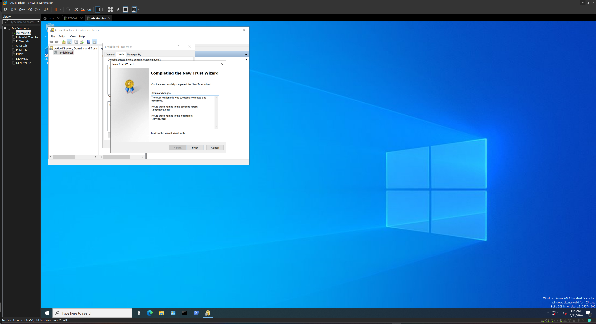

# Post Merger Identity Consolidation: One Forest, One Tenant, One Governance Stack

**Two companies. Two forests. One week to make them one identity program.**

This is the bonus week of my 12 week IAM Engineer portfolio. I simulated an acquisition: DKN Holdings (my `iamlab.local` lab) buys a smaller company called Peachtree Logistics (`peachtree.local`). Then I did the work a company does after the deal closes. I connected the two forests, moved Peachtree's people into one directory, synced them to Entra ID, replaced their spreadsheet access reviews with SailPoint, locked their admin and service accounts in CyberArk, and gave an automation agent an identity with no password at all.

Every claim in this write up is backed by a screenshot, a script, or a raw evidence file in this repo.

Related repos: [CyberArk Tier 0 PAM](https://github.com/GokuCooper/cyberark_pam_tier0_privileged_access) · [SailPoint access governance](https://github.com/GokuCooper/sailpoint_iiq_access_governance) · [SailPoint JML workflows](https://github.com/GokuCooper/sailpoint_iiq_jml_workflows) · [Microsoft Graph inactive user report](https://github.com/GokuCooper/msgraph_inactive_user_report)

> Fill in every [bracket] from your own runs before publishing, then delete this line.

---

## The 30 second version

| Question | Answer |
|---|---|
| **What problem does this solve?** | After an acquisition, the new company's people live in a directory you cannot see, with shared admin passwords, ownerless service accounts, and access reviews done by email. |
| **What did I build?** | A forest trust, a GPO baseline and custom schema attribute, an ADMT migration with SID history, Entra Connect sync, a SailPoint rebuild of Peachtree's access, CyberArk vaulting with safe service account rotation, and a federated identity for an automation agent. |
| **How did I prove it works?** | 12 PowerShell scripts that write their results to `evidence/`, a migration count table matched by SID history, Microsoft Graph queries against the synced tenant, CyberArk and Event Viewer logs, and GitHub Actions run logs. |
| **Tools** | Windows Server, Active Directory, Group Policy, ADMT 3.2, SQL Server Express, Microsoft Entra Connect [version], SailPoint IdentityIQ 8.3, CyberArk PAM 12.6, Microsoft Graph, GitHub Actions, PowerShell, Python |
| **Built on** | [dates] |

## The short version

| Measure | Before | After |
|---|---|---|
| Forests that can see each other | 0 | 2 (two way trust), then 1 after migration |
| Peachtree identities in the DKN directory | 0 | [12] users, [6] groups |
| Migrated accounts that kept their old access (SID history) | 0 | [ ] |
| Peachtree users synced to Entra ID with a source company tag | 0 | [ ] |
| Legacy access lines with an owner and a decision | 0 of [15] | [15] of [15] |
| Shared admin passwords outside a vault | [2] | 0 |
| Service accounts with a named owner | 0 of [3] | [3] of [3] |
| Stored secrets used by the automation agent | 1 | 0 |

This is a lab with one person playing every role. The numbers show the controls work end to end. They are not a production benchmark.

---

## Explain it like I am in 5th grade

Picture two families moving into one house.

First you build a hallway between the two houses so people can walk back and forth (the **forest trust**). Then you write one set of house rules everyone follows (**Group Policy**). Then you move everyone's stuff over and put a label on each box saying which house it came from (the **ADMT migration** and the **custom schema attribute**). Then you give everyone the same key card that works at the house and at the cloud office down the street (**Entra Connect**). Then you check who is allowed in which room (**SailPoint**), lock the master keys in a safe (**CyberArk**), and finally deal with the robots in the house. Robots need keys too, but a robot should never keep a key forever (**service accounts** and the **AI agent**).

### Words you will see

| Word | Simple meaning |
|---|---|
| Forest | A company's whole Active Directory world. Two forests cannot see each other until you connect them. |
| Trust | The hallway between two forests, with a guard at each end. |
| Conditional forwarder | A note in DNS that says "for addresses ending in peachtree.local, ask that server." |
| GPO | A rule sheet AD pushes to every computer and user in a folder (OU). |
| Schema | The list of fields every AD object is allowed to have. Adding one is permanent. |
| SID | The hidden ID number behind every account. Permissions are tied to the SID, not the name. |
| SID history | The old ID number a moved account carries so it can still open old doors. |
| Entra Connect | The sync engine that copies AD users up to Microsoft Entra ID. |
| Correlation | How SailPoint decides an account belongs to a person. |
| Certification | A review where a manager says "keep" or "remove" for each piece of access. |
| NHI (non human identity) | An account used by a program, not a person. Service accounts and agents are NHIs. |
| Usage | Every place a service account's password is typed in, like a Windows service. |
| gMSA | A service account whose password Windows changes by itself and no human ever knows. |
| Federated credential | A trust rule that lets a program prove who it is with a short lived token instead of a password. |

---

## The big picture


*Screenshot 00, the target state at the end of the week. The dashed box is the company being absorbed. The dashed arrows show Peachtree's old spreadsheet reviews and shared password file being replaced.*

| Component | Detail |
|---|---|
| PTDC01 | 192.168.1.54, first DC of `peachtree.local` |
| DKNMIG01 | 192.168.1.55, ADMT 3.2 and SQL Server Express |
| DKNSYNC01 | 192.168.1.56, Microsoft Entra Connect Sync |
| CyberArk | Vault .50, PVWA .51, CPM .52, PSM .53 |
| Existing | `iamlab.local` DC, SailPoint IdentityIQ 8.3, Entra tenant DKN IAM Workforce Lab |
| Hosting | VMware Workstation, bridged networking, one VM per role |

---

## Day 1: Connect the two forests

### Situation
Peachtree arrived as a separate forest. Nobody at DKN could see a single Peachtree account, and no Peachtree user could open a DKN file share.

### Build
1. Promoted `PTDC01` as the first DC of a new forest, `peachtree.local`.
2. Seeded it with [`scripts/01_Seed-Peachtree.ps1`](scripts/01_Seed-Peachtree.ps1): [12] employees, [6] groups, 2 shared admin accounts, and 3 service accounts with no owner. Output: [`evidence/day1_peachtree_seed.csv`](evidence/day1_peachtree_seed.csv).
3. Created DNS conditional forwarders both ways.
4. Built a two way forest trust with forest wide authentication.

### Snag: [title]

*Screenshot 02, Beginning: [what the error said].*

**Root cause layer:** [DNS]. [What you checked, in order, and what each check ruled out.]

**Fix:** [ ]


*Screenshot 03, Middle: [ ].*

### Result

*Screenshot 04, End: [ ].*

[`scripts/02_Test-ForestTrust.ps1`](scripts/02_Test-ForestTrust.ps1) ran before and after. Raw output: [`evidence/day1_trust_validation_before.txt`](evidence/day1_trust_validation_before.txt) and [`evidence/day1_trust_validation_after.txt`](evidence/day1_trust_validation_after.txt).

### Engineer notes
* **Forest wide vs selective authentication.** [Why the lab used forest wide and why a real merger would start selective.]
* **SID filtering stayed on today.** It gets turned off on Day 3 on purpose, and that is a risk to write down.

### Real world mapping
[ ]

---

## Day 2: One set of house rules (GPO and schema)

### Situation
[ ]

### Build
1. Created `OU=Peachtree,OU=Acquired` with Users, Groups, Servers, and ServiceAccounts under it.
2. `GPO_Merger_Security_Baseline` (password, lockout, audit policy), `GPO_Tier0_Logon_Restrictions`, and Windows LAPS.
3. Generated a unique OID with [`scripts/03_New-SchemaOID.ps1`](scripts/03_New-SchemaOID.ps1) and created the `dknSourceCompany` attribute. Record: [`evidence/day2_schema_oid.txt`](evidence/day2_schema_oid.txt).
4. Stamped every DKN user with [`scripts/04_Set-SourceCompany.ps1`](scripts/04_Set-SourceCompany.ps1). Output: [`evidence/day2_source_company_stamp_dkn.csv`](evidence/day2_source_company_stamp_dkn.csv).

### Snag: [title]

*Screenshot 07, Beginning: [ ].*

**Root cause layer:** [ ]

**Fix:** [ ]

### Result

*Screenshot 09, End: [ ].*

### Engineer notes
* **Schema changes cannot be deleted, only made defunct.** I snapshotted the DC before touching the schema.
* **Why one custom attribute matters.** `dknSourceCompany` follows each identity through the whole project: Entra Connect syncs it on Day 4, SailPoint uses it to pick roles on Day 5, and the agent filters on it on Day 7.

### Real world mapping
[ ]

---

## Day 3: Move everyone into one forest (ADMT)

### Situation
[ ]

### Build
1. Took a before snapshot with [`scripts/05_Export-PeachtreeDirectory.ps1`](scripts/05_Export-PeachtreeDirectory.ps1).
2. Prepared SID history: auditing on in both domains, the `PEACHTREE$$$` group, `TcpipClientSupport`, and SID filtering off on the trust.
3. Migrated groups, then users, then the admin and service accounts with ADMT 3.2.
4. Stamped the new arrivals with `04_Set-SourceCompany.ps1 -Company Peachtree`.
5. Checked every object with [`scripts/06_Compare-MigrationResults.ps1`](scripts/06_Compare-MigrationResults.ps1), which matches by SID history first.

### Snag: [title]

*Screenshot 13, Middle: [ ].*

**Root cause layer:** [ ]

**Fix:** [ ]


*Screenshot 14, Middle: `jsmith` already existed in `iamlab.local`. [The rule you chose and why.]*

### Result

| Type | In source | Found in target | With SID history | Renamed | Missing |
|---|---|---|---|---|---|
| Users | [ ] | [ ] | [ ] | [ ] | [ ] |
| Groups | [ ] | [ ] | [ ] | [ ] | [ ] |

Source: [`evidence/day3_migration_counts.csv`](evidence/day3_migration_counts.csv). Per object detail: [`evidence/day3_migration_results.csv`](evidence/day3_migration_results.csv).


*Screenshot 16, End: [ ].*

### Engineer notes
* **ADMT 3.2 is no longer updated by Microsoft** and is not listed as supported on Windows Server 2012 R2 through 2022. Real migrations use commercial tools that automate the same steps. I used ADMT to learn what those tools do underneath.
* **SID filtering is off on the trust until cleanup.** That lets SID history work, and it also widens what the trust allows. It goes back on after shares are re permissioned.

### Real world mapping
[ ]

---

## Day 4: One key card for on prem and cloud (Entra Connect)

### Situation
[ ]

### Build
1. Installed Entra Connect [version] on `DKNSYNC01` from the Entra admin center, custom install, password hash sync.
2. OU filtering so service accounts never leave AD.
3. Directory extension sync for `dknSourceCompany`.
4. Predicted the errors first with [`scripts/07_Find-SyncBlockers.ps1`](scripts/07_Find-SyncBlockers.ps1).

### Snag: [title]

*Screenshot 19, Middle: [ ].*

**Root cause layer:** [ ]

**Fix:** [ ]


*Screenshot 20, Middle: users landed as `@<tenant>.onmicrosoft.com` because `.local` is not a domain anyone can own.*

### Result

*Screenshot 21, End: [ ].*

[`scripts/08_Get-SyncedSourceCompany.ps1`](scripts/08_Get-SyncedSourceCompany.ps1) read the extension attribute back out of Microsoft Graph: [`evidence/day4_entra_source_company.csv`](evidence/day4_entra_source_company.csv).

### Engineer notes
* **Microsoft now enforces a minimum Entra Connect Sync version.** Older builds stop syncing. I installed [version] and recorded it.
* [ ]

### Real world mapping
[ ]

---

## Day 5: Bring Peachtree under governance (SailPoint IdentityIQ)

### Situation
Peachtree tracked "who has what" in a spreadsheet ([`evidence/day5_peachtree_legacy_access.csv`](evidence/day5_peachtree_legacy_access.csv)) and reviewed it by email once a year. Two of the people on it had already left, and one line had no approver at all.

### Build
1. Mapped every legacy line to an AD group, a SailPoint entitlement, a role, and a decision: [`evidence/day5_target_state_mapping.csv`](evidence/day5_target_state_mapping.csv).
2. Connected IdentityIQ to Active Directory with the AD connector and IQService.
3. Added the Peachtree rows to the HR feed and correlated on `employeeID`.
4. Mined roles from the migrated groups and published [ ] business roles.
5. Ran a manager certification scoped to Peachtree identities.

### Snag: [title]

*Screenshot 26, Middle: correlating on account name broke because ADMT renamed `jsmith` to `jsmith_pt`.*

**Root cause layer:** [ ]

**Fix:** [ ]

### Result

*Screenshot 28, End: [ ] items reviewed, [ ] revoked.*

### Engineer notes
* **Honest framing:** this migrates a spreadsheet based process into SailPoint. It is not a migration between two licensed IGA platforms. The design work (mapping, target state, rebuild) is the same.
* The AP plus GL approver line is a segregation of duties conflict. [What you decided.]

### Real world mapping
[ ]

---

## Day 6: Lock up the master keys and the robot accounts (CyberArk and NHI)

### Situation
Peachtree's `admin` and `itadmin` were shared Domain Admins with the password in a file share. Its three service accounts had no owner and passwords that never changed.

### Build
1. Built the NHI inventory with [`scripts/09_Find-ServiceAccounts.ps1`](scripts/09_Find-ServiceAccounts.ps1).
2. Applied the `svc_<app>_<env>` naming standard and owners with [`scripts/10_Rename-ServiceAccounts.ps1`](scripts/10_Rename-ServiceAccounts.ps1).
3. Found every place each account is used with [`scripts/11_Get-ServiceAccountUsage.ps1`](scripts/11_Get-ServiceAccountUsage.ps1).
4. Created safes `PT_Tier0_Admins` (dual control, PSM only) and `PT_Service_Accounts`.
5. Replaced the reports account with a gMSA using [`scripts/12_New-LabGmsa.ps1`](scripts/12_New-LabGmsa.ps1).

### Snag: rotation broke SQL Server

*Screenshot 31, Middle: the CPM changed `svc_sql_pt`'s password and SQL Server would not start. [Exact Event Viewer text.]*

**Root cause layer:** Application configuration. The Windows service still had the old password typed into its "Log on as" field.

**Fix:** Added a Windows Service usage to the account in CyberArk so the CPM updates the service every time it rotates.


*Screenshot 32, Middle: [ ].*

### Result

| Measure | Before | After |
|---|---|---|
| Service accounts with an owner | [ ] | [ ] |
| Following the naming standard | [ ] | [ ] |
| Passwords that never rotate | [ ] | [ ] |
| Shared admin passwords outside a vault | [ ] | [ ] |

Source: [`evidence/day6_nhi_inventory_before.csv`](evidence/day6_nhi_inventory_before.csv) and [`evidence/day6_nhi_inventory_after.csv`](evidence/day6_nhi_inventory_after.csv).


*Screenshot 33, End: [ ].*

### Engineer notes
* **gMSA or CyberArk?** [Two sentences on when you pick each.]
* **About "privileged elevation."** Job descriptions often mean endpoint tools like CyberArk EPM or BeyondTrust Privilege Management. Dual control plus PSM is the closest control in this lab.

### Real world mapping
[ ]

---

## Day 7: An AI agent with an identity and no password

### Situation
Automation and AI agents call APIs on their own, and the easy way to give them access is a client secret, which is just a password sitting in a file.

### Build
1. Ran [`agent/access_hygiene_agent.py`](agent/access_hygiene_agent.py) locally with a client secret (the before picture).
2. Gave the app registration read only Microsoft Graph permissions.
3. Added a federated credential trusting only this repo's `access-agent` environment.
4. Ran the agent from [`.github/workflows/access_hygiene_agent.yml`](.github/workflows/access_hygiene_agent.yml) and deleted the secret.
5. Added the agent to the NHI register with a human owner: [`evidence/day7_nhi_register.csv`](evidence/day7_nhi_register.csv).

### Snag: [title]

*Screenshot 38, Middle: [exact AADSTS error].*

**Root cause layer:** [ ]

**Fix:** [ ]

### Result

*Screenshot 40, End: green run, zero client secrets on the app registration.*

| Guardrail | Test | Result |
|---|---|---|
| Read only | Agent tries to change a user | [403 Forbidden] |
| Only the approved job | [`federation_negative_test.yml`](.github/workflows/federation_negative_test.yml) signs in without the environment | [Rejected by Entra] |
| A human owns it | Agent appears in a SailPoint certification | [Screenshot 41] |

### Engineer notes
* Microsoft recommends moving GitHub federated credentials to immutable subjects (owner and repo IDs) so a renamed or recreated repo cannot reuse the trust.
* [ ]

### Real world mapping
[ ]

---

## Final result

| Deliverable | Status | Evidence |
|---|---|---|
| Forest trust | [ ] | Screenshots 01 to 05, `day1_trust_validation_after.txt` |
| GPO baseline and schema attribute | [ ] | Screenshots 06 to 11, `day2_schema_oid.txt` |
| ADMT migration with SID history | [ ] | Screenshots 12 to 16, `day3_migration_counts.csv` |
| Entra Connect sync | [ ] | Screenshots 17 to 22, `day4_entra_source_company.csv` |
| SailPoint governance rebuild | [ ] | Screenshots 23 to 28, `day5_target_state_mapping.csv` |
| CyberArk and service accounts | [ ] | Screenshots 29 to 35, `day6_nhi_inventory_after.csv` |
| Agent with no stored secret | [ ] | Screenshots 36 to 41, `day7_nhi_register.csv` |

---

## Verification log

| Day | What could have hidden a problem | How I checked | What the evidence showed |
|---|---|---|---|
| 1 | The trust wizard says "validated" from one side only | Ran `02_Test-ForestTrust.ps1` from the DKN side and signed in as a Peachtree user | [ ] |
| 3 | ADMT's summary counts can hide a skipped object | Matched every source SID against target sIDHistory | [ ] |
| 4 | The Entra portal does not show directory extensions | Queried Microsoft Graph directly | [ ] |
| 6 | The CPM can report success while a service is broken | Restarted the service and read Event Viewer | [ ] |
| 7 | A green run does not prove least privilege | Forced a write attempt and a wrong subject sign in | [ ] |

---

## What I would change before calling this production ready

* Start the trust with **selective authentication** and open it server by server.
* Use a **commercial migration tool** instead of ADMT.
* **Verify a real domain** in Entra before the first sync so users keep real UPNs.
* Turn **SID filtering back on** and remove SID history once shares are re permissioned.
* Keep the CyberArk reconcile account for Peachtree Tier 0 in its **own Safe**.
* Move the federated credential to **immutable subjects** and restrict the GitHub environment to the main branch.
* [ ]

---

## Interview talking points (Problem, Solution, Impact, Learning)

**"Walk me through a directory consolidation."**
* **Problem:** [ ]
* **Solution:** [ ]
* **Impact:** [ ]
* **Learning:** [ ]

**"How do you rotate service account passwords without an outage?"**
* **Problem:** [ ]
* **Solution:** [ ]
* **Impact:** [ ]
* **Learning:** [ ]

**"How would you govern AI agents?"**
Treat them as identities: a human owner, least privilege, no stored secrets, a federated trust locked to one workload, and a recurring certification.

---

## Resume bullets

- Consolidated two Active Directory forests in a simulated acquisition: configured a two way forest trust, migrated [X] users and [Y] groups with ADMT and SID history, and resolved account naming collisions with a documented rule.
- Built a merger security baseline with Group Policy (Tier 0 logon restrictions, Windows LAPS) and extended the AD schema with a custom source company attribute synced to Entra ID through Entra Connect.
- Migrated a legacy spreadsheet access process into SailPoint IdentityIQ: target state mapping, AD connector via IQService, correlation redesign, role mining, and a rebuilt certification that removed [Z] stale access lines.
- Brought [N] privileged and service accounts under CyberArk with dual control, PSM recorded sessions, and CPM rotation with Windows service usages, backed by a PowerShell NHI inventory and naming standard.
- Replaced an automation agent's client secret with Entra workload identity federation from GitHub Actions, enforcing read only Graph permissions and owner based certification of the agent identity.

---

## Repository layout

```
post_merger_identity_consolidation/
├── README.md
├── screenshots/        42 images, 00 to 41 (letter suffixes where a step needed more than one)
├── scripts/            12 PowerShell scripts, numbered in the order they run
├── agent/
│   ├── access_hygiene_agent.py
│   └── requirements.txt
├── .github/workflows/
│   ├── access_hygiene_agent.yml
│   └── federation_negative_test.yml
└── evidence/           CSV and TXT output from every script, plus the decision and troubleshooting logs
```

All names and accounts are lab data on the `iamlab.local` and `peachtree.local` domains. No passwords or client secrets appear in any screenshot or file. Tenant and object IDs are blurred.

## Full screenshot index

| # | File | Shows |
|---|---|---|
| 00 | `00_target_state_architecture.png` | Target state diagram |
| 01 | `01_peachtree_forest_promoted.png` | PTDC01 promoted, new forest |
| 02 | `02_trust_wizard_dns_failure.png` | Trust wizard cannot find peachtree.local |
| 03 | `03_conditional_forwarders_both_sides.png` | Forwarders on both DCs |
| 04 | `04_forest_trust_validated.png` | Trust validated |
| 05 | `05_peachtree_user_dkn_share_access.png` | Peachtree user opens a DKN share |
| 06 | `06_acquired_ou_structure.png` | Acquired OU structure |
| 07 | `07_gpresult_gpo_not_applied.png` | GPO filtered out |
| 08 | `08_computer_moved_to_correct_ou.png` | Computer moved into scope |
| 09 | `09_gpresult_baseline_applied.png` | Baseline applied |
| 10 | `10_laps_password_retrieved.png` | Windows LAPS password retrieved |
| 11 | `11_schema_attribute_created.png` | dknSourceCompany in the schema |
| 12 | `12_admt_installed.png` | ADMT installed on DKNMIG01 |
| 13 | `13_sid_history_prereq_error.png` | SID history prerequisite error |
| 14 | `14_jsmith_name_conflict.png` | Name collision |
| 15 | `15_users_migrated_with_sid_history.png` | Users migrated with SID history |
| 16 | `16_old_share_access_via_sid_history.png` | Old share opened through SID history |
| 17 | `17_entra_connect_version.png` | Entra Connect version |
| 18 | `18_ou_filtering.png` | OU filtering |
| 19 | `19_duplicate_proxyaddress_error.png` | Duplicate attribute error |
| 20 | `20_onmicrosoft_upn_explained.png` | Users landed on onmicrosoft.com |
| 21 | `21_sync_zero_errors.png` | Sync with zero errors |
| 22 | `22_source_company_extension_in_graph.png` | Extension attribute in Graph |
| 23 | `23_legacy_access_spreadsheet.png` | Peachtree's legacy access list |
| 24 | `24_target_state_mapping.png` | Target state mapping |
| 25 | `25_iqservice_connection_failure.png` | IQService connection failure |
| 26 | `26_correlation_failed_jsmith_pt.png` | Correlation broke after rename |
| 27 | `27_role_mining_results.png` | Role mining results |
| 28 | `28_peachtree_certification_complete.png` | Certification closed |
| 29 | `29_nhi_inventory_output.png` | NHI inventory |
| 30 | `30_peachtree_safes_created.png` | Peachtree safes |
| 31 | `31_service_failed_after_rotation.png` | SQL service fails after rotation |
| 32 | `32_windows_service_usage_added.png` | Windows Service usage added |
| 33 | `33_service_running_after_rotation.png` | SQL service running after rotation |
| 34 | `34_dual_control_approval.png` | Dual control approval |
| 35 | `35_psm_session_recording.png` | PSM session recording |
| 36 | `36_client_secret_before.png` | Client secret, the before picture |
| 37 | `37_federated_credential_config.png` | Federated credential |
| 38 | `38_aadsts_subject_mismatch.png` | Wrong subject rejected |
| 39 | `39_write_attempt_403.png` | Write attempt returns 403 |
| 40 | `40_workflow_green_no_secrets.png` | Green run, no secrets |
| 41 | `41_agent_in_sailpoint_certification.png` | Agent in a certification |

*Built as part of the IAM Engineer Mentorship Program, bonus week. This is a lab environment with test data only.*
